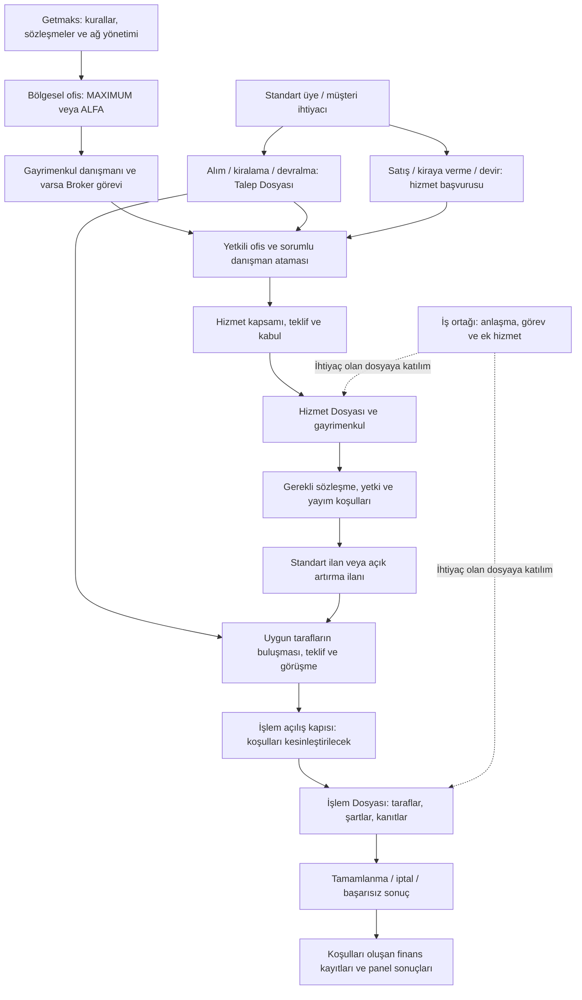

# İş kuralları

Güncel karar özeti: 3 Kasım 2026. ADR-077 Marka–Ofis sınırı korunur; ADR-078 ofis/Broker yaşam döngüsü, ana sözleşme, sınırlı hazırlık, dokuz aktivasyon koşulu ve yetki sonunu bütünleştirir. Ortak matris 8.2, tam yaşam döngüsü 8.4, kabul hedefleri 8.8–8.10'dadır. MAXIMUM Paneli bölüm 9; ayrıntılı tarihsel kaynaklar [referansta](reference/PRODUCT_SPECIFICATIONS.md), uygulanma/kabul kanıtı [handoff'tadır](09_CODEX_HANDOFF.md).

## Ana iş akışı — 29 Ekim 2026

**Durum:** Ürün sahibinin kesin kararlarına dayanan hedef akış. Açık işletme kararları işaretlidir; bu bölüm uygulanmış kod veya faz kabulü değildir. Başarı ölçüsü, tarafların gayrimenkul işlemini kanıtlı biçimde sonuçlandırması ve sonucun ilgili panellere doğru yansımasıdır.

### Birbirinden bağımsız dört seçim

- **Ofis modeli:** MAXIMUM / ALFA; danışmanın çalışma modelini ofis belirler.
- **Hizmet paketi:** müşteriye sunulan kapsam, görev ve ücret koşulları. Paketlerin güncel kapsamı ADR-069/070'tedir; kalan ayrıntılar DQ-008'dedir.
- **İşlem türü:** satış (satıcı–alıcı), kiralama (kiraya veren–kiracı), devir (devreden–devralan).
- **İlan yöntemi:** standart ilan / açık artırma usulü ilan. Açık artırmada seçilen teklif taraf onayına ve sözleşme sürecine gider; otomatik satış değildir. Diğer artırma koşulları DQ-009'da açık.

Bu seçimlerden biri diğerinin yerine kullanılmaz. Hizmet teklifi, gayrimenkule verilen ticari teklif ve açık artırma teklifi de farklı kavramlardır.

### Dosyaların buluşması

Şema iş anlamını gösterir; mevcut teknik OWNER_SERVICE ön kaydını silme veya yeniden oluşturma talimatı değildir. Talep ve Hizmet Dosyaları bağımsız başlayabilir; aynı dosyanın iki adı değildir. İşlem Dosyası bunların ilgili taraflarını ve kaynak gayrimenkulünü ilişkilendirir. İşlem iptali kaynak talep/hizmeti otomatik kapatmaz; devam kararı ayrıca izlenir.

### Aşamalar, sorumluluk ve panel karşılığı

**A0 — Kurumsal hazırlık.** Getmaks Panelinde marka, bölgesel ofis, ofis modeli, geçerli sözleşme ve broker görevi kurulur. Danışman profesyonelliği ve ofis üyeliği doğrulanır. Sonuç: kişinin geçerli ilişkilerine göre çalışma alanları açılır; tek profesyonel kimlik korunur, atanmış Broker için ikinci Consultant kimliği/unvanı gerekmez (ADR-077). Eksik kuruluş koşulu operasyon yetkisi üretmez.

**A1 — Müşteri ihtiyacı.** Standart Panelden veya yetkili profesyonelin müşteri adına kaydından başlar. Alıcı/kiracı/devralan için Talep Dosyası; satıcı/kiraya veren/devreden için hizmet başvurusu oluşturulur. Sonuç: müşteri başvurusunu görür, yetkili atama sorumlusu bekleyen işi görür. Ofis seçilmeden rastgele bir ofise veri açılmaz.

**A2 — Ofis ve çalışma sorumluluğu (ADR-077).** Müşteri talebi açılması otomatik danışman sahipliği doğurmaz. Bölgesel uygun ofise yönlendirme ile ofis içindeki müşteri/portföy/dosya sorumlusunu belirleme ayrıdır: ilkinde kurumsal yönlendirme, ikincisinde Brokerın işletme yetkisi esastır. Bölgede ofis yoksa kayıt Markanın yönlendirme/kurumsal takip kapsamına gelir; Marka müşterinin günlük çalışanı olmaz. MAXIMUM Brokerı veya yetkili danışmanı kendi ofis havuzunda çalışır; uygun portföy yok ve takip sürecekse aynı talep/geçmiş korunarak havuza bırakılır. ALFA'da ortak havuz yoktur; bireysel sorumluluk esastır. Bölge sınırı, çoklu uygun ofis, ALFA ve kapalı ofis yönlendirme ayrıntıları DQ-010'da açıktır. Sonuç aynı kaynak dosyanın ilgili ofis/profesyonel/müşteri görünümlerine yansır; atama kopya dosya oluşturmaz.

**A3 — Hizmet anlaşması.** Danışman, ilgili müşteri için hizmet kapsamını ve koşullarını hazırlar. Mevcut teklif/kabul kapısından sonra Hizmet Dosyası oluşur; gereken sözleşme ve yetki kanıtları sürümleriyle ilişkilendirilir. Müşterinin kendi kabulü ile profesyonelin müşteri adına kaydettiği beyan ayırt edilir. Birebir Destek aylık peşin; Uzman Hizmet başarılı işlem sonunda ücretlenir. Müşteri kendi panelinden karar verebilir; profesyonelin kaydettiği beyan ayrı kaynak etiketi taşır.

**A4 — Gayrimenkul ve ilan.** Danışman yetkili Hizmet Dosyası bağlamında gayrimenkul/portföy/ilan verisini hazırlar. Gereken yayım koşulları sunucuda doğrulanır; standart veya açık artırma yöntemi ayrı seçilir. Sonuç: profesyonel yönetim görünümü, müşteri kendi hizmet durumunu ve yalnız yayımlanmasına izin verilen bilgiler ilan görünümünü besler. Açık artırma kuralı belirlenmeden çalışan artırma varmış gibi sunulmaz.

**A5 — Tarafları buluşturma.** Talep ile uygun ilan ilişkilendirilir; gerekli görüşme, gösterim ve teklifler yürütülür. İlgili danışmanlar işleri, broker yetkili ofisin ilerleyişini, müşteri kendisine düşen kararları görür. Açık artırmada seçilen teklif taraf onayına ve sözleşme sürecine gider. Seçim, taraf kabulü, sözleşme ve emlak işleminin tamamlanması ayrı olaylardır; seçim otomatik satış veya borç üretmez. Her işlemde gösterim veya artırma zorunluluğu varsayılmaz.

**A6 — İşlem açılışı ve mutabakat.** Taraflar, gayrimenkul, kaynak dosyalar, sorumlular ve üzerinde ilerlenen koşullar İşlem Dosyasında bağlanır. Dosyanın hangi mutabakat/kanıttan sonra açılacağı DQ-011'de açık. Mevcut MUTUAL → STARTED kodu ürün sahibi tarafından bütün işlem türleri için kabul edilmiş sayılmaz. Bir profesyonelin notu gerçek taraf imzası olarak sunulmaz.

**A7 — Tamamlama veya sonuçsuz bitiş.** Satış, kiralama ve devir için gereken ayrı belge, karar ve kapanış kanıtları tanımlanır. Yetkili kişiler kendi adımlarını tamamlar. Sonuç: aynı işlem için tek tutarlı kapanış/iptal durumu; gerekçe ve kanıt tarihçesi. Bir dosyanın kapanması aynı gayrimenkule ait diğer talepleri otomatik kapatmaz.

**A8 — Ticari ve mali sonuç.** İlgili sözleşme/politika koşulları gerçekleştiğinde hizmet bedeli ve hakediş akışı başlatılır; fatura, tahsilat ve ödeme ayrı izlenir. Müşteri kendi yükümlülüğünü, danışman kendi hakkını, ofis yetkili ofisin sonucunu, marka yetkili ağ kapsamını görür. Aynı kişinin danışman ve broker sıfatları varsa ayrı hak gerekçeleri izlenir; aynı olaydan mükerrer hak üretilmez.

**A9 — İstisna ve takip.** Ret, eksik belge, süre aşımı, görev değişimi, itiraz ve iptalde sorumlu ve beklenen sonraki adım görünür olmalıdır. Daha önceki onay yeni metin/ücret/sürüm için otomatik kullanılamaz. Genel mesajlaşma, audit ve bekleyen görev aynı kayıt olarak ele alınmaz.

**Her uygun aşamada iş ortağı katılımı:** Marka, broker veya danışman, yetkisi ve anlaşması dahilinde ilgili dosyaya destek görevi ekler. İş Ortakları Panelinde yalnız verilen görev/veri kapsamı açılır. Hizmet kapsamı, müşteriye ek ücretin sunumu/onayı, teslimat ve ücret doğum olayı DQ-012 ile kesinleştirilir. Görevlendirmek tek başına ücretin müşteri tarafından kabul edildiği veya ödendiği anlamına gelmez.

### Yedi hedef panelin ortak sözleşmesi — ADR-075

- **Marka Paneli:** franchise sistemi, kurumsal kuruluş/statü, ticari koşullar, yetkilendirme ve tüm ofislerin denetimi. Günlük müşteri/portföy işini üstlenmez; gerekçeli kurumsal müdahale kapsamı ayrıdır (8.2; ADR-077).
- **MAXIMUM Ofis Paneli:** kendi ofisinin ekip, ortak Data Havuzu izleme/yetkilendirme, yönetim ve ticari sonuçları; brokerın kendi Broker unvanıyla mesleki faaliyetleri yönetimden ayrı işlem bağlamında izlenir (bölüm 9).
- **ALFA Ofis Paneli:** bireysel çalışma modelinin ayrı hedef deneyimi; ortak Data Havuzu yoktur. Ayrıntılı tasarımı bu çalışmada açılmaz.
- **Danışman Paneli:** Broker tarafından yetkilendirilen danışmanın müşteri/dosya işleri ve kendi sonuçları. Brokerın kendi mesleki işi için danışman unvanına dönüşü gerekmez.
- **Stratejik İş Ortakları Paneli:** anlaşmayla katıldığı dosyadaki görevi, teslimatı ve kendisine ait mali durum.
- **Marka Yatırımcı Paneli:** yalnız yatırım ilişkisine ait yetkili görünüm; müşteri/operasyon kaydına kendiliğinden erişim vermez. Ayrıntılar DQ-013'te açık.
- **Nihai Müşteri Paneli:** bütün üyelerin Standart/Standard Member temel müşteri alanı; kendi ihtiyaçları, dosyaları, kararları, belgeleri ve sonuçları. Temel üyelik sekizinci panel değildir.

Aynı kişi birkaç paneli kullanabilir. Her yazımda kullanıcı, işlem yaptığı sıfat, ofis/dosya kapsamı, karar/kanıt ve etkilenen sonuç anlaşılır olmalıdır. Panel seçimi yetki vermez; mevcut yetkinin hangi bağlamda kullanıldığını belirler.

Bir olay için asgari tasarım kaydı: **kaynak dosya → yapan kişi/sıfat → gereken koşul → yeni durum → sıradaki sorumlu → ilgili panelde bekleyen iş → müşteriye gösterilen bilgi → varsa mali etki**. Bunlar hedef davranış alanlarıdır; yeni tablo veya ekran oluşturulduğu anlamına gelmez.

### Önerilen ilk uçtan uca kabul senaryosu

İlk uygulama adayı standart ilanla satış yolculuğudur; işlem türü önceliği kullanıcıyla kesinleştirilecektir. Satıcı hizmet başvurusu → yetkili atama → paket/teklif kabulü → Hizmet Dosyası ve yayım koşulları → standart ilan; bağımsız alıcı Talep Dosyası → eşleşme/görüşme/teklif → işlem açılış kapısı → kanıtlı sonuç. Açık kararlar ve ilgili faz kapıları kapanmadan tamamı uygulanmaz.

Kabulde: aynı işin ilgili panellerde aynı durumu göstermesi; brokerın danışmanlığını koruması; yetkisiz kişinin dosyayı görememesi; müşteri kararının kaynağının anlaşılması; tekrar işlemin kopya dosya/hak doğurmaması; ret/iptalin sonraki adımı belirlemesi; geçmiş snapshot'ların korunması aranır. İkinci senaryo açık artırmayı, üçüncü senaryo ek ücretli iş ortağı katılımını ekler. Kiralama ve devir kendi kapanış/kanıt koşullarıyla ayrıca doğrulanır.

## 1. Hesap, profesyonellik ve dosya tarafı

- Her yeni hesap ve profesyonel daveti MEMBER temel üyeliğini korur. Açıkça yetkili davet ayrıca profesyonel/onboarding ilişkisi kurabilir; kendi kendine kayıt operasyon yetkisi vermez.
- Profesyonel kimlik korunur. Broker ofise atanınca Broker unvanıyla yönetim ve kendi mesleki faaliyetini yürütür; Danışman ile aynı unvan değildir, işlem için ayrıca danışman statüsü gerekmez (ADR-075, ADR-063'ün unvan yorumu güncellendi).
- Eski profesyonel hesaplar topluca rol değişikliğine zorlanmaz. Temel üye alanı ve geçerli profesyonel kapsam birlikte korunur.
- Profesyonel başvuru onayı onboarding'i açar; tek başına Professional, ofis üyeliği, sözleşme veya aktif erişim oluşturmaz.
- Broker ve marka geneli danışman başvurusunu marka yöneticisi; belirli ofise danışman başvurusunu o ofisin yetkili brokerı inceler.
- Alıcı, satıcı, kiracı, kiraya veren, devreden ve devralan dosya tarafı rolleridir. Bir hesap farklı dosyalarda farklı taraf olabilir.
- Müşteri görünürlüğü açık CustomerAccountLink veya FileParty ilişkisine dayanır. E-posta benzerliği otomatik bağlantı veya veri erişimi vermez.
- Kurumsal taraf ile yetkili gerçek kişi temsilcisi ayrıdır; yetki yalnız ilgili kurum/dosya kapsamında açılır.
- Üye iç profesyonel notları ve gelir paylaşımını görmez; yalnız kendisine yayımlanmış dosya durumu ve istenmiş belgeler sunulur.

## 2. Ofis, broker ve danışman

- Organizasyon Brand → Office → Broker yöneticisi ve Consultant üyeleridir. Danışmana broker_id ile bağımsız sahiplik kurulmaz.
- Bir ofiste aynı anda tek aktif broker; danışmanda tek aktif ofis üyeliği vardır. Gelecekteki farklı görev kapsamları için dağınık tek-ofis sabitleri eklenmez.
- Broker değişimi kayıtları başka ofise taşımaz; açık işlerin yönetim sorumluluğu yeni Broker veya yetkili yöneticiye otomatik geçer (ADR-076). Fiilî çalışan ve geçmiş haklar otomatik değiştirilmez. Eski broker üyeliği ve yetkisi tarihçeli kapanır.
- ADR-072: Broker görevi sona eren kişinin profesyonel kimliği korunur; ofisten ayrılma ayrı işlemdir. Eski broker görevi ve ofis yönetim/ticari yetkileri kapanır; devam eden ofis ilişkisi ve kendi operasyon yetkileri ayrı değerlendirilir (unvan yorumu ADR-075/076). Kullanıcı/profesyonel kimliği veya kişisel müşteri hesabı silinmez. ADR-078 ayrımı geçerlidir: aktif Brokerın mesleki işi için unvan dönüşü gerekmez; ilgili resmî ilişki bitince başka geçerli Broker ilişkisi yoksa kişi danışman statüsüne döner, işletme erişimi sürmez.
- Danışman transferi ayrı auditli aksiyondur: eski ofis üyeliği/modeli kapanır; hedef ofis üyeliği, hedef ofisin modeli ve gerekli ticari şartlar kurulur.
- İleri tarihli transfer yürürlükten önce kaynak erişimini değiştirmez. İptal, yeniden deneme, rollback ve tekrarlı uygulama güvenliği korunur.
- Operasyon dosyaları transferle otomatik taşınmaz; dosya taşıma ayrıca kararlaştırılır.
- Ofis kodu sistemde benzersiz üretilir; kullanıcıdan alınmaz ve eski kodlar dönüştürülmez.

## 3. MAXIMUM ve ALFA — kesinleştirilmiş karar

**MAXIMUM ve ALFA hem ofis türü hem danışman çalışma modelidir. Danışman hangi ofisi seçmişse o modeli seçmiş demektir.**

- Office.office_type güncel ofis modelinin kaynağıdır. MAXIMUM ofise katılan danışman MAXIMUM, ALFA ofise katılan danışman ALFA modelinde çalışır.
- Danışmana ofisinden bağımsız ikinci model seçtirilmez. Ticari plan ve paylaşım koşulları çalışma modeliyle aynı kavram değildir.
- ProfessionalWorkModel model tarihçesini; Talep/Hizmet Dosyası snapshot'ları dosyanın oluştuğu koşulları korur. Geçmiş kayıtlar yeni karara göre topluca yeniden yazılmaz.
- Eski NULL ofis türleri ve ofis–danışman model uyumsuzlukları ayrı veri incelemesidir. Bu belge değişikliği migration veya otomatik düzeltme çalıştırmaz.
- ADR-072: Kurulmuş ofisin MAXIMUM/ALFA türü değiştirilemez. Broker mevcut ofisi markaya veya yeni brokera devreder, yönetim yetkilerini bırakır (unvan yorumu ADR-075/076); diğer tür için ayrı Ofis Başvurusu yapar. Mevcut ofis türü, kimliği ve dosya geçmişi korunur. Yeni ilişki tek aktif ofis üyeliği kuralını kendiliğinden kaldırmaz.
- MAXIMUM broker ve danışmanların ekip olarak çalıştığı ofistir. Danışman yetkili Data Havuzundan Talep Dosyasını alır; ihtiyaca uygun portföy yoksa ve takip sürecekse dosyayı havuza geri bırakır (ADR-066).
- MAXIMUM ofiste tamamlanan işlemlerden yapılandırılmış oranlarla Kazanç Havuzuna katkı ayrılır; ay sonunda işlem yapan/yapmayan tüm danışmanlara dağıtılır. Gerekçe, ofisteki her hareketin ekibe katkı sağlamasıdır. Bu karar eşit pay oranı tanımlamaz; ayrıntılar 03 ve DQ-008'dedir.
- ALFA danışman marka ve ofis/brokera bağlı, diğer danışmanlardan bağımsız çalışır; datası ve bireysel kazancı kendisine aittir. Ortak Data/Kazanç Havuzu paylaşımına katılmaz. Bu ifade marka/broker sözleşme haklarını kendiliğinden sıfırlamaz; ticari kesinti koşulları ayrıca netleştirilir.
- MAXIMUM Kazanç Havuzu payı yürürlükteki politikadan okunur. Ofis seçimi tek başına sözleşme, aktivasyon, havuz claim'i veya finansal hakediş üretmez.
- Model kabiliyetleri WorkModelPolicy üzerinden uygulanır; dağınık controller koşullarına dönüştürülmez.
- Mevcut kuruluş kuralında broker franchise başvurusu MAXIMUM ofis içindir; ALFA marka kuruluşu ve açık broker ataması yoludur. Normal danışman ofis üyeliği Broker unvanı veya franchise sahipliği vermez.

## 4. Kuruluş, onay ve aktivasyon

- Marka yöneticisinin doğrudan Office/Broker/Consultant kuruluşu ve brokerın yetkili ofiste danışman daveti ayrı aday approval kuyruğu değildir. Readiness ve yetki kontrolleri yine zorunludur.
- Plan atama yetkisi ile danışman onboarding kaydı oluşturma ayrıdır. Plan atama ve aktivasyon kendi marka/yetki kapılarında kalır.
- Doğrudan ofis kuruluşu DRAFT/SETUP → READY → ACTIVE; dış başvuru SETUP → PENDING_APPROVAL inceleme yolunu kullanır. Ret SETUP'a döner; TERMINATED normal akışla yeniden açılmaz.
- creation_source sunucuda BRAND_ADMIN_DIRECT veya BROKER_APPLICATION olarak belirlenir. İstemci kaynak seçerek onayı aşamaz; eski NULL kaynaklar elle incelenir.
- Ofis kurumsal bilgileri, güncel zorunlu belgeler, geçerli sözleşme kanıtı, broker hazırlığı ve ticari şartlar tamamlanmadan READY/ACTIVE olmaz.
- Marka belge gereksiniminin hiç yapılandırılmamış olması eksiktir; açıkça kaydedilmiş boş liste ayrı işletme kararıdır.
- Belge sürümleri özel depoda, yükleyen/zaman/hash ve inceleme geçmişiyle tutulur. UPLOADED → IN_REVIEW → APPROVED/CORRECTION_REQUESTED/REJECTED; ret/düzeltme gerekçelidir. Yeni sürüm eski onayı devralmaz.
- Sözleşme metni/şartları değişmez sürümlenir. Taraf kanıtı, yetkili doğrulama, inceleme ve tarihler ayrıca denetlenir; ACTIVE ticari kayıt imza değildir. Kanıt yükleme e-imza veya otomatik hukuki doğrulama değildir.
- Geçerli sözleşme/readiness güncel ticari şartlarla eşleşmelidir. Yeni koşullar eski snapshot'ı değiştirmez.
- Önceden aktif ofisler belge eksikliği nedeniyle otomatik kapanmaz; eksikler incelemeye sunulur.
- Danışman aktivasyonu hesap/profesyonel, marka/ofis üyeliği, ofisten gelen çalışma modeli, gerekli plan/sözleşme ve profil koşullarını sunucuda doğrular.
- ADR-072: Güncel ofis çalışma şartlarının danışmanın kendi hesabından kabulü aktivasyon için zorunludur. Güncel danışman anlaşmasının kendi hesabından kabulü operasyon için ayrıca zorunludur. İki kanıt birbirinin yerine geçmez; danışman anlaşması hiç oluşturulmadı diye operasyon kabul kontrolü atlanamaz. Diğer hazırlık/izin/kapsam koşulları da sürer.
- Askıya alma ve sonlandırma kayıtları silmez; tarihçe ve audit üretir. Aktif kişi profil güncellemesiyle aday approval durumuna geri döndürülmez.

## 5. Müşteri, talep ve hizmet

- Customer kalıcı CRM kaydıdır; farklı zamanlarda birden çok talep veya hizmet dosyasıyla ilişkili olabilir.
- Normalize iletişim/kimlik verisi duplicate uyarısı üretir; otomatik birleştirme yapılmaz. Kimlik/vergi referansı şifreli ve arama anahtarı HMAC olarak korunur.
- Alım/Kiralama/Devralma talep tarafı; Satış/Kiraya Verme/Devretme mülk sahibi hizmet tarafıdır.
- Üyenin atanmamış talebi tek RequestFile kaydıdır. Markanın atama bekleyen başvurular listesinde bekler; atama aynı kaydın ofis/danışman bağını günceller, dosya numarasını korur. Bu liste MAXIMUM ofisinin Data Havuzu değildir ve havuz müşterisi üzerinde marka çalışma yetkisi oluşturmaz (ADR-074).
- Mevcut teknik uygulama brokerın ofis Data Havuzuna bıraktığı fırsatı PoolRecord olarak tutar. ADR-066 hedefi ise Talep Dosyasının üstlenilip gerektiğinde aynı kimlikle havuza geri bırakılmasıdır. Bu iki yapı henüz uyarlanmış sayılmaz; geçmişi koruyan geçiş ayrıca tasarlanacaktır.
- Marka kendi marka kapsamını; broker ve danışman güncel üyeliklerinin yetkili ofis kapsamını kullanır. Atanmamış ortak taleplerin görünürlüğü güncel talep kapsamı kuralıyla denetlenir; başka marka/ofis kimliği göndererek erişim genişletilemez.
- Uzaktan Destek online danışmanlıktır. Birebir Destek'te mülk sahibi süreli erişimle kendi işlemini yürütür ve Getmaks refakat eder; aylık bedel önceden alınır. Uzman Hizmet'te süreci Getmaks yürütür; ücret yalnız işlem gerçekleşince doğar (ADR-069). Paket, danışman modeli veya marka–profesyonel ticari planı değildir.
- Hizmet teklifi geçerli talep ve aktif paketten doğar. Revizyon yeni version/parent kaydıdır; kabul edilmiş teklif değiştirilmez.
- Hizmet Dosyası mevcut teklif/kabul kapısından sonra açılır; atanmamış üye başvurusu doğrudan sahte hizmet dosyası üretmez. Aktif hizmet için mevcut tekil kayıt kısıtı korunur.
- Mülk sahibi hizmeti gayrimenkul kaynağıdır. ServiceContract, harici yetkilendirme, taşınmaz kimliği ve Property ayrı sorumluluklardır. Kaynak Property kaydı oluşturmak, ilan yayımlama yetkisi vermez.
- Harici yetki bildirimi gerçek sağlayıcı doğrulaması olarak sunulmaz. İlan/işlem kapıları kendi fazında, somut kanıtla uygulanır.
- Aktivite yalnız görünür müşteri ve ilgili danışmanın kapsamındaki dosyayla bağlanır. Dosya durum değişimleri tarihçe ve audit üretir.

## 6. Data Havuzu

**Panel ve çalışma yetkisi sınırı — ADR-074, ADR-075 güncellemesi:** Data Havuzu yalnız ilgili MAXIMUM ofisinin kaynağıdır; marka genelinde çalışma havuzu değildir. Marka bütün ofisleri, broker kendi ofisini izler/yönetir ve danışmanları yetkilendirir. Marka havuzun günlük çalışma sahibi değildir; ALFA'da havuz yoktur. Danışman müşteri çekme, geri bırakma, temas/randevu/ilerleme işlemlerini brokerın verdiği kapsamla yapar. Brokerın kendi unvanıyla mesleki faaliyeti ADR-075 ile ayrıca tanınır; bu, yönetici olarak başkasının aktif kaydını gerekçesiz devretmek değildir. Yönetim, yetkilendirme ve kişisel çalışma ayrı kanıtlanır; marka rolü tek başına müşteri çalışma hakkı vermez.

ADR-075 güncellemesi: Danışman havuzda broker yetkilendirmesi ve Danışman Paneliyle çalışır. Broker kendi mesleki ilan/müşteri/portföy/işlemini Broker unvanıyla, danışmana dönüşmeden yürütebilir; yönetim yetkisi başkasının aktif çalışma/portföy/kazanç hakkını vermez. Marka unvanı müşteri üzerinde çalışma yetkisi değildir. ALFA veya başka ofisten otomatik erişim yoktur. Broker kendi ofis havuzunda Marka onayı olmadan kişisel iş üstlenebilir (ADR-076); teknik izin uyarlaması eksiktir, kendi ihtilafının incelenme usulü DQ-020'dedir. İzleme, yetkilendirme ve mesleki çalışma ayrı audit kapsamıdır. Bu karar Kazanç Havuzu mali kuralını değiştirmez.

**Hedef davranış (ADR-066):** MAXIMUM ofisinin takip edilecek Talep Dosyaları ortak çalışma kaynağıdır. Üstlenme → ihtiyaç üzerinde çalışma → uygun portföy yoksa ve takip sürecekse geri bırakma → yeniden üstlenme, aynı dosyanın geçmişiyle izlenir. Geri bırakma gerekçesi, sorumluluk değişimi ve takip durumu Ofis/Danışman panellerine; müşteriye yayımlanabilir güncel durum Standart Panele yansır. Geri bırakma veri silmez veya talebi sonuçlandırmaz. Data Havuzu iş/talep yönetimidir; aylık para dağıtılan Kazanç Havuzu değildir.

**1 Kasım ek kararı (ADR-072):** MAXIMUM ofis havuzundaki müşteriler üzerinde ofisin bütün yetkili danışmanlarının çalışma hakkı vardır; veri diğer danışmanlardan saklanmaz. Eşzamanlı aramayı engelleyen geçici çalışma koruması müşteri/işlem sahipliğinin veya kazanılmış hakkın devri değildir. ALFA'da ortak havuz yoktur.

- **İlk 24 saat:** Çekim anından itibaren 24 saatte somut aksiyon yoksa müşteri otomatik havuza bırakılır; ilerlemesiz kaydın süresiz tutulmasına izin verilmez.
- **Teyitli randevu:** Tarih ve saat, müşteriyle iletişim kurulduğu ve randevunun müşteri tarafından teyit edildiği kanıt kaydıyla birlikte tutulur. Bu koşullar sağlanınca müşteri randevu gerçekleşene kadar ilgili danışmanda kalır. Yalnız "randevu oluşturuldu" düğmesi veya kanıtsız ileri tarih çalışma koruması sağlamaz.
- **Gerçekleşen randevu:** Görüşme tamamlanınca 3 günlük çalışma koruması başlar; bu sürede ilerleme yoksa müşteri havuza döner. Başlangıç çekim, kayıt oluşturma veya planlanan saat değil, gerçekleşen görüşmenin tamamlanmasıdır. Bu korumada başka danışman müşteriyi çekemez.
- **İptal / müşteri gelmedi:** Danışmana 24 saat yeniden planlama süresi verilir; yeni randevu veya somut aksiyon yoksa müşteri havuza döner. Yeni randevu da iletişim ve müşteri teyidi kanıtını gerektirir. Danışmanın kendi ihmaliyle gerçekleşmeyen randevu yeni 24 saat veya ek koruma hakkı oluşturmaz.
- **Ayrı olay kayıtları:** Randevu oluşturuldu, müşteri tarafından teyit edildi, gerçekleşti, iptal edildi, müşteri gelmedi ve yeni randevu planlandı durumları ayrı kaydedilir. Yapan/teyit eden, gerçek olay zamanı, gerekçe ve kanıt ilişkisi izlenir; yalnız planlanmış randevu gerçekleşmiş görüşme gibi gösterilmez. Bu ifadeler iş olaylarıdır; mevcut teknik enum değerleri olarak sunulmaz.
- **İletişim koruması:** Son gerçekleşen görüşmeden itibaren müşteri aynı danışman dahil 15 gün aranamaz. Claim/çalışma korumasının bitmesi, iptal veya yeniden planlama bu görüşme tarihini ya da iletişim kısıtını sıfırlamaz. Süre dolunca arama otomatik serbest olmaz; diğer iletişim izinleri ve müşteri tercihleri de sağlanmalıdır. Müşterinin "aranmak istemiyorum" tercihi derhal uygulanır; 15 günün bitmesi bu tercihi kaldırmaz.
- Yetki alınması veya sonuç alınması halinde Talep Dosyasının Hizmet Dosyasıyla ilişkilendirilerek İşlem Dosyasında buluşması hedeflenir. Kaynak kimlik/geçmiş korunur; ilişkilendirme veri silme veya işlemin tamamlandığı/mali hakkın doğduğu anlamına gelmez. Gerekli yetki/sonuç kanıtı ve tür bazlı açılış kapısı DQ-011 kapsamında kalır.
- Süreler yapılandırılmış politika/snapshot üzerinden yönetilir; güncel kodun bunları uyguladığı iddia edilmez. Teyitli randevunun görüşmeye kadar koruması, 3 gün sonunda ilerlemesiz bırakma, iptal/gelmemede yeniden planlama ve iletişim tercihi önceliği ADR-073 uygulama kararıyla kesindir. DQ-017 yalnız somut aksiyon/kanıt ve ihmal değerlendirme ayrıntılarını taşır; bu kararlar yeniden sorulmaz.
- Havuz müşterisini oluşturan kişi otomatik bireysel işlem payı kazanmaz. Ayşe kaydı oluşturur, Ahmet portföyü alır, Selim alıcıyı getirirse bireysel işlem kazancı Ahmet ile Selim'in taraf danışmanlığı üzerinden paylaşılır. Ayşe'nin katkısı MAXIMUM ekip/havuz sisteminin parçasıdır; aylık Kazanç Havuzu hakkı bu nedenle silinmez. İşlemde yalnız satıcı ve alıcı tarafını temsil eden iki danışman bulunur; paylaşım oranı/eşitlik ayrıca varsayılmaz (03).

**Mevcut teknik davranış ve uyarlama açığı:** Aşağıdaki PoolRecord/claim davranışı kodun mevcut yaklaşımıdır; dönüşmüş bir Talep Dosyasının tekrar havuza bırakılmasını tek başına karşılamaz. Yeni hedef için dosya kimliği, sorumluluk, erişim ve eşzamanlı üstlenme korunarak ayrı uygulama gerekir.

- Bir PoolRecord aynı anda tek aktif claim taşır.
- Claim limiti, ilk temas penceresi, süre, otomatik release ve yetkiler tarihli PoolClaimPolicy'den okunur.
- Süre dolması yalnız policy izin veriyorsa otomatik expire ve yeniden AVAILABLE sonucunu verir.
- Claim'den talep açılınca claim ve PoolRecord CONVERTED olur.
- Mevcut kodda marka/broker için geniş havuz izinleri hedef kabulü değildir. ADR-074/075 gereği marka denetimi, brokerın yönetim/yetkilendirmesi, danışmanın yetkili çalışması ve brokerın kendi mesleki işi ayrıştırılır. Danışmana dönüş zorunluluğu yoktur; broker kendi havuzunda ayrıca Marka onayı olmadan çalışabilir (ADR-076). ALFA için ortak havuz çalışma yetkisi yoktur.
- Claim süre sonu komutu ile transfer zamanlayıcısı farklı işlerdir; gerçek işletim sistemi çalışması ayrıca doğrulanır.

## 7. Panel ve sistem yönetimi

### 30 Ekim uygulama eki — giriş, müşteri kararı ve peşin paket

- Giriş sonrası ek panel seçimi ve panel içi geçiş kutusu kaldırıldı. Hesap doğrudan ilgili panele yönlenir. İş kapsamı adresle çözülür; kullanıcıya ait diğer görevlerin geniş yetkisi bu kapsama taşınmaz (ADR-067).
- Bağımsız broker başvurusu yerine Ofis Başvurusu kullanılır. Kabulde başvuranın aynı hesabına ofis yönetim görevi bağlanır; ofisin aktivasyon koşulları ayrıca tamamlanır (ADR-068). Yeni başvuru numaraları kilitli DocumentSequence üzerinden üretilir.
- Müşteri yalnız kendi CRM hesabına aktif bağlantısıyla bağlı hizmet teklifini Standart Panelden kabul/reddeder. Süresi dolmuş, kapalı dosyaya ait veya başka teklif kabulüyle bağdaşmayan karar reddedilir. Tekrarlı kabul kopya karar/audit üretmez. Profesyonel beyanı müşteri kararı olarak etiketlenmez.
- Yeni teklif paket kapsamını ve seçili fiyat koşullarını snapshot olarak taşır. Birebir Destek yalnız mülk sahibi akışında sunulur; pozitif sabit bedel ve vergiler dahil ödenecek toplam açıkça gerekir. Tutar kuraldan tahmin edilmez.
- Peşin paketten Hizmet Dosyası açılınca WAITING_PAYMENT oluşur. Ödeme belgesi özel depoya yüklenir; marka banka hareketini kontrol eder. Tutar/para birimi, benzersiz referans ve belge bütünlüğü sağlanmadan erişim açılmaz. Kullanım bir aydır; süre sonu okuma/yazma kontrollerinde doğrulanır. Yenileme ayrı dönem ve ayrı tahsilattır.
- Süreli mülk yönetimi müşterinin Standart Panelindedir; profesyonel veya başka müşteri yetkisi vermez. Mevcut teslim mülk bilgilerini düzenler. İlan hazırlama/yayım, sözleşme ve yetkilendirme kapıları kendi akışlarında kalır; tüm satış yolculuğu tamamlanmış sayılmaz.
- Uzman Hizmet dosyası peşin ödeme kaydı üretmez. Başarı ücretinin gerçekleşen işleme uygulanması, fatura/ödeme/iade ve Kazanç Havuzu uçtan uca teslimi ayrıca tamamlanmalıdır. Stratejik İş Ortağı ve Yatırımcı panelleri henüz uygulanmadı; kullanıcı bunların sonraki adımda ele alınmasını istedi.

- Üye alanı korunur; profesyonel ve ofis alanları gerçek aktif ilişki/izin/kapsamla eklenir.
- Brokerın Benim Ofisim erişiminin kaynağı aktif broker OfficeMembership'tir. Ayrı ücret/komisyon kaydı tek başına operasyon ön koşulu değildir; mevcut ilişki askı/sonlandırma kısıtları korunur.
- Ofis görevi sona erince o ofis kapsamı kapanır; bağımsız geçerli profesyonellik ve kişisel müşteri dosyaları korunur.
- Brand Admin kurumsal işlemlerde /admin bağlamında kalır. Broker başka ofise erişemez.
- Stratejik ortak/yatırımcı alanları gerçek ilişki ve görev modeli olmadan aktif ekran veya finans yetkisi gibi sunulmaz.
- Menüde çalışan route ve yetki bulunmalı; sahte tamamlandı, ödendi, imzalandı veya teslim edildi sonucu gösterilmemelidir.
- Teknik kodlar kullanıcıya Türkçe iş etiketleriyle sunulur. Detay sekmeleri allow-list ile doğrulanır; tablolar dar ekranda kullanılabilir kalır.
- Sistem ayarları yalnız izinli alanları değiştirir. Ortam/framework bilgisi, sayaçlar ve salt-okunur kimlik alanları düzenlenmez.
- Kullanıcı durumu hesap erişimidir; Professional, üyelik ve onboarding durumunu topluca değiştirmez.
- Son aktif marka yöneticisi ve kritik sistem izinleri kilitlenmeye karşı korunur; rol override'ı yeni yetki vermez.
- Başvuru belge sürümleri, eksik bilgi talepleri, outbox ve broker ilişki tarihçesi korunur. Gerçek teslim kanalı olmadan bildirim teslim edilmiş sayılmaz.

## 8. Marka Paneli — ürün ve işleyiş sözleşmesi

**Kaynak ve durum:** 1 Kasım Marka Paneli tanımı, ADR-075/076 ve 3 Kasım kurumsal sınır talimatı (ADR-077) birlikte esas alınır; değişen eski yorumların geçerliliği 07'de işaretlidir. Bu bölüm hedef davranış ve kabul ölçütüdür; mevcut kodun bunları karşıladığı veya geliştirme fazının kabul edildiği anlamına gelmez. 03C.4 KISMİ kapısı korunur. Açık usuller kesinleşmiş yetkiyi yeniden tartışmaya açmaz; uygulanma ve kabul kanıtı yalnız 09'dadır.

### 8.1 Amaç ve yönetim alanları

Marka Paneli franchise/ofis ağı olan Getmaks'ın kurumsal yönetim merkezidir: ofis kuruluşu ve uygunluk, Broker yetkilendirmesi, ticari politika/sözleşme/yükümlülük, kurumsal statü ve tüm ağın faaliyet/performans/sonuç denetimini kapsar. Dijital pazaryeri portföy yayını ve müşteri erişim kanalıdır; işletme modelinin veya ofis operasyonunun yerine geçmez. Marka sözleşme ihlali, güvenlik ve kurumsal yükümlülük çerçevesinde müdahale/askı/yetki kısıtı/sonlandırma süreçlerini yürütebilir. Bu yetki gündelik müşteri/portföy/danışman iş dağılımını kendiliğinden Markaya taşımaz. Yönetim başkasının öz kabulünü, imzasını, müşteri kararını veya kazanç hakkını oluşturmaz; müdahale usulündeki açıklar DQ-014/020/021'de korunur.

Yönetim alanları: Genel Bakış; Ofis Yönetimi; Broker Yönetimi; Danışman Yönetimi; İş Ortağı Yönetimi; Yatırımcı Yönetimi; Müşteri ve Hizmet Yönetimi; Ticari Yönetim; Sözleşme ve Belgeler; Yetki ve Erişim; Denetim ve Raporlama; Marka Ayarları. Bunlar hedef sorumluluk alanlarıdır, mevcut menü veya uygulanmış modül listesi değildir. Günlük operasyon, stratejik yönetim ve denetim tek karmaşık ekranda birleştirilmez.

### 8.2 Marka aktörleri ve yetki ayrımı

- **Marka Sahibi / Üst Yönetim:** strateji, kurumsal yapı, ticari politika ve üst yönetim; başka tarafın kabulü yerine geçmez.
- **Operasyon Yöneticisi:** ağın kurumsal yaşam döngüsü, yönlendirme, hizmet standardı ve yetkili müdahale takibi; bu sıfat ofisin gündelik müşteri/portföy işini yürütme veya Brokerın görev dağılımını devralma yetkisi değildir. Ayrıca verilmemiş ticari/yatırım kararı yoktur.
- **Ticari Yönetim:** koşul, ücret, sözleşme ve tahakkuk kontrolü; tahakkuku tahsilat veya hakediş olarak sunamaz.
- **İnsan / Profesyonel İlişkiler Yöneticisi:** başvuru, davet ve üyelik; danışmanın kendi kabulünü üretemez.
- **Denetim Yetkilisi:** yetkili kayıtları ve geçmişi görüntüler; inceleme yetkisi yazım yetkisi vermez.
- **Hizmet Yöneticisi:** hizmet standardı, kapsamı ve kalite takibi; müşteri kararı veya ödeme kabulü oluşturamaz. Gerçek banka hareketini doğrulama ayrı ticari yetkidir.

Her marka kullanıcısına aynı yetki verilmez. Örneğin office.manage, commercial.agreement.manage yetkisini içermez. Bu iş sıfatlarının teknik atama modeli henüz seçilmiş değildir; altı yeni UserRole değeri veya kullanıcıya özel izin tablosu uygulanmış sayılmaz (DQ-014).

Çoklu panelde aynı hesap Marka Panelinde marka, Ofis Panelinde ilgili ofisin brokerı, Danışman Panelinde kendi danışmanlığı, Standart Panelde müşteri/üye sıfatıyla hareket eder. Kalıcı User.role seçili panelin izin ve kapsam denetimini atlayamaz.

**ADR-077 — Birbirinden ayrı on kavram:** (1) Hesap sahibi olmak; (2) standart üyelik; (3) profesyonel kimlik; (4) marka/ofis kurumsal ilişkisi; (5) paneli görüntüleme erişimi; (6) kaydı görüntüleme; (7) kaydı yönetme/değiştirme; (8) müşteri/portföy çalışma sorumluluğu; (9) işlem taraflığı; (10) işlemden kazanç hakkı. Birinden diğeri otomatik türemez. Panel değiştirmek yetki kazandırmaz ve panel geçiş arayüzünü geri getirme kararı değildir (ADR-067). Tek kişi/tek profesyonel kaydı korunur; atanmış Broker sistem genelinde Broker unvanıyla çalışır, ayrıca Consultant kimliği/unvanı gerekmez. Yönetim ile kendi mesleki çalışma kapasitesi ayrı izlenir.

**Kurumsal yetki ve sorumluluk matrisi — ADR-077:** Aşağıdaki yetkiler iş kararıdır; mevcut route/permission/policy uygulaması hazır sayılmaz. Teknik görev atama/ikinci onay usulü DQ-014'te; kişisel ihtilaf ve acil kısıt/devir usulü DQ-020/021'dedir.

| İşlem / modül | Marka Paneli — kurumsal sorumluluk | Ofis Paneli — Broker sorumluluğu | Karar, taraf kabulü ve sınır |
| --- | --- | --- | --- |
| Ofis kuruluşu / Office | Doğrudan kurar veya Ofis Başvurusunu değerlendirir | Başvuru/kuruluş bilgilerinin hazırlanması; yeni ofis henüz aktif değildir | Doğrudan kuruluş dış başvuru onayına zorlanmaz; başvuru kabulü aktivasyon değildir. |
| Model ve franchise / Office–Commercial | MAXIMUM/ALFA ve sözleşme ticari çerçevesini kuruluşta belirler | Tanımlanan ofis modeliyle çalışır | Kurulmuş tür değişmez (ADR-072); tür, kuruluş kaynağı ve franchise/şube ilişkisi aynı seçim değildir. DQ-003 açık birleşimleri taşır. |
| Broker görevi / Professional | Atar, kurumsal yetkilendirme/statü ve tarihçeyi yönetir | Kendi ofisinin işletme sorumluluğunu üstlenir | Görev kişinin sözleşme öz kabulü veya geçmiş mali hakkı değildir. |
| Franchise sözleşmesi / Office–Commercial | Koşul/sürüm ve kurumsal incelemeyi yönetir | Kendi tarafının şartlarını inceler ve kabul eder; hazırlıklarını tamamlar | Ana sözleşmede ofis temsil/imzası, Broker şahsi kabulü ve Marka onayı ayrı; ayrıca Broker sözleşmesi zorunlu değil. Hazırlık erişimi müşteri operasyonunu açmaz (ADR-078). |
| Aktivasyon / Office | Gerekli kuruluş, Broker, sözleşme/kanıt koşullarını doğrular; kurumsal kararı verir | Bilgi/belge ve kendi taraf işlemlerini tamamlar | Dokuz koşul 8.4.3: Broker şahsi kabulü/Marka ticari onayı dahil; ilk ilan/kadro veya kararsız ödeme şartı eklenmez (ADR-078; DQ-022). |
| Danışman katılımı / Professional | Kurumsal uygunluk/ilişki ve kayıtları denetler | Ofise katılım, görev ve erişim kapsamını yönetir | Danışmanın ofis şartı ve anlaşma öz kabulleri kendi hesabından; biri diğerinin yerine geçmez (ADR-072). |
| Müşteri/portföy/dosya dağıtımı / Customer–Portfolio–RequestFile–Service | Kapsamlı istatistik ve kayıt denetimi | Sorumluları, görevleri ve çalışma düzenini belirler; varsayılan iş akışını değiştirebilir | Kurumsal üst koşullar, müşteri tercihi, yürürlükteki sözleşmeler, ADR-073 korumaları ve geçmiş haklar aşılmaz. |
| MAXIMUM havuz çalışması / DataPool | Ofis kaynaklarında izler; müşteri üzerinde çalışmaz | Yönetir/yetkilendirir; kendi Broker unvanıyla mesleki iş de üstlenebilir | Ayrıca Marka onayı yok; yetkili danışman kendi kapsamında çalışır. ALFA/başka ofise ortak havuz erişimi doğmaz. |
| Randevu/iletişim/ilerleme / Customer–Showing | Hizmet standardı ve ihlal/sonuç denetimi | Brokerın kendi mesleki işi veya yetkili danışmanın işi | Günlük çalışan ayrı belirlenir; müşteri teyidi ve iletişim tercihi korunur. Marka denetimi arama/randevu yazımı hakkı değildir. |
| İş ortağı / anlaşma ve dosya görevi | Sözleşme/görev kapsamında ilişki tanımlar ve denetler | Yetkili ofis kapsamında görev/ilişki yönetir | Ortak yalnız sözleşme/görev kapsamındadır; danışmanın önceki izinli görevlendirmesi anlaşma sınırında sürer (DQ-012); genel müşteri/portföy yetkisi yoktur. |
| Nihai müşteri / Member–Service | Hizmet/uyum denetimi; müşterinin yerine karar vermez | Yetkili hizmeti yürütür ve takip eder | Müşteri kendi hesabı/bilgisi, talebi, tercihi, belgesi ve hizmet koşulu kararındadır; talep açılması otomatik danışman sahipliği değildir. |
| Yükümlülük ve mali takip / Commercial–Finance | Sözleşme koşullarını ve üç kaynağı ayrı takip eder | Kendi ofis yükümlülüğünü/sonucunu ve kendi hakkını izler | İş dağıtımı ticari ana fiyatı veya geçmiş hakedişi değiştirmez; fatura/tahsilat/paylaşım ayrı (03). İkinci onay DQ-014, ticari takvim DQ-022. |
| Ağ denetimi ve müdahale / Audit–Office | Tüm ofisleri izler, açıklama ister; güvenlik/sözleşme/kurumsal yükümlülük kapsamında müdahale sürecini yürütür | Kendi ofisini işletir, açıklama ve gerekli kurumsal işlemleri yürütür | Müdahale gerekçe/hedef/kapsam/geçmişle izlenir; genel müşteri işi devralma, sınırsız yazım veya geçmiş silme izni değildir. Usul DQ-014/020/021. |
| Broker değişimi / Office–Professional–dosyalar | Görev değişimini ve kurumsal devamı yönetir/denetler | Açık işlerin yönetimini yeni Broker/yetkili yönetici devralır | ADR-076 otomatik yönetim devri; eski/yeni kişi, tarih/neden/kapsam korunur. Ana ofis sözleşmesi devam eder; gerekli atama/ek kayıtlarıyla aynı yürürlükte tek Broker yetkisi el değiştirir (ADR-078). |
| Danışman ayrılığı / Professional–dosyalar | Kurumsal denetim ve geçmiş kontrolü | Açık işler otomatik ofis yönetimine geçer; Broker kendisi yürütür, atar veya yönetim kuyruğunda tutar | Fiilî çalışan/kazanç tarafı otomatik değişmez; tamamlanmış taraflar, haklar ve belgeler korunur. |
| Askı/sonlandırma / Office–Commercial | Yetkili kurumsal statü/erişim ve sona erme süreçleri | Kendi ofisinin gerekli taleplerini ve hizmet devamı işlemlerini yürütür | Açık dosya/borç/hakediş silinmez; hizmet devamı ve tasfiye usulü DQ-010/021/022; otomatik ceza veya yeni süre yoktur. |

**Aktörlerin kalan sınırı:** Danışman yalnız verilen müşteri/portföy/dosya ve erişim kapsamında randevu, takip, iletişim ve işlem yürütür; Brokerın ofis düzenine uyar. Stratejik ortak sözleşme ve görev dışına çıkamaz. Marka Yatırımcı paneli sözleşmeyle tanımlı bilgi/karar kapsamıdır; kurumsal/müşteri operasyon yetkisi veya otomatik kazanç yaratmaz (DQ-013). Yedi hedef panel sırası: **Marka → MAXIMUM Ofis → ALFA Ofis → Danışman → Stratejik İş Ortakları → Marka Yatırımcı → Nihai Müşteri**. Standart Üye alanı her hesabın temelidir; sekizinci ticari panel değildir. Bu sıra yeni kullanıcı rolü veya süreç yerine geçen panel mimarisi tanımlamaz.

### 8.3 Genel bakış ve sonuç görünümü

Ana ekran; Ekosistem Özeti, Kurumsal Durum, Bekleyen Kararlar, Operasyon Uyarıları, Ticari Görünüm, Faaliyet Akışı ve doğrulanmış Performans bölümlerini kapsar. Başvuru, sözleşme kabulü ve ticari onaylar; eksik/geçerliliğini kaybeden belgeler, başarısız bildirimler ve riskler ilgili sorumluya bağlanır.

Her sayaç ilgili listeyle aynı kapsam, sorgu ve filtre tanımından türetilir. Görüntüleme yetkisi bulunmayan bir alanın verisi dashboard üzerinden açılmaz. Uygulanmamış iş ortağı/yatırımcı, fatura veya hakediş alanları sahte sayı/başarıyla gösterilmez. Ticari görünümde beklenen sabit gelir, tahakkuk, fatura, tahsilat, gecikmiş alacak, gerçekleşmiş işlem geliri, hakediş, havuz ve düzeltme birbirinden ayrılır (03).

### 8.4 Ofis kuruluşu, modeli ve yaşam döngüsü

**Güncel karar: ADR-078; ADR-077 kurumsal/günlük işletme sınırı korunur.** Bu bölüm hedef davranıştır; mevcut teknik uygulama, imza modeli veya test kabulü değildir. İlgili alanlar Office, Professional, Commercial, belge/sözleşme, erişim, audit ve açık dosya yönetimidir.

#### 8.4.1 Üç kuruluş yolu, unvan ve sınırlı hazırlık

Üç kuruluş yolu: **mevcut Broker ile**, **yeni Broker davetiyle**, **Broker atamasını erteleyerek**. Üçüncü yolda Marka ofis hazırlığını Broker atanana kadar yürütür; atanınca günlük hazırlık/işletme sorumluluğu Brokera geçer, Markanın kurumsal yönetim ve denetimi devam eder. Bu hazırlık, aktif müşteri operasyonu veya brokersız aktivasyon değildir. Doğrudan Marka kaydı ve dış Ofis Başvurusu farklı başlangıç kaynaklarıdır; kuruluş seçenekleriyle karıştırılmaz. Doğrudan kuruluş dış başvuru onay kuyruğuna zorlanmaz; ayrı Broker Başvurusu yoktur.

Broker bağımsız ve kalıcı kullanıcı unvanı değildir. Resmî ofis franchise ilişkisi veya geçerli Marka Broker atamasıyla kazanılır; bu ilişki yoksa kişi Gayrimenkul Danışmanı statüsündedir. Davet, parola belirleme veya tek başına panel erişimi unvan kazandırmaz. Mevcut başka geçerli Broker ilişkisi korunur; bu kural bugün çoklu aktif ilişki desteği bulunduğu iddiası değildir. Aktif Broker kendi mesleki işini Broker unvanıyla yapar; ikinci Consultant kimliği/unvanı oluşturulmaz.

Davet kabulü + etkin hesap + gerekli ofis ilişkisi/üyeliği sonrasında **SETUP'ta sınırlı hazırlık erişimi** verilebilir. Erişim ofis bilgisini/belgesini hazırlama ve kişinin kendi taraf kabulüne ilişkin kapsamla sınırlıdır. ACTIVE yapma, Marka adına sözleşme kabulü/ticari taahhüt, henüz açılmamış işletme veya yetkisiz finans işlemi vermez. Hazırlık erişimi, Broker unvanı ve aktif ofis işletmesi ayrı kapılardır.

#### 8.4.2 Ana sözleşme ve kabul sırası

Ana sözleşme **Getmaks Ofis Franchise ve İşletme Sözleşmesi**; taraflar **Getmaks A.Ş.** ve **ilgili ofis tüzel kişiliğidir**. Ofisin yönetim/işletme sorumlusu Gayrimenkul Danışmanı metinde açıkça Broker olarak tanımlanır. Brokerın görev, yetki, yükümlülük ve sorumlulukları, şahsi yükümlülükleri ve bunların kabul düzeni aynı sözleşmede ayrı bölümde bulunur. **Ayrı Broker sözleşmesi zorunlu değildir.** Geçmiş ayrı sözleşme/ilişki kayıtları silinmez; bağımsız Broker sözleşmesini zorunlu yeni aktivasyon kapısı sayan eski yorum uygulanmaz.

Standart sıra: **(1)** Marka hazırlar; **(2)** ofis yetkili temsilcisi tüzel kişilik adına kabul/imza verir; **(3)** sözleşmede tanımlanan Broker şahsi görev/sorumluluklarını kabul eder; **(4)** Marka yetkilisi gerekli marka ve ticari onayı verir; **(5)** sistem tarafı, temsil/imza yetkisini, sürümü, kabul tarihini ve imza kayıtlarını doğrular. Bir tarafın kabulü diğerinin yerine geçmez. Ofis adına imza yetkisi ile Brokerın şahsi kabulü aynı kişi olsa bile ayrı sıfat/kanıttır; ikinci kimlik oluşturma veya imza sayısını tahmin etme gerekçesi değildir. Hukuki geçerlilik ve imza düzeni hukukçu incelemesine tabidir (DQ-002).

#### 8.4.3 READY → ACTIVE koşulları

Aktivasyon kararı Marka yönetimindedir. Birlikte doğrulanacak dokuz koşul:

1. Ofis tüzel kişilik bilgilerinin tamamlanması.
2. Yetkili temsilci bilgilerinin doğrulanması.
3. Aktif Broker kimliği.
4. Broker–ofis üyeliğinin kurulması.
5. Ofis sözleşmesinin gerekli kabullerinin tamamlanması.
6. Brokerın aynı sözleşmedeki kişisel kabulünün tamamlanması.
7. Marka ticari onayının tamamlanması.
8. Gerekli kuruluş belgelerinin tamamlanması.
9. MAXIMUM veya ALFA çalışma modelinin belirlenmesi.

Eksikler anlaşılır biçimde gösterilir; eksik koşulda ACTIVE geçişi yapılmaz. **Danışman kadrosunun tamamlanması ve ilk ilan yayını ön koşul değildir.** DQ-022'deki belirsiz franchise bedeli, vade, yenileme veya gecikme yaptırımı yeni ödeme/aktivasyon zorunluluğu yapılamaz. Doğrudan kuruluşta gerekli Marka ticari onayı bulunması, ayrıca dış başvuru onay kuyruğu zorunluluğu değildir. Yeni durum veya veri modeli üretilmez; DRAFT/SETUP/READY/ACTIVE ve kaynak bazlı PENDING_APPROVAL ayrımı korunur.

#### 8.4.4 Broker değişikliği ve aynı anda yetki devri

Yeni Brokerın resmî atama, gerekli kabul ve yetkilendirmesi tamamlanınca yürürlük başlar. **Aynı yürürlük anında eski Brokerın ilgili ofis yetkisi biter, yeni Brokerınki başlar; aynı ofiste iki aktif Broker yetkisi oluşmaz.** Ofis ana sözleşmesi yürürlükte kalır; yeniden oluşturulması zorunlu değildir, gerekli atama ve sözleşme eki kayıtlarıyla değişiklik izlenebilir. İşlem tamamlanmadan salt davet/hazırlık erişimi yeni işletme yetkisi değildir.

ADR-076 açık müşteri/portföy/talep/hizmet/işlem/görev/randevu/takip yönetim devri sürer; eski/yeni sorumlu, yürürlük, neden, kayıt kapsamı ve geçmiş haklar korunur. Devir başarısızsa Marka müdahale edip yeniden atama yapabilir; başarısız devir tamamlandı gösterilmez. Atomiklik/tekrar/geri alma ve bildirim usulünün kalan ayrıntıları DQ-021'dir. Eski Brokerın başka geçerli Broker ilişkisi yoksa statüsü Gayrimenkul Danışmanı olur; başka ofisteki geçerli ilişki korunur. Bu, ikinci kimlik, otomatik danışman çalışma izni veya geçmiş kazanç devri değildir.

#### 8.4.5 Sözleşme sonu, erişim kapanışı ve ayrı kapanış süreci

Ofis franchise/ofis sözleşmesi iptal edildiğinde veya sona erdiğinde ilgili ofisin Broker ilişkisi ve unvanı sona erer; **Broker yetkileri derhal sonlandırılır, ofis işletme erişimi kapanır**. Başka geçerli Broker ilişkisi yoksa kişi Gayrimenkul Danışmanı statüsüne döner. Kişisel hesap/kimlik, diğer geçerli ilişkiler, geçmiş işlemler ve kazanılmış mali haklar korunur.

Mali hesaplaşma, belge/demirbaş teslimi, portföy/müşteri dosyalarının durumu, veri devri ve kapanış tutanakları **ayrı kapanış sürecidir**; gerekli belgeler ve ıslak imzalar alınabilir. Kapanış yükümlülükleri Broker unvanını veya işletme erişimini sürdürmez. Kapanış işlemi için gerekli ayrı görev/erişim ayrıntıları DQ-010/014/021, mali tasfiye DQ-022 kapsamındadır; eski Broker yetkisi yeniden açılmış varsayılmaz. **TERMINATED terminal ofis durumudur**; normal yeniden aktivasyon yolu yoktur. SUSPENDED ayrı geçici durumdur; sözleşme sonuyla eşitlenmez.

Kurulmuş ofisin MAXIMUM/ALFA türü değişmez (ADR-072); diğer tür için ayrı Ofis Başvurusu gerekir. Broker değişimi/ana sözleşme eki ofis türünü veya geçmiş dosya snapshot'ını değiştirmez. Eski “anlaşma sona erince aynı ofise yeni Broker atayarak sürdürme” ifadesi bu sözleşme sonu kuralının yerine geçmez: yürürlükteki sözleşmede Broker değişimi ile sözleşme iptal/sona ermesi farklı olaylardır.

### 8.5 Broker, danışman ve transfer

Broker profilinde hesap/profesyonel kimliği, görevli ofis ve görev tarihçesi, yönetim/ticari yetki, maaş/komisyon ilişkisi, sözleşme/kabul, açık yükümlülük ve geçmiş birlikte izlenir. Bu, bugün aynı anda çoklu aktif ofis üyeliği desteği bulunduğu anlamına gelmez. Broker görevi bitince profesyonel devam ile yönetim görevi ayrılır; yönetim/ticari yetkiler kapanır, ofisten ayrılma ayrıca yapılır (ADR-072; DQ-016 kapandı). ADR-078 ayrımı geçerlidir: aktif Brokerın mesleki işi için unvan dönüşü gerekmez; ilgili resmî ilişki bitince başka geçerli Broker ilişkisi yoksa kişi danışman statüsüne döner, işletme erişimi sürmez.

Danışman tek profilinde kimlik/doğrulama, marka/ofis/görev, model, sözleşme ve sürümlü kabul, ticari koşul, yetki, faaliyet/dosya sorumluluğu, yaşam döngüsü ve audit geçmişini görür. Davet/başvuru → hesap/profesyonel doğrulama → marka/ofis ilişkisi ve ofisten model → şartların sunumu → kendi hesabından kabul → aktivasyon kontrolü → operasyon sırası korunur. Atama, kabul, aktivasyon ve operasyon dört ayrı aşamadır.

Ofis çalışma şartları kabulü aktivasyon; danışman anlaşması kabulü operasyon için zorunludur (ADR-072; DQ-015 kapandı). İki kanıt kendi hesabından, doğru ofis ve güncel sözleşme sürümüyle kaydedilir; biri diğerinin yerine geçmez. Aktivasyon tek başına operasyon yetkisi açmaz. Liste/dashboard/readiness/operasyon aynı kapı tanımlarını kullanır; danışman anlaşmasının yokluğu kabul zorunluluğunu kaldırmaz.

Transfer görünümü kaynak/hedef ofis ve model, yürürlük, eski açık dosya/müşteri/hizmet, kaynak broker sorumluluğu, hedef brokerın devralacağı işler, ticari/abonelik etkisi ve yeni şart kabullerini içerir. Transferle eski dosyanın otomatik taşınacağı veya erişiminin otomatik kapanacağı varsayılmaz; ayrılanın açık işlerinin yönetimi otomatik kaynak ofis yönetimine geçer (ADR-076); fiilî çalışma ve ofisler arası erişimin kalan ayrıntıları DQ-010'dadır.

ADR-073: Ofisler arası danışman transferini hedef/yeni ofis talep eder; kaynak ofis kabul ederse gerçekleşir. Transfer bedelinin dayanağı danışmanın yıllık en yüksek işlem cirosudur; yıllık toplam veya otomatik aylık ciro değildir. Önceki %10–%30 aralığındaki bedeli iki broker görüşüp kendi aralarında kararlaştırır. Sistem kendiliğinden yüzde/borç veya "ödendi" sonucu üretmez. Kaynak ofis kabulü olmadan marka tek taraflı olağan transferi tamamlamaz; önceki ofis/üyelik koşulları kabul ve yürürlükten önce kapanmaz. Marka ataması/devir olağan transferden ayrıdır. Yılın sınırı, vade/ödeme kanıtı ve istisnalar DQ-018'de; ayrılanın açık işleri kaynak ofis yönetimine geçer (ADR-076), kalan işbirliği DQ-010'dadır.

Mesleki hazırlık hedefi (ADR-072): danışman profilinde kendi veya bağlı ofisin taşınmaz ticareti yetki numarası ve ilişki kaynağı bulunur; danışman için MYK, temel eğitim sertifikaları, şahıs vergi levhası ve danışman sözleşmesi; ofis için Seviye 5 MYK, temel eğitim sertifikası, LTD vergi levhası, danışman ve ofis sözleşmeleri istenir. Numaranın kime ait olduğu, belge, inceleme ve geçerlilik kanıtları ayrıdır. EİDS ilan kapısında ilan verenin yetkisi ve mesleki yeterliliği birlikte sorgulanmalıdır. Bunlar ürün sahibinin gereklilikleridir; mevzuat doğrulaması, mevcut EİDS entegrasyonu veya yüklenmiş belgeyle otomatik yeterlilik iddiası değildir. Sağlayıcı cevabı ve izin koşulları uygulanmadan "EİDS doğrulandı" sonucu gösterilmez.

### 8.6 İş ortağı, yatırımcı ve nihai müşteri

**İş ortağı hedefi:** başvuru/davet → kimlik ve yetki doğrulama → hizmet alanı/bölgesi → anlaşma/koşul → kendi kabulü → yetkili ofis/profesyonel ilişkisi → dosya görevi → teslimat, müşteri değerlendirmesi ve ticari sonuç. Hukuk, değerleme, finansman, sigorta/teknik ve taşınma/tadilat destekleri örnektir; otomatik uzmanlık yetkisi değildir. Marka anlaşması tüm ağa veri erişimi vermez. Ek hizmet ve ücret koşulları DQ-012'de; mevcut işlev olarak sunulmaz.

**Yatırımcı hedefi:** kimlik/ilişki, sürümlü sözleşme, kapsam/taahhüt, raporlama dönemi, paylaşıma açık göstergeler, tanımlı karar/onay ve gizlilik sınırı. Yönetim paneli kopyası değildir; müşteri verisi veya yönetim yetkisi doğurmaz. Oy/onay/bilgi/getiri ancak belirli sözleşme ve hukuki yapıdan gelir (DQ-013); uygulanmış sayılmaz.

**Nihai müşteri:** Standart Panel hesabı, açık CRM bağlantısı, kendi talep/hizmeti, paket/teklif ve öz kabul, ödeme/doğrulanmış kullanım, belge, dosya tarafı, memnuniyet/şikâyet üzerinden hizmet alan taraftır. Mevcut kendi CRM kaydıyla yeni dosya açılabilir; her ihtiyaçta ikinci CRM kaydı zorunlu değildir. Başkası adına işlemde temsil edilen kişi/kurum ve yetki ayrıca ilişkilendirilir. Standart Panelin amacı müşteri hizmetidir; profesyonel işe alım çağrısı değildir. Temsil/memnuniyet/şikâyet hedefinin tamamı uygulanmış sayılmaz.

### 8.7 Kritik işlem, audit ve karşı panel standardı

Her kritik işlem kaydı gerçek kullanıcı, kullanılan panel, kullanılan sıfat, marka/ofis/profesyonel kapsamı, hedef kayıt, izin/kapsam dayanağı, eylem, önceki/yeni durum, gerekli gerekçe, etkilenen karşı taraf, gerekiyorsa kabul eden/zaman/sürüm/yöntem ve sonuçları açıklamalıdır. Sonuçta görev, erişim değişikliği, mali etki ve bildirim durumu birbirinden ayrılır. Bu gereklilik mevcut audit alanlarının bunları zaten sakladığı iddiası değildir.

Karşı panel, aynı kaynak kayıttan kendi yetkili görünümünü alır. Örneğin marka atamasında Ofis Paneli ekip ve bekleyen katılımı, Danışman Paneli davet/şart/kararı, Marka/Ofis tarafı kabul ve aktivasyon koşullarını izler. Atama kaydı danışmanın öz kabulü değildir.

Olay sistem değişikliği; görev sorumlunun yapacağı iş; bildirim gönderilen mesaj; teslim kanıtı kanal sonucu; kabul karşı tarafın kendi kararıdır. Bildirim hatası kaydedilir ve yeniden deneme veya alternatif bilgilendirme yolu bulunur. Ana kayıt oluşmuşsa durum saklanır; bildirim başarısızlığı gizlenerek bütün süreç teslim edilmiş/başarılı gösterilmez. Hangi teslimlerin işlem ön koşulu olduğu DQ-014'teki karar matrisiyle belirlenir.

### 8.8 Marka Paneli kabul ölçütleri

Bu liste yeni çalıştırılmış test sonucu değildir. Her madde için ilgili kod/test ve gereken gerçek ortam/tarayıcı kanıtı ile ürün sahibi kabulü aranır.

1. Yetkisiz kullanıcı marka yönetim işlemi yapamaz; görüntüleme yazım yetkisi vermez.
2. Çoklu panelde marka rolü diğer panelin görev/izin kapsamını aşamaz.
3. MAXIMUM kuruluşunda ofis, broker, model ve hazırlık ilişkileri doğrudur.
4. ALFA kuruluşu ilgili model ilişkilerine doğru yansır; diğer ticari paylar kendiliğinden sıfırlanmaz.
5. Brokersız kuruluş hazırlıkta kalır; broker olmadan aktive olmaz.
6. Mevcut broker atamasında kimlik korunur; gereksiz ikinci profesyonel oluşmaz.
7. Yeni broker daveti, kabulü ve hesap aktivasyonu ayrı izlenir.
8. Danışman daveti/ataması kendi kabulü olarak gösterilmez.
9. Transferde eski/yeni ofis, dosya ve sorumluluk etkileri izlenir.
10. Kurulmuş ofisin türü değiştirilemez; devir/yeniden atama aynı ofisin türünü ve dosya geçmişini korur. Başka tür ayrı Ofis Başvurusu gerektirir.
11. Askı/sonlandırma açık müşteri işlerini ve yükümlülükleri kaybettirmez.
12. Audit kullanıcı, panel, sıfat, kapsam, izin, hedef, işlem ve sonucu birlikte izler.
13. Olay, görev, bildirim, teslim ve kabul ayrıdır; başarısız teslim görünürdür.
14. Ticari koşul, tahakkuk, fatura, tahsilat, hakediş, dağıtım ve iade/iptal ayrıdır.
15. Dashboard sayaçları ilgili listeyle aynı yetki/kapsam/filtreyi kullanır.
16. Uygulanmamış iş ortağı/yatırımcı ilişkileri çalışan özellik veya mali hak olarak gösterilmez.

### 8.9 Kurumsal sınırın ek kabul ölçütleri — ADR-077

Yazılmış hedeflerdir; çalıştırılmış test veya faz kabulü değildir. İlgili modüller 8.2 matrisinde, teknik katman sorumlulukları 01'de, kalan kararlar DQ-003/010/014/020/021/022'dedir.

1. Marka denetim/performans görünümünden günlük müşteri çekme, arama veya portföy yürütme yetkisi türemez; yetkisiz yazım sunucuda da reddedilir.
2. Marka güvenlik/sözleşme/kurumsal müdahalesi ile Brokerın günlük iş dağıtımı farklı kapsam/gerekçe/audit ile izlenir; açık müdahale usulü kesinleşmiş sayılmaz.
3. On hak kavramı birbirine eşitlenmez; panel/kayıt görüntüleme, dosya taraflığı veya işlem katılımı kendi başına çalışma/kazanç hakkı vermez.
4. Atanmış Broker bütün sistemde Broker unvanıyla mesleki iş yapabilir; ayrıca Consultant kimliği/unvanı veya kendi MAXIMUM havuz işi için Marka onayı istenmez.
5. Mevcut Broker, yeni Broker daveti ve atamayı erteleme kuruluş yollarıdır (ADR-078); doğrudan/başvuru kaynağı ayrı eksendir. Ertelemede hazırlık Markada, atama sonrası günlük sorumluluk Brokerdadır; doğrudan kuruluş dış onaya zorlanmaz.
6. Kurulmuş MAXIMUM/ALFA türü değiştirilemez; NULL eski türün incelenmesi, model dönüşümü veya ALFA ortak havuz açılması değildir.
7. Hazırlık erişimi, davet/parola, sözleşme taraf kabulü, imza kanıtı, ofis aktivasyonu ve doğrulanmış ödeme birbirinin yerine geçmez; kararsız franchise ödeme ön koşulu eklenmez.
8. Talep oluşturmak otomatik danışman sahipliği yaratmaz; müşteri tercihleri ve kendi kararları korunur, ofis içi sorumluyu Broker belirler.
9. Broker değişimi/çalışma ilişkisi bitişi açık işi sahipsiz bırakmaz; eski/yeni yönetim sorumlusu, tarih/neden/kapsam izlenir. Bekleyen randevu/takip, belge ve geçmiş korunur.
10. Danışman ayrılığında otomatik yönetim devri sonrası Brokerın yürüt/ata/yönetim kuyruğunda tut seçenekleri ayrı fiilî çalışma kayıtlarıdır; tamamlanmış taraf/hakediş değişmez.
11. Data Havuzu operasyonel kaynak, Kazanç Havuzu mali mekanizmadır; ALFA'ya MAXIMUM ortak çalışma/dağıtım modeli taşınmaz.
12. A ticari sözleşme, B İşlem Dosyası ve C peşin paket satın alma/ödeme kaynakları ayrı izlenir; tahakkuk/fatura/tahsilat/hakediş/dağıtım/ödeme karışmaz, paylaşım ikinci gelir yaratmaz.
13. Kararlaştırılmamış ilan/yayınlama ücreti veya pazaryeri komisyonu doğmaz; muhasebe çalışma alanı yedili hedefe otomatik yeni panel eklemez.
14. Stratejik ortak yalnız görev/sözleşme, yatırımcı kendi tanımlı ilişki, müşteri kendi hesap/dosya/kararı kapsamındadır; genel ağ/müşteri erişimi verilmez.
15. Ekran, route, permission/policy, servis ve görünürlük aynı sınırı uygular; audit gerçek kullanıcı/panel/sıfat/hedef/önce-sonra/gerekçe/kanıt/sonucu gösterir. Teknik model seçimi bu belgede üretilmez.

### 8.10 Ofis/Broker yaşam döngüsü kabul hedefleri — ADR-078

Çalıştırılmamış hedeflerdir; kod/test/faz kabulü değildir. 01 katman etkileri ve 8.4 davranışı birlikte doğrulanmalıdır.

1. Mevcut Broker, yeni davet ve atamayı erteleme yolları ayrıdır; ertelemede Marka hazırlığı yürütür, atamayla günlük sorumluluk Brokera geçer. Kurumsal denetim sürer.
2. Davet veya panel erişimi unvan vermez; hazırlık için davet kabulü, etkin hesap ve gerekli ofis ilişkisi gerekir. Başka geçerli Broker ilişkisi zarar görmez.
3. SETUP hazırlığı ACTIVE yapma, Marka adına kabul/taahhüt, açılmamış işletme veya yetkisiz finans eylemini açmaz.
4. Resmî ilişkiyle Broker unvanı kazanılır; ikinci Consultant kimliği yoktur. İlişki bitince başka geçerli Broker ilişkisi yoksa kişi danışman statüsündedir; bu otomatik çalışma izni değildir.
5. Ana sözleşme Getmaks A.Ş.–ofis tüzel kişiliği arasındadır; Broker açık tanımlıdır, şahsi görev/yükümlülükleri aynı sözleşmede kabul edilir. Ayrı Broker sözleşmesi zorunlu kapı değildir.
6. Ofis adına temsil/imza ile Broker şahsi kabulü aynı kişi olsa bile ayrıdır; Marka hazırlama → ofis kabul/imza → Broker şahsi kabul → Marka onayı → kanıt doğrulama sırası izlenir.
7. Dokuz aktivasyon koşulundan eksik olan açık gösterilir ve ACTIVE engellenir. Kadro/ilk ilan şartı veya DQ-022 kaynaklı belirsiz ödeme zorunluluğu oluşturulmaz.
8. Broker değişimi gerekli atama/kabul/yetkilendirme tamamlanınca tek yürürlükte eski yetkiyi kapatıp yenisini açar; aynı ofiste iki aktif Broker yetkisi oluşmaz.
9. Broker değişiminde ana sözleşme yürürlükte kalır; gerekli atama/ek geçmişi korunur. Açık iş yönetimi aktarılır, fiilî çalışan/kazanılmış pay topluca değiştirilmez.
10. Başarısız devir başarı gösterilmez; Marka müdahale/yeniden atama yapabilir. Tekrar/geri alma/bildirim ayrıntısı kararlaştırılmadan uydurulmaz.
11. Sözleşme iptal/sonunda ilgili Broker yetkisi ve işletme erişimi derhal kapanır; başka geçerli Broker ilişkisi korunur, yoksa danışman statüsüne dönülür.
12. TERMINATED terminaldir. Mali hesaplaşma, belge/demirbaş, portföy/müşteri dosyası, veri devri ve tutanak/ıslak imza işleri ayrı kapanıştır; Broker unvanını/işletme erişimini uzatmaz.
13. Yeni süreç geçmiş sözleşme/ilişki/işlem/kanıt ve kazanılmış mali hakları silmez. Hukukçu incelemesi tamamlanmış veya mevcut iki taraf imzası Broker şahsi kabulünü karşılamış sayılmaz.

## 9. MAXIMUM Ofis Paneli — tasarım ve belge entegrasyonu

**Kaynak/durum:** 2 Kasım 2026 ürün sahibinin MAXIMUM panel taslağı ve entegrasyon talimatı (ADR-075). Bu bölüm hedef davranıştır; mevcut ekranların dökümü 9.4'tedir. Tasarım tamamlanmış yazılım, çalıştırılmış test veya faz kabulü değildir. Yalnız MAXIMUM ele alınır; ALFA panel tasarımına geçilmez. Yeni domain, tablo, migration veya ortak dosya motoru tanımlanmaz.

### 9.1 Kesin kapsam, aktör ve haklar

Yedi hedef panel: Marka; MAXIMUM Ofis; ALFA Ofis; Danışman; Stratejik İş Ortakları; Marka Yatırımcı; Nihai Müşteri. Standard Member ortak temel üyelik ve müşteri alanıdır; sekizinci panel değildir. Mevcut kodun ortak `/broker` ve dört rol yapısı hedefteki yedi panelin hazır olduğu anlamına gelmez.

Marka bütün ofisleri izler/kurumsal yönetir; MAXIMUM havuzunda müşteri çalışma hakkı kazanmaz. Broker yalnız kendi ofisini yönetir, danışman davet/erişim/yetkilendirmesini yürütür. Danışman aktif ofis/mesleki şartlar ve broker yetkisiyle çalışır. Nihai müşteri kendi hesap/dosya/karar kapsamındadır. Birinin görünürlük yetkisi diğerinin öz kabulü veya kazancı değildir.

Geçerli resmî Broker ilişkisi ve aktif işletme koşulları bulunan kişi Broker unvanıyla ilan, müşteri, portföy ve işlem faaliyeti yapabilir; danışman unvanına dönüş veya ikinci statü gerekmez. Kendi MAXIMUM havuzundan kişisel iş üstlenebilir; ayrıca Marka onayı aranmaz (ADR-076). Yönetim yetkisi, kişisel mesleki çalışma, ofisin ticari hakkı ve işlem kazancı ayrıdır. Dosya, müşteri izni, sözleşme ve mesleki koşullar korunur; yönetim yetkisi geçmiş hakları silmez. Davet veya SETUP hazırlığı bu faaliyetleri tek başına açmaz (ADR-078); DQ-020 yalnız kalan inceleme/kanıt ayrıntılarını taşır.

Birbirine indirgenemeyen beş ilişki: **kayıt kaynağı**, **süreli çalışma hakkı**, **müşteri ilişki sorumlusu**, **portföy sorumlusu**, **gerçekleşen işlem kazanç tarafı**. Aynı kişi olmaları zorunlu değildir; tek `owner` alanı varsayılmaz. Customer/RequestFile/ServiceFile/Property/Portfolio/TransactionFile mevcut kaynakları korunur; beş kavramın bütün teknik karşılıkları hazırmış gibi yazılmaz. Bir müşteri birçok taşınmazla, bir taşınmaz birçok alıcı adayıyla ilişkilendirilebilir; müşteri ve portföy sorumluluğu bağımsız ilerler.

Ayşe kaydı açar, Ahmet satıcı portföyünü yürütür, Selim alıcıyı getirirse bireysel paylaşım Ahmet/Selim tarafındadır. Kayıt kaynağı üçüncü bireysel pay vermez. Broker gerçek taraf profesyoneli olarak çalışmışsa Broker unvanıyla taraf olabilir; yalnız yönetici olduğu için üçüncü bireysel pay kazanmaz. Ofis/marka sözleşme hakkı ve MAXIMUM ortak aylık havuz katkı/dağıtımı ayrı kalır; oran/vergi/ödeme kuralı üretilmez (03).

### 9.2 Çalışma, randevu ve mesleki hazırlık

ADR-072/073 korunur: ofis şartı öz kabulü aktivasyon; danışman anlaşması öz kabulü operasyon kapısıdır. Kimlik, MYK/temel eğitim, şahıs vergi levhası, danışman sözleşmesi ve ofisin taşınmaz ticareti yetki/belge koşulları incelenir; broker operasyon yetkisini ayrıca verir. Profil alanı belge onayı, belge yükleme EİDS doğrulaması değildir (DQ-019).

Havuz görünürlüğü aynı anda arama serbestisi değildir. İlk çekimden 24 saatte aksiyon yoksa otomatik dönüş; iletişim ve müşteri teyidi kanıtlı tarih/saatli randevuda gerçekleşmeye kadar koruma; tamamlanan görüşmeden 3 günde ilerleme yoksa dönüş; iptal/gelmemede 24 saatte yeni teyitli randevu/aksiyon yoksa dönüş uygulanır. Danışman ihmali ek süre yaratmaz. Oluşturma, müşteri teyidi, gerçekleşme, iptal, gelmedi ve yeniden planlama ayrı olaydır; kanıtsız ileri tarih koruma vermez.

Son gerçekleşen görüşmeden aynı danışman dahil 15 gün aramama sürer; yeniden çekim/koruma bitişi bu sayacı kaldırmaz. Aranmama tercihi derhal etkilidir; 15 gün dolunca diğer izinler/tercihler yine aranır. Yetki/sonuç alındığında Talep/Hizmet kaynakları İşlem Dosyasında ilişkilendirilir; kaynak kimlik/geçmiş ve müşteri tercihleri taşınır, otomatik kapanış/tahsilat sayılmaz. Teknik kenar durumlar DQ-017/011'dedir.

### 9.3 Broker müdahalesi, müşteri ve portföy devri

**Kesin karar — ADR-076:** Franchise veya atanmış şube Brokerı kendi ofisinin operasyonel inisiyatifini taşır. Müşteri/portföy sorumlularını ve görev dağılımını belirler; sistemin standart dağıtım/çalışma düzenini gerektiğinde değiştirebilir. Marka bütün ofislerin istatistik/performansını izler ve Brokerdan açıklama ister; günlük müşteri işini üstlenmez. Yönetim işlemi ve Brokerın kendi mesleki çalışması ayrı sıfat/kanıttır. Sorumlu değiştirme yetkisi geçmiş kazanç hakkını silme yetkisi değildir.

**Müşteri devri hedef kaydı:** eski/yeni ilişki sorumlusu, neden, iletişim durumu, açık talep/hizmetler, tercih/izin, önceki çalışmalar ve varsa kabul/itiraz. Bu işlem taşınmazın portföy sorumlusunu veya kazanılmış işlem payını kendiliğinden değiştirmez.

**Portföy devri hedef kaydı:** eski/yeni portföy sorumlusu, taşınmaz sahibi, güncel yetki ve sözleşmesi, ilan/pazarlama, alıcı adayları, görüşme/teklifler, işlem/kazanç etkileri. Gerekli malik yetkilendirmesi ve sözleşme koşulları korunmadan tamamlandı sayılamaz; müşteri ilişkileri otomatik devredilmez.

**Broker/ofis yöneticisi değişimi:** Açık müşteri ilişkileri, portföy yönetimi, Talep/Hizmet/İşlem Dosyaları, görevler, randevular ve bekleyen takiplerin yönetim sorumluluğu yeni Broker veya yetkilendirilmiş yöneticiye otomatik aktarılır. Eski/yeni yönetim sorumlusu, zaman ve aktarılan kayıtlar audit geçmişinde tutulur. Ofis kimliği değişmez; bütün fiilî danışmanlar veya dosyalardaki `consultant_id` değerleri yeni Brokerla topluca değiştirilmez.

**Danışmanın ofis üyeliği/çalışma ilişkisi sona erdiğinde:** Açık müşteri, portföy ve bağlı açık talep/hizmet/işlem işleri otomatik ofis yönetimine geçer. Broker (1) Broker unvanıyla kendisi yürütür, (2) başka yetkili danışmana atar veya (3) yeni çalışan belirlenene kadar yönetiminde bekletir. Bekletmek işi tamamlamaz, iletişim yasağını kaldırmaz veya randevu/takibi sahipsiz bırakma izni vermez. Salt askı, ilişki sonlandırmasıyla aynı olay değildir.

**Korunan haklar ve kalan usul:** Yönetim devri, fiilî çalışma ataması ve kazanç hakkı farklıdır. Belgeler, geçmiş faaliyetler, müşteri tercihleri, sözleşmeler/yükümlülükler korunur; tamamlanmış işlem tarafları ve kazanılmış hakedişler değiştirilmez. Eski/yeni sorumlu, tarih ve aktarılan kayıtlar izlenir. İtiraz süresi/inceleyen/sonuç, acil kısıtın kanıtı/kaldırılması, yeni Broker/yetkili yönetici henüz yokken gerçek kişinin görevlendirilmesi ve başarısız devir/bildirim/tekrar kanıtları DQ-020/021'de açıktır. Bu usul açıkları kesin yetkiyi ve otomatik devri yeniden Marka onayına bağlamaz; yeni sabit süre veya mali sonuç üretilmez.

Ofisler arası danışman transferi müşteri/portföy devri değildir: hedef ofis talep eder, kaynak kabul ederse yürürlükte ilişki değişir. Kaynak/hedef broker bedeli geriye dönük yıllık dönemdeki en yüksek işlem cirosu ve %10–%30 aralığında anlaşır. Sistem oran/ödeyen/tahsilat seçmez. Eski iş sorumluluğu, yeni şart kabulleri ve geçmiş ayrıca korunur; kesin yıllık kesim ve ödeme kanıtı DQ-018'dedir.

### 9.4 Mevcut ekranlar ve hedefle farkı — kaynak kod incelemesi

**Kanıt sınırı:** 2 Kasım statik kaynak incelemesidir; HTTP, tarayıcı, test veya migration çalıştırılmadı. `/panels/ofis/operations/...` adresleri mevcut ortak operasyon route'unun ofis bağlamıdır; yeni MAXIMUM route'u icat edilmez.

| Hedef alan | Mevcut route / bileşen | Gerçekte bulunan / eksik taraf |
| --- | --- | --- |
| Genel Bakış | `/broker`; BrokerDashboardController; broker/dashboard | KISMİ: ofis, danışman, havuz/dosya sayaçları ve ticari özet; ayrı MAXIMUM paneli, tam görev/risk/sonuç raporu yok. |
| Danışman Yönetimi | `/broker/consultants`, create, show, edit; Broker/ConsultantController | KISMİ: davet, profil, aktivasyon, yetkiye bağlı askı/sonlandırma; hedef açık operasyon yetkilendirme ve bütün mesleki belge kapıları tamamlanmış değil. |
| Data Havuzu | `/panels/ofis/operations/data-pool`, create, claim/contact/release/policy | KISMİ: PoolRecord/PoolClaim, süre/limit politikası; rol izinlerinde BROKER claim yok. Aynı Talep Dosyasının dönüş döngüsü, brokerın kendi mesleki havuz işi, kanıtlı randevu ve 15 gün/tercih kapısı tamamlanmış değil. |
| Portföy Yönetimi | `/panels/ofis/operations/portfolios/{portfolio}`, properties ve listings detayları | KISMİ: hizmetten portföy/ilan oluşturma ve aktivasyon; ayrı portföy liste/devir/onay/itiraz modülü yok. |
| Müşteri Yönetimi | `/panels/ofis/operations/customers`, create, show, activities | KISMİ: CRM ve faaliyet; beş ayrı hak ilişkisi, zorunlu devir/şikâyet/tercih mekanizmaları tam değil. |
| Talep Yönetimi | `/panels/ofis/operations/request-files`, create, show, assign/activate/lose | KISMİ: talep ve OWNER_SERVICE ön başvurusu; hedef havuz çalışma hakkı ve dosya sorumluluğu devriyle bütünleşme eksik. |
| Randevu ve Görüşmeler | eşleşmeden showings store; showing prepare-form/complete; talep detayında gösterim | KISMİ: PropertyShowing SCHEDULED/COMPLETED/CANCELLED; müşteri teyidi/gelmedi/yeniden planlama ayrı olay zinciri ve bağımsız liste yok. CANCELLED enum varlığı iptal endpoint'inin bulunduğu anlamına gelmez. |
| Hizmet Dosyaları | `/panels/ofis/operations/service-files`, create/show/transition/documents | KISMİ: teklif/hizmet/durum/belge talebi, mülk/portföy bağlantısı; taraf bazlı belge sorumlusu ve bütün inceleme/temsil akışları yok. |
| İşlem Dosyaları | eşleşme → transactions POST; TransactionFileController::store | EKSİK/KISMİ: MUTUAL eşleşmeden STARTED dosya açılır; bağımsız ofis işlem listesi/detayı, iki taraf profesyoneli, kapanış ve mali sonuç tamamlanmamış. |
| Kazanç ve Hakediş | `/broker/commercial` ticari koşul görünümü | EKSİK: koşul/istisna/yetki görünümü gerçek hakediş, havuz dönemi/katkısı/dağıtımı veya fatura ekranı değildir. |
| Sözleşmeler ve Belgeler | `/broker/commercial`; ofis belge/sözleşme yönetimi mevcut `/admin` ekranında | KISMİ: ticari sunum var; MAXIMUM ofis kapsamındaki tam belge/sözleşme/kabul iş listesi yok. Marka formu broker öz kabulü sayılamaz. |
| Raporlar | dashboard metrikleri ve `/panels/ofis/operations/audit` | KISMİ: audit/sayaç var; ayrıntılı performans ve doğrulanmış mali sonuç raporları yok. |
| Ofis Ayarları | `/broker/offices/create` kuruluş yolu; mevcut ofis bilgisi dashboard'da | EKSİK: mevcut ofis için kapsamlı ayar ekranı yok. Kuruluş ekranı mevcut ofisi düzenleme değildir; türün değişmezliği mevcut update yollarında tam uygulanmış değil. |

Başlıca kanıtlar: [broker route'ları](../routes/web.php#L209), [ortak operasyon route'ları](../routes/web.php#L242), [dashboard](../app/Http/Controllers/Broker/BrokerDashboardController.php#L26), [danışman yönetimi](../app/Http/Controllers/Broker/ConsultantController.php#L43), [havuz işlemleri](../app/Http/Controllers/Operations/DataPoolController.php#L116), [izin listesi](../app/Core/Authorization/RolePermissionRegistry.php#L15), [gösterim durumu](../app/Domains/Showing/PropertyShowingStatus.php#L5), [işlem başlatma](../app/Domains/Transaction/Actions/StartTransactionFile.php#L21). `#L` numaraları kaynak satır referansıdır, Markdown başlığı değildir.

Mevcut ExpirePoolClaims policy.auto_release_enabled ve claim son tarihini kullanır; hedef ADR-073 randevu teyidi/gerçekleşme/tercih zincirini doğrulamaz. EnsureDataPoolAccess model kontrolünü yalnız CONSULTANT bağlamında yapar; BROKER için ALFA ayrımı eşdeğer kapı değildir. Ortak ofis/rol varlığı hedef yetki kabulü sayılmaz. Kaynakta görev/bildirim/audit/kabul katmanları hedefteki tam zinciri oluşturmaz; başvuru outbox teslim kanalı yapılandırılmamıştır.

### 9.5 Hedef menü sözleşmeleri

**Bütün menülere uygulanan standart:** gerçek kullanıcı + MAXIMUM Ofis paneli + yönetim veya kendi mesleki sıfatı + aktif ofis/izin + hedef kayıt kapsamı doğrulanır. Danışmanın panelindeki yazım ayrıca broker yetkilendirmesi ve iki kabul kapısına tabidir. Başka ofisin kimliğini göndermek yetki vermez. Görev, olay, bildirim, teslim ve kabul ayrı izlenir. Yazımda önceki/yeni durum, aktör/sıfat/ofis, hedef, neden, kanıt ve sonuç audit'i; ilişkili kayıtlar için atomiklik ve tekrar çağrı güvenliği aranır. Hata görünürdür; dosya/para/kabul kaydı sessizce silinmez. Aşağıdaki düğmeler hedef ekran sözleşmesidir; mevcut endpoint iddiası değildir. Brokerın yönetim/sorumlu belirleme ve otomatik devir yetkisi 9.3/ADR-076 ile kesindir. Yalnız henüz kararlaştırılmamış itiraz/acil usul önerileri kesin süreç sayılmaz.

| Menü / aktör ve erişim | Bilgi | İşlem / düğme | Ön koşul ve durum geçişi | Modül, görev ve bildirim etkisi | Audit / hata ve istisna |
| --- | --- | --- | --- | --- | --- |
| Genel Bakış — broker kendi ofisi; marka ayrı denetim görünümü | Yetki bekleyen danışman, teyit/aksiyon/claim süreleri, açık dosya ve doğrulanmış sonuç | Filtreli listeyi aç, bekleyen işi incele | Salt okuma; sayaç/liste aynı sorgu ve yetki | Görev kaynağına gider; sahte bildirim veya gelir üretmez | Filtre/kapsam korunur; veri kaynağı olmayan mali metrik başarı olarak gösterilmez. |
| Danışman Yönetimi — broker kendi ekibi | Kimlik, MYK/eğitim/vergi, ofis/mesleki yetki, iki kabul, çalışma kapsamı | Davet, belge incele, yetkilendir, erişimi incele/askı talebi | Davet ≠ kabul ≠ aktivasyon ≠ operasyon; ofis şartı aktivasyon, danışman anlaşması + broker yetkisi operasyon | Danışmana bekleyen şart/eksik iş; marka denetim geçmişi; teslim ayrı | Gerekçeli yetki değişimi; eksik/güncel olmayan kabulde erişim açılmaz; acil kısıt DQ-021. |
| Data Havuzu — ofis izleme/yetkilendirme; yetkili danışman çalışma; broker kendi mesleki işi ayrı | Kayıt kaynağı, çalışma sorumlusu, teyit/iletişim, süre, görünür durum | İncele; danışmanda üstlen/bırak/aksiyon; broker kendi unvanıyla üstlen/bırak/aksiyon; Marka onayı gerekmez | Tek aktif çalışma; 24 saat / teyitli randevu / görüşme sonrası 3 gün / iptalde 24 saat; 15 gün ve tercih ayrı | Danışmana süre/aksiyon işi, ofise ihlal uyarısı, müşteriye yayımlanabilir durum; gelir yok | Eşzamanlı çekim engeli; kanıtsız teyit veya süresiz saklama yok; marka çalışamaz. |
| Portföy Yönetimi — broker denetim/kendi portföyü; danışman kendi yetkili işi | Taşınmaz, malik, yetki sözleşmesi, sorumlu, ilan, alıcı adayları | İncele, yetki/belge kontrolü, kendi portföy işini yürüt, sorumlu belirle/değiştir; devir kaydını incele | Geçerli malik yetkisi/mesleki koşul; devir talebi ≠ tamamlanma | Hizmet/ilan/teklif bağları; taraflara ilgili kabul/inceleme işi | Yetkisiz ilan/devir reddi; malik koşulu kaybolamaz; sorumlu Brokerca belirlenir; itiraz/acil usul DQ-021. |
| Müşteri Yönetimi — broker ofis izleme/kendi ilişkisi, danışman yetkili ilişkisi | CRM kimliği, kayıt kaynağı, iletişim tercihi, çoklu taşınmaz, açık dosyalar | İncele, izinli iletişim/aksiyon, müşteri sorumlusunu belirle/değiştir | Aktif çalışma hakkı ve iletişim izni; müşteri devri portföy devri değildir | Yeni sorumlu kabulü/itirazı gereken haller ayrıca; müşteriye kendi durum bilgisi | Tercih anında uygulanır; üçüncü kişi verisine erişim yok; genel sorumlu Brokerca belirlenir; itiraz/acil usul DQ-021. |
| Talep Yönetimi — broker ofis izleme/kendi mesleki talebi; danışman yetkili talep | İhtiyaç, taraf, kaynak, sorumlu, eşleşme ve çalışma geçmişi | Talebi incele, kendi kapsamıyla oluştur/ilerlet, eşleştirme/teklif | Aynı kaynak dosya; atanmamış başvuru havuz kaydıyla karışmaz; kapanış kanıtlı | Hizmet/portföy/işlem bağlantısı; ilgili profesyonele görev; müşteri kendi statüsü | Kopya dosya, başka ofis atama veya korunmuş çalışma hakkını aşma engeli. |
| Randevu ve Görüşmeler — ilgili profesyonel yazımı, broker ofis takibi, müşteri teyidi | Plan/gerçek zaman, iletişim ve teyit kanıtı, sonuç/iptal/gelmedi/ihmal | Planla, teyidi kaydet, gerçekleşti/iptal/gelmedi, yeniden planla | Altı ayrı olay; yalnız planlama korumaz; ADR-073 süreleri | Çalışma koruması ile aramama takvimi ayrı; profesyonele sonraki aksiyon, müşteriye izinli bildirim | Sahte/tekrarlı teyit veya danışman ihmaliyle süre uzatma yok; kanıt yöntemi DQ-017. |
| Hizmet Dosyaları — kendi ofisi/mesleki kapsamı | Teklif/kabul kaynağı, paket snapshot, sözleşme/yetki, mülk ve belge | İncele, kendi hizmetini yürüt, belge iste, durum kararı | Müşteri öz kabulü ile profesyonel beyanı ayrı; peşin pakette doğrulanmış ödeme | Müşteride belge/karar işi; portföy ve işlem kaynakları; ödeme ayrı | Süresi geçmiş teklif, yetkisiz taraf, eksik yetki veya ödendi varsayımı reddedilir. |
| İşlem Dosyaları — ilgili taraf profesyonelleri, broker ofis takibi | Alıcı/satıcı tarafı, kaynak talep/hizmet/portföy, kanıt ve iki kazanç tarafı | İncele; kanıtlı açılış, taraf/şart inceleme; kapanış/iptal hedefi | Yetki/sonuç ve gerekli kaynaklar; açılış tamamlanma değildir; DQ-011 kapanış | Müşteri taraf kararı; mali olay ancak koşul oluşursa; kaynaklar otomatik kapanmaz | Eksik taraf/kanıt, mükerrer işlem/pay engeli; kapanış yetkisi uydurulmaz. |
| Kazanç ve Hakediş — broker ofis; kişi kendi hakkı; marka denetim | Bireysel taraf payı, ofis/marka payı, havuz katkı/dönem, tahakkuk-fatura-tahsilat | Ayrı kalem incele, dayanak aç; dağıtım/ödeme yalnız ilgili faz/kararla | Gerçekleşen işlem ve sürümlü koşul; kayıt kaynağı pay değildir | Kişiye yalnız kendi mali sonucu; ortak havuz ayrı; mali bildirim gerçek olaydan | Oran/vergi/ödeme üretme yok; tahakkuk tahsilat değildir; düzeltme geçmişi silmez. |
| Sözleşmeler ve Belgeler — broker kendi ofisi/kendi taraflığı; danışman kendi kabulü; marka kurumsal yönetim | Ofis/broker/danışman sürümleri, taraf, imza/inceleme/yürürlük | İzinli belge sun, sürümü gör, kendi kabulü; diğer tarafın kabulünü bekle | Belge yükleme ≠ imza; yeni sürüm eski kabulü devralmaz | Eksik belge/kabul görevleri ve aktivasyon/operasyon kapısı; mali koşul ayrı | Başkasının yerine kabul veya eksik belgeyle doğrulandı yok; özel depo ve aidiyet kontrolü. |
| Raporlar — broker kendi ofisi; marka tüm ofisleri kendi panelinde | Süre/teyit/tercih ihlali, çalışma/portföy/işlem katkısı, gerçek sonuç ve audit | Filtrele, dayanak aç; dışa aktarma yalnız ayrıca izinli kapsamla | Aynı sorgu/filtre; planlanan performans gerçekleşmiş sayılmaz | Kaynak kayda izlenebilir bağlantı; rapor hak veya görev tamamlanması yaratmaz | Başka ofis/kullanıcının kişisel mali bilgisi sızmaz; mevcut export varmış gibi gösterilmez. |
| Ofis Ayarları — broker kendi ofisinin izinli ayarı; marka kurumsal üst koşul | Profil, ofis türü salt okuma, yetkilendirme ve izinli çalışma parametreleri | İzinli alanı düzenle, yetki kapsamını incele; tür değiştirme yok | MAXIMUM türü değişmez; marka üst sözleşmesi aşılmaz; standart dağıtım/çalışma düzenini Broker değiştirebilir; sözleşme/tercih/ADR-073 korumaları aşılmaz | Değişiklik etkisi ilgili kullanıcıya; geçmiş politika/dosya snapshot korunur | Tür/marka sınırı istemciyle aşılamaz; kimlik/sayaç serbest düzenlenmez. |

### 9.6 Panel ve modül etkileşim matrisi

İki tablo aynı M1–M6 ilişkilerini tamamlar. İş Ortağı/Yatırımcı satırları hedef bağdır, uygulanmış erişim değildir.

| No / paneller | Başlatan / kullanılan panel ve sıfat | Hedef kayıt | Ön koşul / kabul | Veri görünürlüğü ve karşı panel |
| --- | --- | --- | --- | --- |
| M1 Marka ↔ MAXIMUM | Marka yöneticisi kendi panelinde kuruluş/atama/denetim; broker kendi Ofisinde belge/kurumsal talep | Ofis, broker görevi, sözleşme, belge, inceleme | Yetkili marka ve ilgili ofis; taraf öz kabulü/imza gerektiğinde kendi aktörü; devir DQ-010/021 | Marka tüm ofisleri, broker kendi ofisini; marka havuzda müşteri üzerinde çalışamaz. |
| M2 MAXIMUM ↔ Danışman | Broker Ofis Panelinde davet/yetkilendirme; danışman kendi panelinde kabul/iş | Üyelik, belge, iki kabul, çalışma hakkı, devir talebi | Mesleki hazırlık; ofis şartı aktivasyon, anlaşma + broker yetkisi operasyon; ayrılıkta açık işler otomatik ofis yönetimine | Ofis ekip takibi; danışman kendi yetkili işi ve ofis ortak havuzu; başkasının aktif çalışmasına müdahale yok. |
| M3 MAXIMUM ↔ Nihai Müşteri | Broker kendi mesleki sıfatı veya danışman teklif/randevu/hizmet; müşteri kendi panelinde karar/tercih | CRM bağı, teklif, belge, randevu, hizmet/işlem | Aktif hesap-dosya bağı, çalışma/iletişim izni; öz kabul müşteriden, belge gereken taraftan | Müşteriye kendi hizmet/kararı; iç gelir paylaşımı/genel ofis verisi açılmaz; ofis yalnız yetkili kapsam. |
| M4 MAXIMUM ↔ ALFA | Yeni ofisin brokerı kendi panelinden transfer talebi, kaynak broker kabul | Transfer ilişkisi, model/şart, açık iş ve bedel dayanağı | Hedef talep + kaynak kabul + yürürlük; yeni şartlar; ayrılanın açık işleri kaynak ofis yönetimine; kalan işbirliği DQ-010 | Havuz başka ofise/ALFA'ya açılmaz; müşteri/portföy ve geçmiş mali hak otomatik taşınmaz. Bu ALFA panel tasarımı değildir. |
| M5 MAXIMUM ↔ İş Ortağı | İzinli marka/broker/profesyonel görev önerir; ortak kendi alanında kabul hedefi | Anlaşma, dosya görevi, teslimat, müşterinin ek hizmet koşulu | Gerçek ilişki ve görev kapsamı; müşteri ek ücret kabulü DQ-012 | Yalnız seçilen görev/veri; tüm havuz/CRM yok. Mevcut ortak panel/görev zinciri EKSİK. |
| M6 MAXIMUM ↔ Marka Yatırımcı | Marka, yatırım ilişkisi kapsamıyla bilgi/karar sunar; ofisin doğrudan yatırımcıya erişim verme yetkisi yok | İzinli rapor, yatırım sözleşmesi/kararı | DQ-013 sözleşme/bilgi/karar sınırı; müşteri bilgisi için otomatik erişim yok | Yatırımcıya yalnız tanımlı bilgi; ofis paneli veya havuz kopyası değil. Mevcut yatırımcı paneli EKSİK. |

| No | Modül, görev ve bildirim etkisi | Finansal etki | İptal / geri alma | Denetim kaydı |
| --- | --- | --- | --- | --- |
| M1 | Ofis hazırlık/belge/karar işi; rol ve erişim sonucu; gönderim/teslim ayrı | Sözleşme koşulu; ödeme/hakediş değildir | Kuruluş reddi/düzeltme veya gerekçeli yaşam döngüsü; eski sürüm/kimlik silinmez | Kullanıcı, panel, yönetim sıfatı, ofis, hedef, önce/sonra, kanıt/kabul ve sonuç |
| M2 | Davet, eksik belge/kabul, yetki değişikliği ve ilgili açık iş takibi; sessiz başarılı bildirim yok | Koşul ve varsa iki broker transfer anlaşması; hakediş otomatik değil | Ret/ayrılık/askı geçmişi; hak devri ve itiraz DQ-021; ayrılıkta açık işler otomatik ofis yönetimine geçer; yürüt/ata/beklet seçimi Brokerındır | Davet eden, yetkilendiren, kendi kabulünü veren, sürüm, yürürlük, gerekçe |
| M3 | Müşteride teklif/teyit/belge/tercih; profesyonelde sonraki aksiyon; 24/3/15 takvimleri | Paket varsa gerçek doğrulama; işlem başarı ücreti ancak gerekli sonuçla | Ret, iptal, gelmedi, yeniden planlama ayrı; aranmama tercihi anında, geçmiş silinmez | Gerçek müşterinin kararı ile profesyonel beyan kaynağı; randevu olay/kanıt ve zaman |
| M4 | Kaynakta kabul/itiraz ve açık iş incelemesi, hedefte yeni şart/erişim işi | Geriye dönük yıllık en yüksek işlem cirosu/%10–%30 broker anlaşması; oran/ödendi varsayılmaz | Kabul öncesi talep geri çekme/ret koşulları ayrıntılandırılır; uygulanan transfer geçmişi silinmez | İsteyen/kabul eden broker, ofisler, tarih, şart ve mali dayanak; dosya devam kararı |
| M5 | Ortağa görev/kabul/teslim ve müşteriye ek hizmet kararı; teslim kanalı ayrı | Ayrı ek hizmet bedeli; iki tarafın ana bireysel paylaşımına otomatik üçüncü pay değil | İptal/ret/itiraz/iade DQ-012; genel erişim açılmaz | Görevlendiren, kapsam, kabul eden, belge/sürüm, teslim ve mali olay |
| M6 | İzinli dönemsel rapor/karar hedefi; ofis işlemi yatırımcı işi yaratmaz | Getiri/oy/pay üretilmez; yalnız tanımlı yatırım sözleşmesi | Bilgi/karar hakkı bitişi sözleşmeyle; geçmiş rapor/karar silinmez | Paylaşan marka yetkilisi, bilgi kapsamı/dönemi, yatırımcı kararı/kanıtı |

### 9.7 MAXIMUM kabul ve test ölçütleri

**Çalıştırılmış test değildir.** Her senaryo için izin/kapsam, gerçek kaynak kaydı, olumlu/olumsuz sonuç, audit ve gereken karşı panel görünümü doğrulanmalıdır. İş kuralı kararı bekleyen senaryo GEÇTİ olarak işaretlenmez.

1. MAXIMUM A broker/danışmanı B ofisinin havuzuna kayıt kimliği değiştirerek erişemez; marka denetimi ayrı kalır.
2. ALFA danışmanı MAXIMUM havuz çalışma hakkı kazanamaz; ofis türü istemciden değiştirilemez.
3. Broker yalnız kendi ekibini yetkilendirir; yetkisiz danışman çekme/iletişim/ilerleme yazamaz.
4. Broker kendi Broker unvanıyla mesleki iş yapar; danışman unvanına dönüş veya ikinci kimlik zorunlu değildir.
5. Broker yönetici olduğu için başkasının çalışma/portföy veya bireysel kazanç hakkını alamaz.
6. Ayşe kayıt kaynağı, Ahmet/Selim iki işlem tarafı olduğunda üçüncü bireysel pay doğmaz; ortak aylık hak ayrı kalır.
7. Kayıt kaynağı/çalışma hakkı/ilişki/portföy/işlem tarafı ayrı izlenir; çoklu müşteri-taşınmaz ilişkisi korunur.
8. İlk çekimden tam 24 saatte ilerleme yoksa tek kez otomatik bırakma; eşzamanlı çekimde tek aktif çalışma olur.
9. Yalnız planlanan/kanıtsız randevu koruma sağlamaz; gerçek müşteri teyidi ve iletişim kanıtı gerekir.
10. Altı randevu olayı ayrı; gerçek görüşmeden 3 gün sonunda ilerleme yoksa dönüş, iptal/gelmemede 24 saat yeniden planlama uygulanır; ihmal süre kazandırmaz.
11. Son görüşmeden aynı kişi dahil 15 gün aramama; yeniden çekim sayacı sıfırlamaz; aranmama tercihi derhal etkili ve süre bitiminde de korunur.
12. Ofis şartı olmadan aktivasyon, güncel danışman anlaşması/broker yetkisi olmadan operasyon açılmaz.
13. Müşteri devri portföy sorumlusunu, portföy devri bütün müşteri ilişkilerini otomatik değiştirmez; gerekli malik yetkisi/sözleşme korunur.
14. Broker standart dağıtımı ve müşteri/portföy sorumlularını değiştirebilir; eski/yeni kişi, tarih ve geçmiş korunur. Açık itiraz/acil kısıt usulü kesin yönetim yetkisini yeniden onaya bağlamaz (ADR-076).
15. Ayrılık/askı/transferde geçmiş faaliyet ve kazanılmış mali hak silinmez; açık iş sorumlusu görünürdür.
16. Kaynak/hedef ofis transferinde yeni ofis ister, eski kabul eder; kabul öncesi eski erişim kapanmaz; yeni şartlar ve yürürlük korunur.
17. İşlemde alıcı/satıcı tarafı ve iki taraf profesyoneli belirlenir; açılış, kapanış ve gelir farklıdır.
18. Ortak havuz katkısı/ofis hakkı/bireysel pay; tahakkuk/fatura/tahsilat/hakediş/dağıtım/iade ayrı ve kaynak işlemle tutarlıdır; oran/vergi uydurulmaz.
19. Marka denetiminden müşteri çekme/portföy çalışma yetkisi türemez; çoklu sıfat paneli aşamaz.
20. Dashboard ve rapor listeleri aynı kapsamı kullanır; audit gerçek kullanıcı/panel/mesleki-yönetim sıfatı/hedef/kanıtı gösterir; görev, teslim ve kabul karışmaz.
21. İş Ortağı/Yatırımcı veya yedi hedef panel mevcut kodda tamamlandı diye sunulmaz; eksik modül sahte veri üretmez.

### 9.8 Kaynak uyumu ve açık kararlar

Yeni hedefteki yedi panel sayımı önceki ADR-064'ün altı sayımını; Brokerın kendi unvanıyla mesleki faaliyeti ADR-074'ün her çalışmayı Danışman Paneline zorlayan kısmını günceller. Marka müşteri çalışamaz, ofis izolasyonu, broker yetkilendirmesi ve başkasının hakkını koruma sınırları sürer. ADR-072 ofis türü/iki kabul ve ADR-073 süre/teyit/iletişim tercihleri korunur. ADR-076, danışman unvanına dönüş şartının tarihsel olduğunu ve ayrılıkta açık iş yönetiminin otomatik aktarılacağını belirler.

Talimatın andığı 10_SYSTEM_BEHAVIOR_CONTRACT.md, 11_CROSS_MODULE_INTERACTION_MATRIX.md ve 12_BUSINESS_MODEL_VALIDATION.md güncel çalışma dosyası olarak bulunmaz; üçü de [28 Ekim öncesi arşivde](archive/docs-2026-10-28-oncesi.zip) bulundu ve ZIP'ten salt okunur incelendi. Dosyalar yeniden yaratılmadı. 10'un davranış sorumluluğu burada/01'de, 11'in etkileşimi bu bölümde, 12'nin doğrulama ve kabulü burada/05/09'da güncellenir. Mali kural 03, açık kararlar 07'dir. Arşiv ve özgün referans kaynakları değiştirilmez; eski test sayısı veya mevcut/yok etiketi bugünkü kabul sayılmaz.

| Tarihsel ifade / kaynak | Güncel değerlendirme |
| --- | --- |
| 10: MAXIMUM/ALFA ofis türü değildir | ADR-061/072/075 önceliklidir: ofis türüdür, danışman modelini belirler; kurulmuş tür değişmez. |
| 11: bağımsız çalışma modeli değişimi ve ALFA havuz kararı açık | Ofisten model alma ve ALFA ortak havuz yokluğu kesindir; karar yeniden açılmaz. |
| Eski altı panel ve brokerın yalnız danışman bağlamında çalışması | ADR-075 yedi hedef panel ve Brokerın kendi unvanıyla mesleki işini tanır; ofis izolasyonu ve hak koruması sürer. |
| 10/11/12: gösterim/işlem/publish yolu yok veya sonraki hedef | Güncel kaynakta PropertyShowing, TransactionFile STARTED ve listing activate endpoint'i var; tam randevu/kapanış/pazaryeri veya mali kabul bunlardan çıkarılmaz. |
| 12: geçmiş otomatik test başarıları ve 03C.4 kabul kanıtı | Tarihsel kanıttır; bu çalışmada test yoktur, güncel faz/tarayıcı/scheduler kabulü sayılmaz. |
| 11: claim dönüşümü ve policy expiry yeterli akış gibi | ADR-073 aynı dosya geçmişi, kanıtlı teyit/randevu ve iletişim koruması ister; mevcut PoolRecord dönüşümü/süre sonu hedefin tamamı değildir. |

ADR-076 ile Marka onaysız kişisel havuz çalışması, standart düzeni değiştirme, müşteri/portföy sorumlusu belirleme ve ayrılıklarda otomatik yönetim devri kesindir. DQ-020 inceleme/kanıt; DQ-021 itiraz/acil kısıt/geçici yönetici ve devir hata usulü için açıktır. DQ-010 kalan bölgesel işbirliği/temsil ayrıntıları, DQ-011 işlem kapıları, DQ-017 kanıt/ihmal, DQ-018 mali kanıt, DQ-019 mesleki entegrasyon, DQ-012/013 diğer panellerin ilişkileri olarak sürer. ALFA panel tasarımına geçilmez.

### 9.9 Son kararların mevcut kaynak karşılığı — salt okunur inceleme

**2 Kasım statik bulgusudur; çalışır ekran veya test kabulü değildir.** Yeni tablo/kolon/event adı dayatılmaz. Route/ekranlar 9.4'te, hedef menüler 9.5'tedir.

| Ayrım / kaynak | Durum ve eksik |
| --- | --- |
| RolePermissionRegistry::PERMISSIONS, SetPanelContext, DataPoolController::claim | KISMİ: yönetim/CRM izinleri var; BROKER için data_pool.claim yok, BRAND_ADMIN için var. Hedef Marka izleme ve Brokerın ayrı mesleki çalışmasıyla uyumsuz. |
| AssignBrokerToOffice::handle, RemoveBrokerFromOffice::handle; OfficeMembership/BrokerCommercialAuthority | KISMİ: tarihli üyelik/yetki kapanışı ve audit var; tüm açık işlerin otomatik yönetim devri yok. Üyelik değişimi devir kanıtı değildir. |
| Broker/ConsultantController::terminate, TerminateProfessional::handle | KISMİ: statü/üyelik/model/abonelik kapanışı ve tarihçe var; açık işlerin ofis yönetimine geçmesi, yürüt/ata/beklet zinciri EKSİK. |
| Customer created_by_professional_id/created_by_user_id, CustomerVisibility | KISMİ: kaynak ve kapsam var; değişebilir müşteri ilişki sorumlusu ve ayrı devir geçmişi tamamlanmamış. created_by devralan kişiyle değiştirilmemeli. |
| Portfolio/RequestFile/ServiceFile/TransactionFile office_id ve consultant_id; OperationalAssignment, ilgili Visibility servisleri | KISMİ: ofis/profesyonel ataması var; ayrı yönetim sorumluluğu ve otomatik devir zinciri yok. Yeni Brokerın kayıtları görebilmesi devir audit'i değildir; bütün consultant_id değerleri yeni Brokera yazılamaz. |
| Admin/Broker dashboard sayaçları | KISMİ istatistikler; performans açıklaması isteme/yanıt/takip süreci EKSİK. Başvuru bilgi isteme akışı Broker performans incelemesi değildir. |
| AuditLogger::record, StatusHistory ve belge/dosya ilişkileri | KARŞILANAN temel: audit/tarihçe ve kaynak ilişkileri var. KISMİ hedef: toplu devir kapsamı, eski/yeni yönetici ve fiilî çalışan ayrımı, panel/sıfat/hata/tekrar kanıtı yok. |
| app/Events PoolRecordClaimed/PoolClaimExpired/ServiceFile*; PropertyShowing, CustomerActivity | Randevu/aktivite ve dosya olayları var; incelenen atama/çıkarma/sonlandırma yollarında tüm açık işleri devreden olay/servis zinciri EKSİK. Görev/bildirim/teslim hedefi tamamlanmış değil. |
| TransactionFile, TransactionFileStatus, dosya/model snapshot'ları | KISMİ: işlem başlangıcı/kaynak bağları var. Tam kapanış, iki profesyonel kazanç tarafı ve hakediş dağıtımı hazır değil. Hedef devir geçmiş hakları değiştiremez; tamamlanmış hakediş uygulaması kabul edilmiş gösterilmez. |

Kanıtlar: [Broker atama](../app/Domains/Professional/Actions/AssignBrokerToOffice.php), [Broker çıkarma](../app/Domains/Professional/Actions/RemoveBrokerFromOffice.php), [profesyonel sonlandırma](../app/Domains/Professional/Actions/TerminateProfessional.php), [operasyon ataması](../app/Core/Organization/OperationalAssignment.php), [Customer](../app/Models/Customer.php), [Portfolio](../app/Models/Portfolio.php), [TransactionFile](../app/Models/TransactionFile.php), [audit](../app/Core/Audit/AuditLogger.php). Kaynaklar değiştirilmedi.

### 9.10 Son entegrasyon için 14 ek kabul senaryosu

**Yazılmış ölçüttür; çalıştırılmadı, GEÇTİ değildir.** 9.7'deki 21 ölçütü tamamlar; kesişen davranışlar ayrı test başarısı sayılmaz.

1. **SE-01:** Broker kendi MAXIMUM havuzundan Broker unvanıyla müşteri üstlenebilir; yönetim ve kişisel çalışma ayrı sıfat/kanıttır.
2. **SE-02:** Kişisel havuz işi için ayrıca Marka onayı veya danışman unvanına dönüş istenmez; ofis/mesleki/iletişim koşulları korunur.
3. **SE-03:** Marka bütün ofislerin performansını izler, Brokerdan açıklama ister; yanıt/geçmiş izlenir, Marka günlük müşteri işine geçmez.
4. **SE-04:** Broker standart müşteri dağıtımını değiştirebilir; başka ofis veya sözleşme/iletişim korumaları aşılmaz.
5. **SE-05:** Müşteri veya portföy sorumlusu değişince eski/yeni kişi, tarih, aktör ve geçmiş korunur; iki devir birbirini otomatik değiştirmez.
6. **SE-06:** Broker/yönetici değişince açık ilişki, portföy, Talep/Hizmet/İşlem Dosyaları, görev/randevu/takiplerin yönetimi yeni Broker/yetkili yöneticiye otomatik geçer; aktarılan kapsam audit'te görünür.
7. **SE-07:** Danışmanın ofis/çalışma ilişkisi bitince açık işler otomatik ofis yönetimine geçer; kaynak ve geçmiş silinmez.
8. **SE-08:** Broker devraldığı işi kendi unvanıyla yürütebilir; fiilî çalışma seçimi otomatik kazanç devri değildir.
9. **SE-09:** Broker başka yetkili danışmana atayabilir; yeni çalışanın kapsamı, eski kişi ve zaman izlenir.
10. **SE-10:** Yeni çalışan atamadan iş ofis yönetiminde bekleyebilir; görünürlük ve randevu/takip sorumluluğu korunur.
11. **SE-11:** Her iki otomatik devir tamamlanmış işlem taraflarını ve kazanılmış hakedişleri değiştirmez; açık iş yönetimi kişisel pay üretmez.
12. **SE-12:** Açık dosya belgeleri, eski danışman faaliyetleri, müşteri tercihleri ve audit devirden sonra korunur.
13. **SE-13:** Marka denetimi/açıklama istemesi müşteri çekme/arama, portföy yürütme veya kişisel kazanç hakkına dönüşmez.
14. **SE-14:** Devir veya Brokerın kişisel çalışması başka ofis havuzuna erişim vermez; MAXIMUM izolasyonu ve ALFA'da ortak havuz yokluğu korunur.
