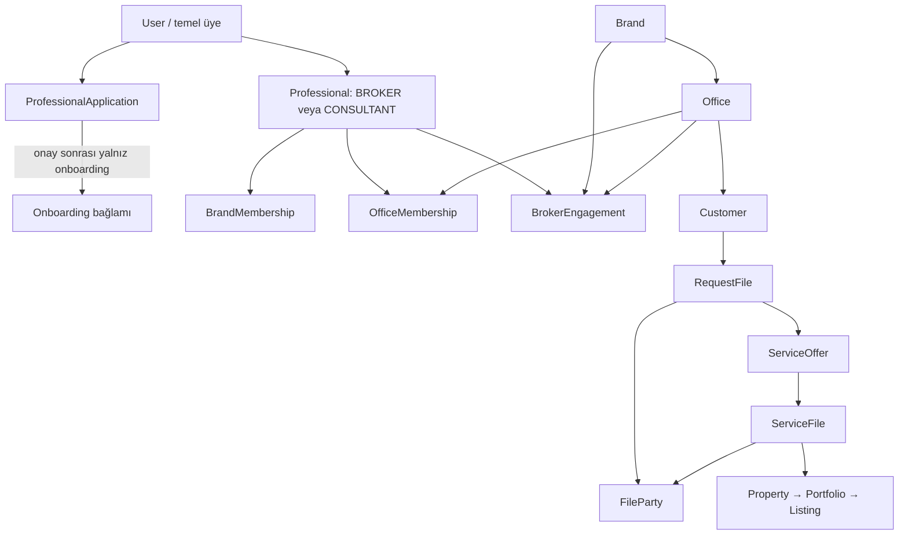

# Ayrıntılı ürün kaynakları

28 Ekim 2026 tarihinde on kaynak tek dosyada toplandı. Günlük okuma: [belge rehberi](../README.md). Bu dosya ayrıntı referansıdır; uygulama veya kabul kanıtı değildir.

**Öncelik:** Güncel [iş kuralları](../02_BUSINESS_RULES.md), [kararlar](../07_DECISIONS.md) ve [handoff](../09_CODEX_HANDOFF.md) esas alınır. Kaynak metinler tarihsel ifadeleriyle korunmuştur. MAXIMUM/ALFA hem ofis türü hem danışman çalışma modelidir; danışmanın modeli seçtiği ofisten gelir. Aşağıdaki bağımsız model seçimi/otomatik eşlenmez ifadeleri yeni kararın önüne geçmez. Geçmiş snapshot kayıtları değiştirilmez. Kaynaklardaki faz, test ve uygulandı/yok ifadeleri kendi tarihindeki kayıttır.

Prototip kabulü Laravel uygulama kabulü değildir. Eski dosya adları kaynak kimliğidir; özgün dosyaların tamamı [arşivde](../archive/docs-2026-10-28-oncesi.zip) bulunur.

**Ofis/Broker yaşam döngüsü önceliği — ADR-078 (3 Kasım):** ADR-077 kurumsal/operasyon sınırı sürer. Üç kuruluş seçeneği mevcut Broker, yeni davet ve atamayı ertelemedir; hazırlık erişimi unvan veya tam işletme değildir. Broker unvanı resmî ilişkiye bağlıdır; ilgili ilişki bitince başka geçerli Broker ilişkisi yoksa kişi danışman statüsündedir. Ana sözleşme Getmaks A.Ş.–ofis tüzel kişiliğinin Getmaks Ofis Franchise ve İşletme Sözleşmesidir; ofis temsil/imzası ve Broker şahsi kabulü ayrıdır, ayrıca Broker sözleşmesi zorunlu değildir. Değişimde ana sözleşme sürer, atama/ek izlenir; eski/yeni yetki aynı yürürlükte değişir. Sözleşme sonunda yetki/işletme erişimi derhal kapanır, ayrı kapanış işleri bunu uzatmaz; TERMINATED terminaldir. Dokuz aktivasyon koşulu ve davranış [02 bölüm 8.4'te](../02_BUSINESS_RULES.md#84-ofis-kuruluşu-modeli-ve-yaşam-döngüsü), açık hukuk/mali usuller [07'dedir](../07_DECISIONS.md). Aşağıdaki bağımsız Broker sözleşmesi, kalıcı unvan veya eski kuruluş/erişim ifadeleri bu kararı geçersiz kılmaz. Özgün kaynak gövdeleri değiştirilmez; yeni ödeme şartı veya teknik uygulama kabulü üretilmez.

**3 Kasım güncel kurumsal sınır — ADR-077:** Getmaks franchise/ofis ağı, Getmaks360 işletim ekosistemi, pazaryeri ayrı bütünleşik kanaldır. Marka kuruluş/sözleşme/kurumsal yetki/statü/denetim ve gerekçeli müdahale, Broker kendi ofisinin günlük işletme/ekip/iş dağıtımını yönetir; atanmış Brokerın mesleki işi için ikinci Consultant kimliği gerekmez. Danışman görev, ortak sözleşmeli görev, müşteri kendi karar kapsamındadır. Ortak matris/modüller [02 bölüm 8.2'de](../02_BUSINESS_RULES.md#82-marka-aktörleri-ve-yetki-ayrımı); A ofis ticari ilişkisi/B gerçekleşmiş İşlem Dosyası/C peşin paket mali kaynakları [03'te](../03_FINANCE_RULES.md); müdahale/itiraz/devir usulü ve ticari takvim açıkları [07'dedir](../07_DECISIONS.md). Aşağıdaki özgün kaynaklarda farklı panel sayımı, bağımsız model, geniş Marka operasyonu veya farklı kuruluş anlatımı güncel kararın önüne geçmez; özgün kaynak gövdeleri değiştirilmez. Yeni oran, ilan ücreti, pazaryeri komisyonu veya uygulama onayı üretilmez.

**Güncel öncelik — 2 Kasım 2026:** ADR-075 ve 02 bölüm 9 yedi hedef paneli, MAXIMUM Ofis Panelini ve Brokerın kendi unvanıyla mesleki faaliyetini tanımlar. Altı panel veya brokerın yalnız Danışman Panelinde çalışması ifadeleri tarihsel kalır. ADR-072/073 ofis türü, iki kabul, havuz süreleri ve müşteri tercihleri korunur. Aşağıdaki özgün kaynakların metni değiştirilmemiştir; hedef kod veya faz kabulü sayılmaz. Son entegrasyonda ADR-076, Brokerın Marka onaysız kendi havuz işini, operasyonel inisiyatifini ve ayrılıklarda otomatik yönetim devrini kesinleştirir. Eski danışman unvanına dönüş ve devralanın belirsizliği ifadeleri güncel kural değildir; geçmiş mali haklar korunur.

**29 Ekim 2026 tarihsel öncelik notu:** ADR-063–066 ana iş akışı, MAXIMUM ekip/aylık tüm danışmanlara havuz paylaşımı ve ALFA bağımsız çalışmayı kaydetti. O tarihteki altı sayımı ADR-075 ile güncellendi. Açık artırmada seçilen teklif taraf onayına ve sözleşmeye gider; uygulama/kabul kanıtı değildir.

## İçindekiler

- [Kaynak 1: GETMAKS360_ANA_DEGISMEZ_ISKELET_v3.1.md](#kaynak-1)
- [Kaynak 2: GETMAKS360_UYELIK_POTANSIYEL_MUSTERI_VE_PROFESYONEL_UNVAN_KARARLARI_v1.0.md](#kaynak-2)
- [Kaynak 3: GETMAKS360_DILIM_03_ISLEM_ROLLERI_VE_SOZLESME_KAPILARI_v1.3.md](#kaynak-3)
- [Kaynak 4: GETMAKS360_DILIM_03_KABUL_KONTROLU_v1.3.md](#kaynak-4)
- [Kaynak 5: GETMAKS360_CODEX_PANEL_YASAM_DONGUSU_UYGULAMA_TALIMATI_v1.2.txt](#kaynak-5)
- [Kaynak 6: GETMAKS360_PANEL_DURUM_GECIS_MATRISI_v1.0.md](#kaynak-6)
- [Kaynak 7: GETMAKS360_ROL_PANEL_EKRAN_ISLEM_KURGUSU_v1.1.md](#kaynak-7)
- [Kaynak 8: 13_BUTUNLESMIS_PANEL_SARTNAMESI.md](#kaynak-8)
- [Kaynak 9: 14_GETMAKS360_EKOSISTEM_BLUEPRINT_v1.0.md](#kaynak-9)
- [Kaynak 10: 10_PANEL_TALEP_VE_OFIS_TUTARLILIGI_v1.0.md](#kaynak-10)

---

## Kaynak 1: GETMAKS360_ANA_DEGISMEZ_ISKELET_v3.1.md

# GETMAKS360 — Ana Değişmez Sistem İskeleti v3.1

## 1. Yönetim kararı

GETMAKS360, birbirinden kopuk paneller toplamı değildir. Bütün ekranlar aynı kaynak kayıtları, aynı durum geçişlerini ve aynı yetki kurallarını kullanır. Paneller, kullanıcının gerçek ilişkilerine göre aynı operasyonun farklı görünümleridir.

**Sabit iş omurgası:**

**Kimlik kuralı:** Her hesap Standart Üye olarak başlar ve GETMAKS açısından potansiyel müşteri havuzunun parçasıdır. Gayrimenkul profesyoneli mesleki sürece kabul edildiğinde Gayrimenkul Danışmanı unvanıyla başlar; MAXIMUM franchise/ofis kuruluşu veya GETMAKS tarafından açık Broker/şube yöneticisi ataması ve gerekli aktivasyon koşullarıyla Broker unvanına geçer. Bu geçişler kullanıcı hesabı, işlem içi müşteri rolü ve ofis erişimiyle karıştırılmaz.

**GETMAKS Markası → Ofis → Broker ilişkisi/yönetimi → Ofis üyeliğiyle Danışman → Nihai müşteri tarafı → Talep Dosyası / Hizmet Dosyası → Portföy ve İlan → Eşleşme ve Gösterim → İşlem Dosyası → Finans**

Bu omurga değişmez. Ekranlar, menüler, bildirimler, görevler ve pazar yeri zamanla geliştirilebilir; fakat kaynak kayıt sahipliği ve işlem yaşam döngüsü birbirinden koparılamaz.

## 2. Panel sayısı: 5 operasyonel çalışma alanı + daha sonra 1 pazar yeri vitrini

“Panel” ile kullanıcı türünü birbirine karıştırmayın. Kullanıcı/profil türleri ile o profilin erişebildiği çalışma alanları farklıdır.

### 2.1 Marka yönetim paneli — GETMAKS

**Kim kullanır:** Yetkili ana sistem/marka yöneticileri.

**Sorumluluklar:**
- Ofis kayıtları, ofis türü ve ofis açılış/atanma süreçleri.
- Broker başvurusu, davet, onboarding ve marka-broker ilişkisi.
- Ofislerin yetkili yöneticileri ve ofis üyelikleri üzerinde yetkili yönetim.
- Marka tarafından yapılandırılan hizmet kapsamı ve belge/sözleşme gereklilikleri.
- Denetim geçmişi, operasyon görünürlüğü ve sistem ayarları.
- Marka tarafından tahsis edilen ofislerde brokerın çalışma/ücret ilişkisinin yönetimi.

**Yapmamalı:** Müşteri rolünü global kullanıcı rolüne çevirmek, ofis ve danışman kayıtlarını kopyalamak, doğrulanmamış finansal sonuç üretmek.

### 2.2 Broker çalışma alanı

Gayrimenkul profesyonelinin başlangıç unvanı Gayrimenkul Danışmanıdır. Broker unvanı, onaylı MAXIMUM franchise/ofis kuruluşu veya GETMAKS tarafından açık Broker/ALFA şube yöneticisi ataması ve ilgili aktivasyon koşullarıyla kazanılır. Broker profesyonel profilidir; tek başına ofis sahipliği veya danışman yönetim yetkisi anlamına gelmez.

Normal bir ofise danışman olarak bağlanmak, `OfficeMembership` kazanmak veya e-posta/e-Devlet doğrulaması Broker unvanı üretmez. Broker unvanı ile belirli bir ofise erişim hakkı da ayrı değerlendirilir; ofis işlemleri için aktif ilişki ve sunucu tarafı yetki kontrolü gerekir.

**Görünür işlevler:**
- Broker profili ve marka ile ilişkisi.
- Başvuru/onboarding, davetler, kendi sözleşme ve yükümlülüklerinin durumu.
- Franchise/ofis açılış süreci veya marka tarafından ofise atanma durumu.
- Varsa erişebildiği ofis çalışma alanına geçiş.

**Ofissiz broker:** Ofis oluşturma/kurulum veya atanma sürecini görebilir. Danışman listesi, danışman ekleme ve ofis operasyonlarına erişemez.

### 2.3 Ofis çalışma alanı

**Ofis bir kullanıcı tipi değildir.** Ofis çalışma alanı, gerçek ve aktif ofis ilişkisiyle profile eklenen bir yetki alanıdır.

Erişim koşulları:
- Franchise/ofis sahibi veya marka tarafından yetkili atanmış broker için ilgili ofis ilişkisi ve yetkiler doğrulanır.
- Danışman için geçerli `OfficeMembership` ve bu üyeliğin kapsadığı izinler doğrulanır.
- Menü seçimi, URL parametresi veya istemciden gönderilen ofis kimliği tek başına yetki vermez.

**Ofis işlevleri:**
- Ofis genel bakış ve iş kuyruğu.
- Ofise bağlı Talep Dosyaları ve Hizmet Dosyaları.
- Danışman üyelikleri, atamalar ve görevler.
- Mülk/portföy/ilan yönetimi.
- Eşleşmeler, gösterimler, teklifler ve İşlem Dosyaları.
- Ofis kapsamındaki belgeler, zaman çizelgeleri ve performans.

Broker ve danışman aynı ofis kayıtlarını farklı izinlerle görür; biri diğerinin yerine geçen bir rol değildir.

### 2.4 Danışman çalışma alanı

Gayrimenkul profesyoneli yaşam döngüsündeki başlangıç mesleki unvanı Gayrimenkul Danışmanıdır. Danışman, profesyonel kabul/aktivasyon koşullarını karşılamadan sırf standart üye olduğu için profesyonel sayılmaz. Unvanı Broker olarak değişen kişinin geçmiş danışmanlık ve ofis ilişkileri denetim izinde korunur; unvan, ofis türü ve erişim yetkileri tek bir alan olarak birleştirilmez.

**Sorumluluklar:**
- Kendisine atanmış ofis(ler) ve yetkili operasyon kapsamı.
- Kendisine atanmış müşteri, Talep Dosyası, Hizmet Dosyası ve görevler.
- Portföy, ilan, eşleşme, gösterim ve işlem dosyası adımları.
- Kendi iş kuyruğu, randevular, belgeler ve iletişim.

Danışman, brokerın alt kullanıcısı değildir. Ofisin profesyonel üyesidir. Bir ofis üyeliği veya ilişki kapandığında geçmiş kayıtlar korunur; başka geçerli ilişkiler varsayımla kapatılmaz.

### 2.5 Üye / Nihai müşteri çalışma alanı

Bütün standart üyeler bu alanı kullanır. Standart üyeliğin iş modeli karşılığı, GETMAKS’ın hizmet ve aracılık hizmeti sunabileceği **potansiyel müşteri** havuzudur. Bu ilişki müşteri kazanımı için başlangıç noktasıdır; tek başına aktif talep, işlem taraf rolü veya kazanılmış hizmet bedeli anlamına gelmez. E-posta veya kimlik doğrulaması profesyonellik yetkisi oluşturmaz.

**Ana başlangıçları:**
- Mülkümü satmak istiyorum → Hizmet Dosyası.
- Mülkümü kiraya vermek istiyorum → Hizmet Dosyası.
- Gayrimenkul satın almak istiyorum → Talep Dosyası.
- Kiralık gayrimenkul arıyorum → Talep Dosyası.

**Müşteri ekranları:** Genel Bakış, Talep Dosyalarım, Hizmet Dosyalarım, Mülk/ilan ilgilerim, Randevu ve gösterimlerim, Belgelerim, Mesajlarım, İşlem durumlarım.

Satıcı, alıcı, mülk sahibi ve kiracı kalıcı panel/profil türleri değildir. Bunlar ilgili Talep, Hizmet, Gösterim veya İşlem Dosyasındaki taraf rolleridir. Aynı kişi birden fazla dosyada farklı taraf rolüne sahip olabilir; paneli değişmez.

### 2.6 Üyelik, müşteri ilişkisi, profesyonel unvan ve işlem rolü ayrımı

Bu kavramlar aynı `User.role` alanına sıkıştırılmaz:

| Kavram | Kanonik anlam | Doğurmadığı sonuç |
|---|---|---|
| Standart Üye | Her hesabın temel üyeliği ve Üye/Müşteri çalışma alanı; GETMAKS açısından potansiyel müşteri havuzunun parçası | Otomatik alıcı/satıcı/kiracı rolü, profesyonel unvan veya gelir |
| Potansiyel Müşteri | GETMAKS'ın hizmet sunabileceği müşteri ilişkisi; ihtiyaç/etkileşimle nitelik kazanabilir | Kişinin tüm dosyalarda aynı rolü taşıması |
| Dosya içi taraf rolü | Alıcı, satıcı, mülk sahibi, kiraya veren, kiracı, devreden, devir alan vb. ilgili dosyada kayıtlıdır | Kalıcı hesap türü veya temel panelin değişmesi |
| Gayrimenkul Danışmanı | Profesyonel kabul/aktivasyon sonrası gayrimenkul profesyonelinin başlangıç unvanı | Ofis sahibi veya danışman yöneticisi olmak |
| Broker | Onaylı MAXIMUM franchise/ofis kuruluşu veya açık Broker/ALFA şube yöneticisi ataması ve gereken aktivasyon sonucu oluşan mesleki unvan | Otomatik olarak her ofise erişmek veya ALFA şubesinin sahibi olmak |
| Ofis üyeliği / görevlendirmesi | `OfficeMembership` veya broker–ofis ilişkisinin gerçek kaydı ve durumudur; erişim sunucuda izinlerle hesaplanır | Sadece üyelikten Broker unvanı kazanmak |
| Hizmet bedeli / hak ediş | İlgili sözleşme, olay ve iş koşulları doğrulandığında ayrı finansal yaşam döngüsüne girer | Sadece üyelik, talep veya mutabakat oluşturuldu diye kazanılmış sayılmak |

**Müşteri yaşam döngüsü:** Standart Üye → potansiyel müşteri → ihtiyaç/etkileşim → Talep Dosyası veya Hizmet Dosyası → ilgili dosyada taraf rolü → uygun işlem ve sözleşme koşulları → doğrulanmış finansal olay varsa ayrı finansal kayıt.

**Gayrimenkul profesyonel yaşam döngüsü:** Standart Üye → profesyonel başvuru/davet ve gerekli doğrulama → Gayrimenkul Danışmanı → (a) danışman olarak ofise bağlanma: unvan değişmez, aktif `OfficeMembership` kapsamındaki erişim açılır; veya (b) onaylı MAXIMUM franchise/ofis kuruluşu ya da (c) GETMAKS tarafından açık Broker/ALFA şube yöneticisi ataması: gereken koşullar sonrası Broker unvanı ve sadece ilgili aktif ofis kapsamındaki yetkiler açılır.

Broker/şube yöneticisi olarak açık atama ile normal danışman ofis üyeliği farklı ilişkilerdir. Üyelik veya unvan geçişi; sözleşme, ofis sahipliği, çalışma/ücret ilişkisi, ödeme ya da finansal hak edişi varsayımla oluşturmaz.

### 2.7 Pazar yeri vitrini — daha sonraki aşama

Pazar yeri, operasyon çekirdeğiyle aynı ilan ve yetkilendirilmiş mülk kayıtlarını kullanan vitrin katmanıdır. Kendi başına ikinci bir ilan/mülk kaynağı oluşturmamalıdır. Çekirdek akışlar doğru çalışmadan pazar yeri son rötuşlarına geçilmez.

## 3. Değişmez iş kavramları

### Ofis türü
- `Office.office_type = MAXIMUM | ALFA`
- MAXIMUM/ALFA, ofisin ticari/operasyonel türüdür.
- `ProfessionalWorkModel` ise tarihsel danışman çalışma/capability modelidir. Bunlar birbirine otomatik dönüştürülmez.

### Müşteriye sunulan hizmet kapsamı
- Uzaktan Destek
- Birebir Destek
- Uzman Hizmet

Bunlar hizmetin biçimi/kapsamıdır. Ofis türü, franchise yükümlülüğü veya genel “ticari plan” değildir.

### Franchise ve ücret ilişkileri
- Brokerın franchise/ofis açılış yükümlülüğü, markayla olan ilişkisinde tutulur; temel anlatım 5 yıllık franchise süresidir.
- Aylık/yıllık ödeme dönemi, ödeme yükümlülüğünün niteliğinden ayrı gösterilir.
- Marka tarafından belirli bir ofise atanmış brokerın maaş/SGK/prim düzeni yalnız bu çalışma ilişkisi gerçekten varsa uygulanır.
- Danışmanın giriş, aylık ve yıllık ücretleri alıcı tarafı (marka ve/veya ofis), neden ve koşul bilgisiyle ayrılır.
- “Ofis paketi” veya genel “ticari plan” adlı uydurma kavram oluşturulmaz. Mevcut veri modelinde bu ayrımları temsil eden yapı yoksa önce karar ve geçiş matrisi hazırlanır.

## 4. Üç ana operasyon kaydı

### 4.1 Talep Dosyası
Alıcı/kiracı ihtiyacını temsil eder. Müşteri, arama kriterleri, bütçe, konum, talep durumu, sorumlu ofis/danışman ve eşleşmelerle ilişkilidir.

### 4.2 Hizmet Dosyası
Mülk sahibi/satıcıdan alınan hizmetin merkezidir. Hizmet kapsamı, müşteri, mülk/temsil kanıtları, sözleşme/yetkilendirme, sorumlu ofis/danışman ve sonraki portföy/ilan adımlarını yönetir.

### 4.3 İşlem Dosyası
Talep Dosyası ile uygun Hizmet Dosyası/ilan ve tarafların mutabakatından doğar. İşlem türleri satış, kiralama veya devirdir. İşlem Dosyasının açılması kapanış anlamına gelmez. Sözleşmeler, teslim/devir kanıtları, bedel ve kapanış kontrolü ilgili işlem türüne bağlıdır.

## 5. Kanonik yaşam döngüsü

1. Standart Üye, GETMAKS’ın potansiyel müşteri havuzundaki temel hesabıyla ihtiyacını başlatır; bu noktada işlem taraf rolü veya gelir varsayılmaz.
2. Satıcı/mülk sahibi akışı Hizmet Dosyası; alıcı/kiracı akışı Talep Dosyası oluşturur.
3. Dosya uygun ofise ve yetkili danışmana atanır.
4. Hizmet Dosyasında hizmet kapsamı, mülk kanıtları, temsil/yetki sözleşmesi ve gerekli yetkilendirme kontrolleri tamamlanır.
5. Uygun Hizmet Dosyasından mülk, portföy ve ilan oluşturulur. İlanın kaynak Hizmet Dosyası bağlantısı korunur.
6. Talep Dosyası uygun ilan ve Hizmet Dosyalarıyla eşleşir.
7. Gösterim, talep + ilan + hizmet kaynağına bağlı yürütülür; yer gösterme formunun hazırlanması, imzalanması ve gösterim gerçekleşmesi farklı durumlardır.
8. Taraflar mutabık olduğunda işlem türüne uygun İşlem Dosyası başlatılır.
9. Satış/kiralama/devir için gereken sözleşme ve kanıtlar tamamlanır.
10. Gerçekleşme, teslim/devir ve kapanış koşulları doğrulanır.
11. Finansal etkiler yalnız gerçek ve doğrulanmış olaylardan ayrı tahakkuk, fatura, tahsilat ve ödeme kayıtları olarak doğar.

Sözleşme türü ve zorunluluğu, mevcut hukuk/marka tarafından onaylı gereklilik matrisi varsa oradan gelir. Mutabakat oluşmadan gelecekteki satış veya kira sözleşmesi imzalanmış sayılmaz.

## 6. Panel iletişiminin teknik standardı

- Aynı dosyanın her panelde ayrı kopyası olmaz; tek kaynak kayıt kullanılır.
- Her iş aksiyonu: kullanıcı etkileşimi → sunucu yetkisi → doğrulama → kalıcı kayıt/transaction → durum geçişi → audit/zaman çizelgesi → ilgili panellerde görünürlük.
- Bildirim varsa aynı olay kaydına bağlı ve idempotent çalışır; bildirim teslimi olayın kaydedilmesiyle karıştırılmaz.
- Bir paneldeki durum göstergesi diğer paneldeki aynı kayıtla çelişmemeli.
- Yetki menüden değil sunucuda, kaynak kaydın marka/ofis/ilişki sahipliği üzerinden belirlenir.

## 7. Ekran kalite standardı

1. Ana ekranlar boş teknik formlar yığını değil; iş kuyruğu, durum, sıradaki aksiyon ve ilgili kayıtları göstermeli.
2. Liste, filtre ve ayar/yapılandırma ekranları ayrılmalı. Örneğin belge gerekliliği yönetimi, broker başvuru listesine ham çok satırlı kod alanı olarak gömülmez; ayrı bir yapılandırma ekranı ve yapılandırılmış alanlarla sunulur.
3. Broker başvuruları ile danışman onboarding ekranları ayrı iş kuyruklarıdır. Ortak görünüm gerekiyorsa açık sekme/filtreyle ayrılır; birbirine karıştırılmaz.
4. Kullanıcıya gösterilen etiketler gerçek iş anlamını taşır ve Türkçe karakterleri doğru gösterir. `G8&#246nderildi` gibi ham/çift kaçışlı HTML entity gösterimi kabul hatasıdır; doğru metin `Gönderildi` olarak görünmelidir.
5. Üretim ortamında “İnceleme Modu”, rol taklidi veya yerel test kısayolları normal kullanıcıya gösterilemez.
6. Masaüstü 100% tarayıcı zoom'da temel form ve tablolar okunaklı, uygun genişlikte ve taşmasızdır; mobilde işlevler kaybolmaz.
7. Her buton gerçek bir aksiyon yapar veya açıkça devre dışı bırakılır; tamamlanmamış işlev sahte başarı mesajı göstermez.
8. Boş durumlar kullanıcıya bir sonraki anlamlı adımı söyler.
9. Formlar alan grupları, açıklamalar, doğrulama hataları ve kayıt sonrası geri bildirim içermelidir.
10. Tasarım prototipi uygulama sayılmaz; gerçek Blade ekranı, route, yetki, kayıt ve test birlikte tamamlanmalıdır.

## 8. Görseldeki Başvuru ekranının açık kusurları

`/admin/professional-applications` ekranında aşağıdaki sorunlar, mevcut uygulamada doğrulanıp düzeltilmesi gereken kabul kriterleridir:
- Durum seçeneğinde ham/bozuk `G8&#246nderildi` metni görünmemelidir; `Gönderildi` olmalıdır.
- Başvuru listesi içinde belge gerekliliğini `Kod|Ad|optional` metniyle topluca yazdıran ham textarea bulunmamalıdır. Gereklilik yönetimi ayrı ekrana, düzenlenebilir yapılandırılmış satırlara taşınmalıdır.
- Broker başvuruları ile onboarding aşamasındaki danışmanların aynı uzun sayfada ilgisiz bloklar gibi karıştırılması önlenmelidir.
- Başvuru listesi; arama, durum filtresi, aday satırı, başvuru tarihi, eksik belge durumu, karar ve detay aksiyonlarını net bir tablo/uygun kart görünümünde sunmalıdır.
- 33% tarayıcı zoom ile alınan görüntü tek başına CSS kusurunu kanıtlamaz. Ekran 100% zoom'da ayrıca doğrulanmalıdır; fakat bozuk etiket ve yanlış bilgi mimarisi zoomdan bağımsız hatalardır.

## 9. Mevcut sistemle uyumluluk ve güvenli değişiklikler

- C1–C5'teki başvuru belgeleri, bilgi talepleri, outbox, broker ilişki geçişleri ve merkezi erişim kontrolü korunur.
- `Office.office_type` ile tarihsel `ProfessionalWorkModel` ayrımı korunur; eski kayıtlar otomatik dönüştürülmez.
- `OfficeMembership` danışmanın ofis üyeliğidir; brokerın alt kullanıcı ilişkisi olarak modellenmez.
- Broker ilişki durumu, ofis üyeliği, profesyonel durumu, sözleşme ve panel erişimi ayrı kavramlardır.
- Eski/eksik kayıtlar tahminle sınıflandırılmaz. Migration gerekirse önce eski/yeni değerler için eşleme ve geri dönüş planı hazırlanır.
- Finansal kayıtlar yalnız doğrulanmış olaylardan sonra oluşturulur. Tahakkuk, fatura, tahsilat ve ödeme birbirinden farklı kayıtlardır.

## 10. Uygulama kabul kapısı

Bir ekran “tamamlandı” sayılabilmesi için birlikte doğrulanmalıdır:
- Doğru kaynak kaydı kullanması.
- Doğru rol/ofis/marka kapsamını uygulaması.
- Form ve filtrelerin gerçek verilerle çalışması.
- Butonun gerçek sunucu aksiyonu yapması.
- Geçerli/geçersiz durumların ele alınması.
- Sonucun diğer yetkili panellerde aynı kayıtta görünmesi.
- Hata, boş durum ve başarı geri bildiriminin düzgün olması.
- İlgili feature testlerinin geçmesi.
- Pint ve Blade view cache kontrollerinin geçmesi.

Yalnızca dosya eklemek, route tanımlamak veya testin bir bölümünü çalıştırmak tamamlanma kanıtı değildir.

---

**v3.1 değişiklik notu (26 Ekim 2026):** Standart Üye = potansiyel müşteri mantığı ile Gayrimenkul Danışmanı → Broker unvan yaşam döngüsü ayrıştırıldı. Normal ofis üyeliğinin Broker unvanı vermediği; MAXIMUM franchise kuruluşu ile ALFA şube yöneticisi atamasının farklı Broker yolları olduğu ve unvan/erişim/finansal hak edişin ayrı tutulduğu açıkça yazıldı.

---

## Kaynak 2: GETMAKS360_UYELIK_POTANSIYEL_MUSTERI_VE_PROFESYONEL_UNVAN_KARARLARI_v1.0.md

# GETMAKS360 — Üyelik, Potansiyel Müşteri ve Profesyonel Unvan Karar Matrisi v1.0

Tarih: 26 Ekim 2026  
Durum: Tasarım kararı / prototipte işlenmiştir; Laravel uygulamasına ayrıca onaylı görevle aktarılacaktır.

## 1. Ana karar

GETMAKS360'da **Standart Üye**, her hesabın temel üyelik durumudur ve ticari mantıkta GETMAKS'ın hizmet sunabileceği **potansiyel müşteri** havuzunu temsil eder. Gayrimenkul profesyonelinin başlangıç mesleki unvanı ise **Gayrimenkul Danışmanı**dır. **Broker** unvanı, onaylı MAXIMUM franchise/ofis kuruluşu veya GETMAKS tarafından açık Broker/ALFA şube yöneticisi görevlendirmesi ve gerekli aktivasyon koşulları tamamlandığında kazanılır.

## 2. Birbirine karıştırılmayacak kavramlar

| Kavram | Ne ifade eder? | Tek başına ne oluşturmaz? |
|---|---|---|
| Standart Üye | Temel kullanıcı hesabı ve Üye/Müşteri alanı | Kalıcı alıcı/satıcı/kiracı rolü, profesyonel statü, hizmet bedeli/hak ediş |
| Potansiyel Müşteri | GETMAKS'ın hizmet veya aracılık hizmeti sunabileceği müşteri ilişkisi | Kesinleşmiş talep, işlem, kazanılmış gelir |
| Talep Dosyası | Alıcı/kiracı veya uygun devralan tarafın ihtiyacını temsil eder | Global kullanıcı rolü veya gelir tahakkuku |
| Hizmet Dosyası | Mülk sahibi/satıcı/kiraya veren/devreden tarafına hizmet sürecini temsil eder | Otomatik yetki, ilan veya işlem kapanışı |
| Dosya içi taraf rolü | Alıcı, satıcı, mülk sahibi, kiracı, kiraya veren, devreden, devir alan vb. | Kalıcı kullanıcı tipi veya temel panel değişimi |
| Gayrimenkul Danışmanı | Profesyonel kabul/aktivasyon sonrası başlangıç unvanı | Ofis sahibi olmak, Broker olmak veya otomatik ofis yönetimi |
| Broker unvanı | Onaylı ofis kuruluşu veya açık Broker/şube yöneticisi ataması sonrası mesleki unvan | Her ofise erişmek, ALFA şubesinin sahibi olmak, otomatik maaş/prim |
| `OfficeMembership` | Danışmanın belirli bir ofise üyeliği ve izin kapsamı | Broker unvanı |
| Broker–ofis ilişkisi | Franchise/ofis sahibi veya marka tarafından atanmış şube yöneticisi gibi gerçek ilişki | İlişki türü farklıyken varsayımla sahiplik/ücret yükümlülüğü |
| Finansal hak ediş | Sözleşme, gerçek olay ve ilgili koşullar doğrulandıktan sonra oluşabilecek finansal sonuç | Üyelik, talep veya mutabakat anında otomatik gelir |

## 3. Potansiyel müşteri yaşam döngüsü

1. Hesap açılır ve temel durum Standart Üye'dir.
2. Standart üyelik, GETMAKS açısından kişiyi potansiyel müşteri havuzuna alır; henüz ihtiyaç belirtmemiş olabilir.
3. İhtiyaç ve işlem yönüne göre uygun akış başlar:
   - Mülkümü satmak istiyorum → Hizmet Dosyası.
   - Mülkümü kiraya vermek istiyorum → Hizmet Dosyası.
   - Gayrimenkul satın almak istiyorum → Talep Dosyası.
   - Kiralık gayrimenkul arıyorum → Talep Dosyası.
   - İşletme/hak devri → işlem yönü ve hizmet ihtiyacına göre Hizmet Dosyası veya Talep Dosyası.
4. Alıcı/satıcı/kiracı vb. taraf rolleri ilgili dosya, ilan etkileşimi, gösterim veya işlem bağlamında tutulur. Aynı hesap farklı dosyalarda farklı roller alabilir.
5. Hizmet bedeli ve aracılık hak edişi yalnız sözleşme ve gerçek iş/işlem koşulları doğrulandığında ayrı finansal yaşam döngüsüne alınır.

## 4. Gayrimenkul profesyoneli yaşam döngüsü

1. Hesap temel Standart Üye hesabını ve müşteri alanını korur.
2. Kişi profesyonel başvuru/davet, gerekli nitelik-belge ve aktivasyon kontrollerinden geçer.
3. Gayrimenkul profesyoneli başlangıç unvanı **Gayrimenkul Danışmanı**dır.
4. Buradan üç ayrı durum izlenir:
   - **Ofissiz danışman:** Danışman unvanı korunur; ofis operasyonları ve danışman yönetimi açılmaz.
   - **Ofise danışman olarak katılım:** Aktif `OfficeMembership` ile izin kapsamındaki ofis alanı açılır; unvan Gayrimenkul Danışmanı olarak kalır.
   - **Broker geçişi:** Onaylı MAXIMUM franchise/ofis kuruluşu veya GETMAKS'ın açık Broker/ALFA şube yöneticisi ataması ve gerekli aktivasyon koşulları tamamlanınca Broker unvanı ve yalnız ilgili aktif ofis ilişkisinin izin verdiği yönetim alanı açılır.

**MAXIMUM ve ALFA farkı korunur:** MAXIMUM franchise/ofisini broker başlatır; ALFA şubesini GETMAKS Marka kurar. MAXIMUM Broker yolu franchise/ofis kuruluşu üzerinden, ALFA Broker yolu açık şube yöneticisi ataması üzerinden ilerler. ALFA ataması şube sahipliği/franchise ilişkisi olarak sunulmaz.

## 5. Erişim ve güvenlik kuralları

- E-posta veya e-Devlet doğrulaması tek başına profesyonel kabul, Broker unvanı veya ofis yetkisi oluşturmaz.
- Panel ve buton görünürlüğü tek başına güvenlik değildir; bütün erişim sunucuda gerçek profil, unvan, aktif ilişki, ofis sahipliği/yöneticiliği ve izinler üzerinden kontrol edilir.
- Broker unvanı ile aktif ofis erişimi ayrı değerlendirilir. Askıya alınmış/sonlandırılmış ilişki, ilişkiye bağlı operasyon erişimini etkiler; üye alanını silmez.
- Ofis üyeliği, Broker görevlendirmesi, franchise sözleşmesi, istihdam/maaş/SGK/prim ve finansal hak ediş farklı ilişki/kayıt türleridir.
- Geçmiş unvan/ilişki geçişleri denetim izinde korunur. Eski kayıtlar tahminle dönüştürülmez; gereken veri geçişi ayrı eşleme ve geri dönüş planıyla ele alınır.

## 6. Prototipte kontrol edilecek örnekler

- Üye ihtiyacı seçimi `Hizmet Dosyası` ve `Talep Dosyası` başlangıçlarını doğru değiştirir.
- Henüz ihtiyacı olmayan standart üye için dosya içi taraf rolü yaratılmaz.
- Danışmanın normal ofis üyeliği seçeneği sonucunda unvan `Gayrimenkul Danışmanı` kalır.
- MAXIMUM kuruluşu sonucunda Broker + MAXIMUM ofis alanı gösterilir.
- ALFA şubesine Broker olarak atanma sonucunda Broker + atanmış ALFA alanı gösterilir; franchise sahipliği gösterilmez.
- Kamuya açık marka görünümü bu iç üyelik/unvan ilişkilerini göstermez.

## 7. Uygulama notu

Bu belge tasarım kararını sabitler. Şu anda `/mnt/data` içindeki HTML prototip ve mimari doküman güncellenmiştir; Laravel kaynak kodu, veritabanı, migration veya gerçek yetki davranışı değiştirilmemiştir. Kod uygulamasına geçmeden önce mevcut modeller ve `Professional.status`, profesyonel başvuru türleri, `OfficeMembership`, `BrokerEngagement` ile ofis başvuru/kayıt süreçleri karşılaştırılmalı; alan ve durum adları mevcut modelle uyumlu karara bağlanmalıdır.

---

## Kaynak 3: GETMAKS360_DILIM_03_ISLEM_ROLLERI_VE_SOZLESME_KAPILARI_v1.3.md

# GETMAKS360 — İşlem Rolleri ve Dijital Sözleşme Kapıları v1.3

## 1. Hesap, profesyonel profil ve işlem rolü ayrıdır

- Her hesap önce `Standart Üye`dir; bunun ticari karşılığı GETMAKS'ın hizmet sunabileceği `Potansiyel Müşteri` havuzudur. İhtiyaç belirtmemiş üyede henüz dosya içi rol veya gelir varsayılmaz.
- Gayrimenkul profesyonelinin başlangıç unvanı `Gayrimenkul Danışmanı`dır. `Broker` unvanı onaylı MAXIMUM franchise/ofis kuruluşu veya GETMAKS tarafından açık Broker/ALFA şube yöneticisi ataması ve ilgili aktivasyon koşulları tamamlandığında kazanılır.
- Danışmanın bir ofise normal `OfficeMembership` ile katılması onu Broker yapmaz. `Ofis`, ayrı bir kullanıcı tipi değil; Brokerın gerçek ve aktif ofis ilişkisi veya danışmanın aktif `OfficeMembership` kaydı üzerinden izin kapsamıyla eklenen çalışma alanıdır.
- Standart üyelik, müşteri ilişkisi, dosya içi taraf rolü, profesyonel unvan, ofis ilişkisi ve finansal hak ediş ayrı kavramlardır. E-posta/e-Devlet doğrulaması tek başına profesyonel veya Broker erişimi sağlamaz.
- `Satıcı`, `Alıcı`, `Mülk Sahibi`, `Kiracı`, `Devreden` ve `Devir Alan` kalıcı hesap türleri değildir. İlgili dosya, ilan etkileşimi, gösterim, sözleşme ve işlem bağlamına bağlı taraf kayıtlarıdır.
- Aynı kişi farklı dosyalarda farklı taraf rollerine sahip olabilir. Bu, panelini veya genel kullanıcı kimliğini değiştirmez.

## 2. İç model ile dış marka adı

| İç model / ilişki | Müşteriye görünen ad | Dışarıya açılmayan iç bilgi |
|---|---|---|
| `office_type=MAXIMUM`; broker franchise yoluyla kurar | `Maksimum Ofis / [Brokerın eklediği ad]`; ör. **Maksimum Ofis / Elite** | MAXIMUM kodu, franchise ilişkisi ve iç kuruluş/işletme ayrıntıları
| `office_type=ALFA`; markanın kurduğu şube | `Getmaks Alfa [İlçe]`; ör. **Getmaks Alfa Bakırköy** | ALFA kodu, markanın kuruluş akışı ve broker varsa şube yöneticisi ataması

Konum, gerektiğinde ayrı konum bilgisi olarak sunulur. Resmî sözleşme/fatura üzerinde gerekli yasal taraf/unvan bilgileri korunur; public display name bunların yerine geçmez.

## 3. İşlem türüne göre taraf rolleri

| Aşama | Satış | Kiralama | Devir |
|---|---|---|---|
| Hizmet başlangıcı | Mülk Sahibi / Satıcı | Mülk Sahibi / Kiraya Veren | Devreden
| İlanla anlamlı etkileşim | Alıcı Adayı | Kiracı Adayı | Devir Alan Adayı
| Gösterim / inceleme | Alıcı + Satıcı/Mülk Sahibi; yer gösterme formu ilgili gösterime bağlanır | Kiracı + Kiraya Veren; yer gösterme formu ilgili gösterime bağlanır | Devir inceleme/görüşme tarafları; yer gösterme yalnız uygulanıyorsa
| Mutabakat | Alıcı + Satıcı | Kiracı + Kiraya Veren | Devreden + Devir Alan
| Nihai işlem | Alıcı + Satıcı | Kiracı + Kiraya Veren | Devreden + Devir Alan

Salt ilan görüntülemesi tek başına kalıcı bir hesap rolü yaratmaz. İletişim, talep veya gösterim isteği gibi anlamlı etkileşimler, ilgili ilan/Talep Dosyası bağlamında aday taraf kaydı oluşturabilir.

## 4. Sözleşme ve kanıt kapıları

### A. Hizmet başlangıcı ve ilan öncesi yetkilendirme

1. Üye hizmet isteğiyle Hizmet Dosyası başlatır.
2. Dosya tarafları, temsil yetkileri ve mülk/işletme bilgileri doğrulanır.
3. İlgili taraflar arasında **Yetki Sözleşmesi** için taslak hazırlanır.
4. Sözleşme sunulur, gerekli taraf imzaları alınır ve imza/kanıt kontrolü tamamlanır.
5. Yetki kapısı geçilmeden mülk/portföy/ilan yayınına geçilmez.

### B. İlan etkileşimi ve yer gösterme

1. Hizmet Dosyası, mülk, portföy ve ilan aynı kaynak ilişkisiyle bağlanır.
2. Alıcı/kiracı/devir alan adayı anlamlı etkileşimde bulunduğunda rol, ilgili dosya/ilan bağlamında oluşturulur.
3. Gösterim planlanırsa **Yer Gösterme Formu/Belgesi** o gösterim kaydına, taraflara ve imza kanıtına bağlı tutulur.
4. Formun taslağı, imzaya sunulması, taraf imzaları, kanıt kontrolü ve gösterimin gerçekleşmesi ayrı durumlardır.

### C. Mutabakat ve kapora/ön ödeme

1. Taraf mutabakatı ayrı kalıcı olay/kayıt olarak kaydedilir. Eşleşme veya gösterim tek başına mutabakat değildir.
2. Uygulanabilir sözleşme/iş koşullarına göre **Kapora/Ön Ödeme Sözleşmesi** hazırlanabilir.
3. Kapora/ön ödeme yükümlülüğü, sözleşmenin imzası ve ödeme kanıtı ayrı durumlar ve kayıtlar olarak izlenir.
4. Kiralama akışında kapora/ön ödeme ile kira depozitosu/güvence bedeli birbirine dönüştürülmez.
5. Gerçek ödeme veya tahsilat yapılmış gibi bir durum yalnız doğrulanmış ödeme kaydı/kanıtıyla gösterilir.

### D. Nihai işlem sözleşmesi

- **Satış:** Satış Vaadi Sözleşmesi; kullanılacak kesin tür, format ve imza standardı onaylı hukuk gereklilik matrisiyle doğrulanır.
- **Kiralama:** Kiralama/Kira Sözleşmesi; kira şartları, taraflar, depozito ve teslim maddeleri ilgili onaylı şablondan gelir.
- **Devir:** Devir Sözleşmesi; devir alt türü, izinler, taraflar ve imza şartları ilgili onaylı alt tür matrisinden gelir.

Nihai dijital sözleşme taslağı, İşlem Dosyası için taraf/temsil bilgileri, süreç adımları ve zorunlu belgeler tamamlandığında doğru dosya verilerinden oluşturulur. Taslak oluşturma, imzaya sunma, tüm taraf imzaları ve kanıt kontrolü farklı durumlardır. Prototipteki demo butonları gerçek elektronik imza veya hukuki geçerlilik teyidi sağlamaz.

### E. İşlem Dosyası kapanış kapısı

Aşağıdakilerin tamamı gerekir:

- İşlem tarafları ve temsil yetkileri doğrulanmış.
- İşlem türüne uygun süreç adımları, gerekli gösterim/mutabakat ve onaylar tamamlanmış.
- Onaylı gereklilik matrisindeki zorunlu belge sürümleri tamamlanmış.
- Gerekli sözleşmelerin taraf imzaları ve imza/kanıt doğrulaması tamamlanmış.
- Kapora/ön ödeme uygulanıyorsa ilgili sözleşme ile ödeme kanıtı doğrulanmış.
- İşlem türüne uygun gerçekleşme/teslim kanıtı kaydedilmiş.

Kapanışın oluşması; tahakkuk, fatura, tahsilat ve ödeme kayıtlarını tek bir kayıt haline getirmez. Finansal etkiler ayrı, onaylı kurallara bağlıdır.

## 5. Hukuk/uyum sınırı

Bu belge, ürün akışının ekran/veri sahipliği tasarımıdır; hukuki görüş değildir. Sözleşmenin türü, zorunluluğu, temsil ve imza şartları, elektronik imza türü ve geçerlilik koşulları marka tarafından onaylanmış hukuk gereklilik matrisinden beslenmelidir. Matris yapılandırılmamışsa sistem “eksiksiz” veya “hukuken tamamlandı” varsayımı yapmaz.

---

## Kaynak 4: GETMAKS360_DILIM_03_KABUL_KONTROLU_v1.3.md

# Dilim 03 v1.3 — Kabul Kontrolü

## Yeni üyelik / profesyonel unvan kararları
- [x] İlk ekranda Standart Üye = GETMAKS açısından potansiyel müşteri mantığı anlatılıyor.
- [x] İhtiyaç seçimi, satış/kiralama hizmet talebini Hizmet Dosyasına; satın alma/kiralık arayışını Talep Dosyasına bağlıyor.
- [x] İhtiyaç belirtilmemiş üyede dosya içi rol veya hizmet geliri varmış gibi gösterilmiyor.
- [x] Profesyonel başlangıç unvanı Gayrimenkul Danışmanı olarak gösteriliyor.
- [x] Bir ofise normal danışman üyeliğinin unvanı Broker'a çevirmediği açık.
- [x] MAXIMUM franchise/ofis kuruluşu Broker yolu ve ilgili ofis alanı olarak ayrı gösteriliyor.
- [x] ALFA şubesine açık Broker/şube yöneticisi ataması ayrı Broker yolu olarak gösteriliyor; franchise sahipliği anlamı çıkarılmıyor.
- [x] Broker unvanı ile ofise erişimin aktif ilişki/izin koşullarına bağlı olduğu belirtiliyor.
- [x] Üye alanı profesyonel yaşam döngüsünde korunuyor.

## Önceki v1.2 kapsamı
- [x] MAXIMUM franchise kuruluşu ile marka tarafından kurulan ALFA şubesi ayrı akışlar.
- [x] Dış marka önizlemesinde `Maksimum Ofis / Elite` ve `Getmaks Alfa Bakırköy` kullanılıyor.
- [x] Dış marka modunda tüm iç ilişki bölümleri gizleniyor.
- [x] Satış, kiralama ve devir için dosya bazlı taraf rolleri gösteriliyor.
- [x] Yetki, gösterim, mutabakat, kapora/ön ödeme, nihai sözleşme ve kapanış kapıları korunuyor.
- [x] Kapora/ön ödeme kanıtı ile kira depozitosunun ayrı olduğu belirtiliyor.

## Tarayıcı kontrolü (HTML prototipi)
- [x] Yeni bölüm yükleniyor ve iki seçim kontrolü dinamik metni değiştiriyor.
- [x] Satış ve satın alma ihtiyaçları için doğru dosya başlangıcı gösteriliyor.
- [x] Danışman ofis üyeliği seçeneğinde unvan `Gayrimenkul Danışmanı` olarak kalıyor.
- [x] MAXIMUM ve ALFA seçenekleri Broker çıktısını farklı ilişkilerle açıklıyor.
- [x] Dış görünüm modunda yeni iç üyelik/unvan bölümü gizli kalıyor.
- [x] JavaScript çalışma zamanı hatası: 0.
- [x] Mobil 390px genişlikte yatay taşma yok (`clientWidth=390`, `scrollWidth=390`).

## Sınır
Bu kontroller HTML prototipinin etkileşim ve gösterim davranışını doğrular; Laravel, veritabanı, gerçek yetki, elektronik imza veya finans entegrasyonu için uygulama testi değildir.

---

## Kaynak 5: GETMAKS360_CODEX_PANEL_YASAM_DONGUSU_UYGULAMA_TALIMATI_v1.2.txt

GETMAKS360 — ROL, PANEL, EKRAN VE İŞLEM YAŞAM DÖNGÜSÜ
DOĞRUDAN UYGULAMA TALİMATI v1.2

PROJE
C:\laragon\www\GETMAKS360_V2

GÖREV
Bu paketteki bağlayıcı panel kurgusunu mevcut Laravel + Blade uygulamasına uygula. Hedef, kullanıcının gerçek durumuna göre doğru panellerin birlikte açılması/kapanması ve bu panellerin kendi ekran, işlem ve veri kapsamlarıyla çalışmasıdır. Yalnız rol adlarını/rozetlerini değiştirme. Ekran, menü, route/action izinleri, ilişki kapsamı ve işlem sonuçlarını aynı kurala bağla.

BU BİR UYGULAMA GÖREVİDİR
- İş modelini yorumlama, yeniden tasarlama, alternatif üretme veya yeni hedef belirleme.
- Ayrı analiz raporu, plan, mimari öneri, test, lint, Pint, view cache veya doğrulama çalışması yapma.
- Talimattaki panel isimlerini, bileşimini, geçişlerini ve kullanıcıya gösterilecek sonuçları aynen uygula.
- İlgili mevcut kodu gerektiği kadar inceleyerek doğrudan değişiklikleri yap. Kapsam dışı refactor yapma; çalışan akışları sebepsiz yere baştan yazma.
- Test yaptığını, çalıştırdığını veya geçtiğini iddia etme.
- Uygulamayı kesin olarak engelleyen somut teknik bağımlılık varsa iş kuralı uydurma; sadece uygulanamayan noktayı ve engelin bağlı olduğu dosya/ilişkiyi kısa bildir.
- Son yanıtı yalnızca: uygulanan ana değişiklikler, değişen önemli dosyalar ve varsa somut engel olarak ver.

BAĞLAYICI KAYNAKLAR VE ÖNCELİK
1. GETMAKS360_ROL_PANEL_EKRAN_ISLEM_KURGUSU_v1.1.md — panel/rol/ekran/işlem kurgusu için ana ve bağlayıcı kaynak.
2. GETMAKS360_ANA_DEGISMEZ_ISKELET_v3.1.md
3. GETMAKS360_UYELIK_POTANSIYEL_MUSTERI_VE_PROFESYONEL_UNVAN_KARARLARI_v1.0.md
4. GETMAKS360_DILIM_03_ISLEM_ROLLERI_VE_SOZLESME_KAPILARI_v1.3.md
5. GETMAKS360_DILIM_03_PROTOTIP_v1.3.html, kullanım notu, kabul kontrolü ve ekran görselleri.
6. GETMAKS360_UYE_MUSTERI_PANELI_TASARIMI_v2.1.html ve ilgili masaüstü/mobil görselleri.
7. Projedeki docs/09_CODEX_HANDOFF.md ve mevcut C1-C5 uygulamaları.

Eğer eski genel anlatım bu metindeki açık panel yaşam döngüsü kararlarıyla çelişirse bu talimattaki ve bağlayıcı kurgudaki açık kararları uygula. Kaynak belgeleri silme veya eski sürümle üzerine yazma.

1. HESAP VE PANEL TEMELİ
Her hesap Standart Üye / Nihai Müşteri Paneli ile başlar ve bu panel kalıcıdır. Standart Üye sadece rozet veya veritabanı etiketi değildir; aşağıdaki müşteri ekranları ve işlemleri olan tam paneldir. Bir kullanıcı ek panel kazandığında standart paneli kaldırma, gizleme veya onunla değiştirme.

PANEL BİLEŞİMİ
A. Yalnız Standart Üye: Standart Üye / Nihai Müşteri Paneli.
B. Profesyonel başvurusu yapılmış, fakat kabul/aktivasyon tamamlanmamış kişi: mevcut Standart Üye Paneli. Başvuru durumu standart paneldeki başvuru akışında görünür; aktif Danışman Paneli açılmaz.
C. Aktif Gayrimenkul Danışmanı: Standart Üye Paneli + Danışman Paneli.
D. Aktif MAXIMUM franchise Broker'ı: Standart Üye Paneli + Danışman Paneli + yalnız kurduğu/aktif sahip olduğu ilgili ofisin Ofis Paneli. Franchise Broker türü ayrı kalır.
E. GETMAKS tarafından Broker/şube yöneticisi olarak atanmış Broker (özellikle marka tarafından açılan ALFA şubesi): Standart Üye Paneli + Danışman Paneli + yalnız atandığı ofisin Ofis Paneli. Bu kişi MAXIMUM franchise sahibi gibi gösterilmez. Atama ilişkisi franchise ilişkisiyle birleştirilmez.
F. Ofise yalnız danışman olarak OfficeMembership üzerinden katılan kişi: Standart Üye + Danışman Paneli. Broker/Ofis yöneticisi paneli açılmaz.
G. Stratejik İş Ortağı: Standart Üye Paneli + Stratejik İş Ortağı Paneli. Bu ilişki tek başına genel Danışman Paneli veya Ofis Paneli vermez. Kişi bağımsız olarak aktif Danışman/Broker durumundaysa yalnız o ayrı ilişki de geçerliyse ilgili panelleri birlikte bulunabilir.
H. Marka yönetim yetkilisi veya yatırımcı: Standart Üye Paneli korunur; kendi ayrı ve etkin ilişki/kapsamıyla Marka Yönetimi veya Yatırımcı Paneli eklenir. İlgisiz kayıtlar açılmaz.

2. PANEL KAZANMA VE KALDIRMA KURALLARI
- Hesap açılması: yalnız Standart Üye Paneli; tek başına müşteri rolü, dosya, profesyonellik, Broker unvanı veya gelir oluşturmaz.
- Profesyonel başvurusu göndermek: panel açmaz. Başvurunun kabulü ve gerekli mevcut aktivasyon koşulları tamamlandığında Danışman Paneli eklenir.
- Broker statüsü: yalnız iki ayrı yol ile oluşur: (1) MAXIMUM franchise ofisini kurma/aktif etme koşullarını tamamlayan franchise Broker'ı; (2) GETMAKS tarafından açılmış ilgili ofise açık Broker/şube yöneticisi ataması yapılan atanmış Broker.
- Normal ofis üyeliği, plan seçimi, belge gönderimi veya Broker başvurusu tek başına Broker statüsü oluşturmaz.
- Broker ofis görevinden/atamasından alındığında ya da o ofisle aktif Broker ilişkisi bittiğinde o ofisin Ofis Paneli ve ilgili operasyon izinleri kaldırılır. Profesyonel statüsü aktif kalıyorsa Standart Üye + Danışman panelleri aynen kalır. Diğer bağımsız geçerli panelleri kendiliğinden kaldırma.
- Profesyonel statüsü iptal edildiğinde Standart Üye Paneli her zaman kalır; Danışman Paneli ve profesyonelliğe bağlı Broker/Ofis operasyon erişimi kapanır. Bağımsız, geçerli stratejik ortaklık/marka/yatırımcı ilişkileri kendi durumuna göre değerlendirilir. Geçmiş müşteri dosyalarını silme.
- Stratejik ortaklık bittiğinde Stratejik İş Ortağı Paneli ve yalnız bu ilişkiye bağlı atama/görev erişimi kapanır; Standart Üye Paneli kalır.
- Kurumsal temsil yetkisi bittiğinde o kurumsal bağlama erişim kapanır; kişinin kişisel paneli ve diğer bağımsız ilişkileri kalır.
- Yetki değişimi menüden çıkarmayla sınırlı olmaz: doğrudan URL, route, controller/action ve kayıt kapsamı aynı durumu uygular. Aktif oturum veya eski önbellek, kaldırılmış yetkiyi devam ettiremez.
- Ofis görevi sona erince ofis kaydı, ofisin müşterileri, dosyaları ve geçmişi silinmez. Gerekliyse yeni Broker'a devir veya marka yönetimi ayrı ilişkiyle yapılır.

3. BİREYSEL VE KURUMSAL NİHAİ MÜŞTERİ
Nihai müşteri bireysel gerçek kişi veya kurumsal/tüzel kişi olabilir.
- Gerçek kişi kullanıcı hesabı ile şirket/kurum aynı kayıt gibi ele alınmaz.
- Kullanıcının kişisel Standart Üye Paneli daima korunur. Bir veya daha fazla kurumsal taraf adına işlem yapmaya yetkiliyse bağlam seçicisiyle “Kişisel Alanım” ve “Kurumsal Hesaplarım” arasında geçebilir.
- Talep/Hizmet/İşlem Dosyasının hukuki tarafı bireysel kişi veya kurumsal taraf olarak kayıtlı olur. Şirket adına işlem yapan gerçek kişi temsilci ayrı ilişki ve izinle belirlenir; temsil/imza yetkisi dosyanın tarafıyla karıştırılmaz.
- Çalışan olmak tek başına kurumun tüm dosyalarını görme hakkı değildir. Kurumsal kayıtlara yalnız yetkili temsilci ve kapsam izinleri erişir.
- Mevcut kurumsal taraf/temsil modelini kullan; yoksa bu akışı destekleyen en küçük tutarlı ilişkiyi uygulamaya ekle. Şirketi yalnız bir metin adı olarak taklit etme veya kişi hesabını şirket hesabına dönüştürme.
- Standart Üye Panelinde M01–M09 ekranları hem kişisel bağlamda hem seçilmiş ve yetkili olunan kurumsal bağlamda doğru veriyi sunar.

4. DOSYAYA BAĞLI MÜŞTERİ ROLLERİ
Alıcı, satıcı, kiracı/kiracı adayı, mülk sahibi/kiraya veren, devreden ve devir alan kalıcı hesap rolleri değildir. İlgili dosya veya işlem bağlamında hukuki tarafa atanırlar.
- “Mülkümü satmak istiyorum” -> Hizmet Dosyası.
- “Mülkümü kiraya vermek istiyorum” -> Hizmet Dosyası.
- “Gayrimenkul satın almak istiyorum” -> Talep Dosyası.
- “Kiralık gayrimenkul arıyorum” -> Talep Dosyası.
- İlanı görüntülemek tek başına rol oluşturmaz. Anlamlı talep/gösterim/işlem etkileşiminde rol uygun dosya kapsamına bağlanır.
- Talep Dosyası, Hizmet Dosyası ve İşlem Dosyası ayrıdır; geçişler otomatik değil tanımlı koşullarla olur.
- Aynı User hesabını, müşteri dosyasını, mülkü veya ilanı paneller arasında kopyalama. Aynı kaynak kaydı kullan; kullanıcının rolüne göre hangi alanı gördüğünü yetkiler belirler.

5. PANEL VE EKRANLARIN UYGULANMASI
Ana ekran envanteri `GETMAKS360_ROL_PANEL_EKRAN_ISLEM_KURGUSU_v1.1.md` dosyasındaki ekran kodlarıyla bağlayıcıdır. Ekran ismini menüye eklemekle yetinme; gerçek route/action, kayıt kapsamı ve işlem sonucunu bağla.

A. Standart Üye / Nihai Müşteri Paneli M01-M09:
- M01 Genel Bakış: dört müşteri başlangıç aksiyonu, süreç özeti.
- M02 Arayışlarım: yalnız kişinin/yetkili kurumsal tarafın Talep Dosyaları.
- M03 Mülklerim ve Hizmetlerim: Hizmet Dosyaları ve mülkleri.
- M04 Randevularım ve Gösterimlerim: kullanıcı/kurum tarafı olunan gerçek randevular ve gösterimler.
- M05 İşlemlerim: taraf olunan İşlem Dosyaları ve izinli durumlar.
- M06 Belgelerim: kişisel/kurumsal bağlam ve dosya izinlerine göre belgeler.
- M07 Hesap ve Güvenlik.
- M08 Yardım ve İletişim: yalnız gerçek hedefi olan bağlantılar.
- M09 Profesyonel Başvuru: ikincil giriş; müşteri başlangıçlarının önüne geçmez.

B. Danışman Paneli D01-D13:
Danışman genel bakış; yetkili müşteriler; Talep Dosyaları; Hizmet Dosyaları; portföy/ilanlar; eşleşmeler; randevu/yer gösterme; İşlem Dosyaları; görev/takvim; belgeler/formlar; ofis üyeliği; gerçek kayıtla ücret koşulları; profil/güvenlik. Her ekran yalnız atanmış/izinli kayıtları görür.

C. Broker/Ofis Paneli B01-B11:
Broker durumu; Ofis Genel Bakış; Ofis Bilgileri/Ayarları; Danışman Ekibim/Ofis Üyelikleri; Müşteriler ve Dosyalar; Ofis Portföyü/İlanlar; Eşleşme/Randevu/Gösterimler; İşlem Dosyaları; Görevler/Ofis Takvimi; Ofis Raporları; Franchise/Görevlendirme/Ücret Koşulları. Yalnız Broker'ın aktif yönettiği/kurduğu ofis verileri görünür. Franchise ve atanmış Broker ayrımı ekranlarda ve kayıt ilişkilerinde kalır.

D. Stratejik İş Ortağı Paneli SO01-SO06:
Ortak genel bakış; atanmış görevler; görev/işlem detayı; belgeler/teslimatlar; takvim/iletişim; ortaklık profili/kapsam. Yalnız atanmış görevler ve iş için gereken asgari veri görünür.

E. Marka Yönetimi MRK01-MRK14 ve Yatırımcı YT01-YT06:
Bağımsız, açıkça verilmiş marka/yatırımcı ilişkisi ve kapsamı varsa görünür. Brokerın Ofis Paneli marka yönetimi değildir. Yatırımcı yalnız anlaşmada yer alan ofisleri ve gerçek finansal kayıtları görür. Eksik model varsa sahte finansal panel üretme.

6. İŞLEM, VERİ VE İZİN BAĞLANTILARI
Her ekran ve buton için aşağıdaki zincir bozulmayacak:
KULLANICI/İLİŞKİ -> PANEL -> EKRAN -> İZİN/KAYIT KAPSAMI -> EYLEM -> KAYIT/DURUM DEĞİŞİMİ -> SONRAKİ EKRAN/AKIŞ.
Örnek: Standart Üye “Mülkümü satmak istiyorum” seçer; uygun alanları doldurup gönderir; Hizmet Dosyası oluşur; sonuç müşterinin M03 ekranına ve yetkili danışmanın D04 ekranına aynı kaynak kayıt üzerinden yansır. Gerekli yetki/sözleşme belgeleri tamamlanmadan ilan yayına alınmış sayılmaz.

İşlem akışında aşağıdaki kuralları koru:
- Talep Dosyası: alıcı/kiracı veya devir alan tarafın arayışı.
- Hizmet Dosyası: satıcı/mülk sahibi/kiraya veren/devreden taraf adına hizmet süreci.
- Portföy/ilan, uygun Hizmet Dosyası ve yetki belgeleriyle ilişkilidir.
- Eşleşme, gösterim, mutabakat, İşlem Dosyası, kapora/ön ödeme, ödeme kanıtı, nihai sözleşme, gerçekleşme/teslim kanıtı ve kapanış ayrı aşamalardır.
- Kapora/ön ödeme ile kira depozitosu birbirine karıştırılmaz.
- Dijital sözleşme demosu gerçek e-imza/hukuki geçerlilik iddiası oluşturmaz; mevcut onaylı sözleşme/kanunî gereklilik çerçevesi korunur.
- Müşteri hizmet paketleri yalnız Uzaktan Destek, Birebir Destek ve Uzman Hizmet. Bunlar ofis paketi veya ticari plan değildir.

7. ÖNCEKİ UYGULAMADA KORUNACAK DAVRANIŞLAR
- Aktif broker–ofis ilişkisi, Ofis Panelini açmak için ayrı ücret/komisyon engagement kaydı gerektirmez. Operasyonel ilişki ve ticari/finansal kayıt ayrı konudur.
- Broker, kendi yetkili ofisi için danışman onboarding kaydı başlatabilir. `plan.assign` izninin olmaması onboarding kaydı oluşturmayı tek başına engellemez. Plan atama ve aktivasyon ayrı kapılar olarak kalır.
- Broker danışman detayındaki “başvuru belgeleri” etiketi düzeltmesini koru.
- C1-C5 belge, bilgi talebi, outbox, BrokerEngagement ve merkezi erişim kontrolü davranışlarını sebepsiz yere yeniden yazma.
- Eski kullanıcıları, eski `ProfessionalWorkModel` değerlerini veya ofis kayıtlarını tahminle ve toplu şekilde yeni ilişki türlerine dönüştürme.
- MAXIMUM franchise ofisini Broker kurar; ALFA şubeyi GETMAKS açar ve Broker atayabilir.
- Dış müşteriye görünen adlar: “Maksimum Ofis / [ek ad]”, “Getmaks Alfa [İlçe]”. İç franchise/atama modelini müşteri ekranına yansıtma.

8. MEVCUT DOKÜMANTASYONA İŞLE
Projede `docs/09_CODEX_HANDOFF.md` içindeki bağlayıcı kaynak bölümünü güncelle; yeni `GETMAKS360_ROL_PANEL_EKRAN_ISLEM_KURGUSU_v1.1.md` dosyasını bağlayıcı kaynak olarak ekle. İlgili kaynak dosyaları `docs` altına mevcut adları ve sürümleriyle dahil et. Önceki kaynakları silme veya sessizce üzerine yazma.

9. KAPSAM DIŞI
- Bu görevde test yazma/çalıştırma, lint, Pint veya ayrıca doğrulama yok.
- Ayrı analiz veya mimari raporu yok.
- İş modelini kendiliğinden değiştirmek, yeni panel türleri icat etmek, kapsam dışı refactor yapmak yok.
- Sadece statik demo ekranı üretip mevcut gerçek uygulama akışını bağlamadan işi tamamlandı sayma.
- Teknik olarak uygulamayı kesin engelleyen bir durum varsa iş kuralı uydurma; yalnız engelin somut kaynağını ve uygulanamayan kısmı bildir.

BİTİŞ YANITI
Yalnızca uygulanan değişiklikleri, değiştirilen önemli dosyaları ve varsa somut engeli kısa bildir. Test/analiz raporu verme.

---

## Kaynak 6: GETMAKS360_PANEL_DURUM_GECIS_MATRISI_v1.0.md

# GETMAKS360 — Panel Durum ve Geçiş Matrisi v1.0

Bu matris, `GETMAKS360_ROL_PANEL_EKRAN_ISLEM_KURGUSU_v1.1.md` belgesinin kısa karar özetidir.

| Olay | Standart Üye | Danışman | Ofis | Stratejik İş Ortağı | Bağlayıcı sonuç |
|---|---|---|---|---|---|
| İlk üyelik | Açık | Kapalı | Kapalı | Kapalı | Standart müşteri alanı ve dört ana müşteri ihtiyacı açılır. |
| Profesyonel başvurusu beklemede | Açık | Kapalı | Kapalı | Kendi bağımsız ilişkisine göre | Başvuru ekranı görülür; başvuru panel yetkisi değildir. |
| Danışmanlık onaylandı/aktive edildi | Açık | Açık | Kapalı | Kendi bağımsız ilişkisine göre | Standart Üye + Danışman panelleri birlikte kalır. |
| Sıradan danışman OfficeMembership ile ofise katıldı | Açık | Açık | Kapalı | Kendi bağımsız ilişkisine göre | Ofis üyeliği Broker yönetim yetkisi değildir. |
| MAXIMUM franchise Broker'ı aktif | Açık | Açık | İlgili MAXIMUM ofisi için açık | Kendi bağımsız ilişkisine göre | Franchise sahibi Broker ile atanmış Broker ayrı tutulur. |
| GETMAKS tarafından ALFA şubesine Broker atandı | Açık | Açık | Yalnız atandığı ALFA ofisi için açık | Kendi bağımsız ilişkisine göre | Franchise sahipliği verilmez; erişim atama kapsamına sınırlıdır. |
| Broker ofis görevinden alındı/atama sona erdi | Açık | Profesyonellik aktifse açık | Eski ofis için kapalı | Kendi bağımsız ilişkisine göre | Ofis verisi silinmez; yeni sorumluya devir ayrı yürütülür. |
| Profesyonel statü iptal edildi | Açık | Kapalı | Profesyonelliğe bağlı Broker/Ofis operasyonu kapalı | Kendi bağımsız ilişkisine göre | Standart Üye Paneli kalıcıdır; geçmiş müşteri dosyaları silinmez. |
| Stratejik ortaklık sona erdi | Açık | Yalnız bağımsız aktif danışmanlık varsa açık | Yalnız bağımsız aktif Broker ilişkisi varsa açık | Kapalı | Ortak görev erişimi kapanır; kişisel müşteri alanı kalır. |
| Kurumsal temsil yetkisi sona erdi | Açık | Diğer ilişkilerine göre | Diğer ilişkilerine göre | Diğer ilişkilerine göre | Yalnız ilgili kurumsal bağlam kapanır, kişisel hesap kalır. |
| Müşteri şirket adına işlem yapıyor | Açık | Diğer ilişkilerine göre | Diğer ilişkilerine göre | Diğer ilişkilerine göre | Kurumsal taraf ile gerçek kişi temsilci ayrı tutulur; şirket dosyası sadece yetkililere açık. |

## Değişmezler

1. Standart Üye Paneli her kullanıcıda kalır.
2. Aktif danışmanlık, Standart Üye Paneline Danışman Panelini ekler; onu değiştirmez.
3. Broker paneli, Standart Üye + Danışman + belirli ofisin Ofis Panelinden oluşur.
4. Franchise Broker ve atanmış Broker birbirine dönüştürülemez.
5. Ofis görevi kalkınca yalnız o ofisin panel ve operasyon yetkisi kapanır; profesyonellik sürüyorsa Standart Üye + Danışman kalır.
6. Profesyonellik iptalinde Standart Üye kalır; Danışman ve ona bağlı Broker/Ofis operasyonu kapanır.
7. Stratejik ortaklık, danışmanlık veya Broker statüsünün yerine geçmez; her bağımsız ilişki kendi durumuna göre panel ekler/kaldırır.
8. Bireysel ve kurumsal müşteri aynı dosya tarafı türü değildir. Kurumsal taraf, yetkili gerçek kişi temsilcisi üzerinden çalışır.
9. Menüde görünürlük tek başına güvenlik değildir; route/action ve kayıt kapsamı da aynı duruma uyar.

---

## Kaynak 7: GETMAKS360_ROL_PANEL_EKRAN_ISLEM_KURGUSU_v1.1.md

# GETMAKS360 — Rol, Panel, Ekran ve İşlem Kurgusu

**Sürüm:** 1.1 — Bağlayıcı ürün kurgusu ve panel yaşam döngüsü  
**Proje:** `C:\laragon\www\GETMAKS360_V2`  
**Amaç:** Kullanıcı rolü, panel/çalışma alanı, panel içindeki ekranlar ve işlem sonuçlarının birbirinden ayrılmasını ve doğru ilişkilendirilmesini sağlamak.  
**Bu belgenin niteliği:** İş/UX karar kaynağıdır. Laravel kodu veya veri modeli değildir; uygulamada mevcut kayıtlar ve ilişkiler kullanılarak hayata geçirilir.

---

## 1. Temel tanım: Dört ayrı katmanı birbirine karıştırma

GETMAKS360'ta “üye”, “müşteri rolü”, “profesyonel unvanı”, “panel” ve “ofis ilişkisi” aynı şey değildir. Bunları tek bir `User.role` değeriyle anlatmak panel hatalarının temel nedenidir.

### 1.1 Hesap / temel üyelik

Her hesap **Standart Üye** temel alanıyla başlar ve bu alan kalıcı olarak korunur. “Standart Üye” yalnızca veritabanında duran bir rol etiketi veya başlık rozeti değildir. Kullanıcının kullanabileceği tam bir **Nihai Müşteri Paneli** ve buna ait ekranlar vardır.

### 1.2 İşlem dosyasındaki müşteri rolü

Alıcı, satıcı, kiracı adayı, kiraya veren/mülk sahibi, devreden ve devir alan gibi roller genel hesap rolü değildir. Yalnız ilgili Talep Dosyası, Hizmet Dosyası, ilan etkileşimi, gösterim veya İşlem Dosyası kapsamında atanır. Rol değişti diye ana panel veya kalıcı hesap tipi değiştirilmez.

### 1.3 Profesyonel unvan / çalışma ilişkisi

- Gayrimenkul Danışmanı, onaylı ve gerekli aktivasyon kapıları tamamlanmış profesyonelin mesleki çalışma alanıdır.
- Profesyonel başvuru yapmak başvuruyu kabul edilmiş veya profesyoneli aktif yapmaz.
- Broker başvurusu/isteği yapmak tek başına Broker unvanı veya Ofis Paneli vermez.
- Kişi, MAXIMUM franchise ofisini kurma/aktif etme koşulları tamamlandığında veya GETMAKS tarafından açılmış ALFA şubesine açıkça Broker/şube yöneticisi olarak atandığında Broker olur.
- Bir ofise danışman olarak `OfficeMembership` üzerinden katılmak Broker yapmaz.

### 1.4 Panel / çalışma alanı

Panel, kişinin belirli işlerini yapabildiği ayrı çalışma alanıdır. Panel kazanmak temel üyeliği veya diğer geçerli panelleri silmez; **yeni çalışma alanı ekler**. Her panelin kendi menüsü, ekranları, butonları, kayıt kapsamı ve izinleri vardır. Aynı kişi panel değiştirince yeni kullanıcı hesabı veya kopya müşteri/dosya oluşturulmaz.

### 1.5 Nihai müşteri: Bireysel veya kurumsal taraf

Nihai müşteri yalnız gerçek kişi olmak zorunda değildir. Hizmetin veya işlemin tarafı **bireysel kişi** ya da **kurumsal/tüzel kişi** olabilir.

- Bireysel müşteri: gerçek kişi hesabı, kendi adına açtığı dosyalar ve dosya kapsamındaki rolleri.
- Kurumsal müşteri: şirket/kurum gibi ayrı bir hukuki taraf kaydı, bu kurum adına işlem yapma yetkisi verilmiş kullanıcı/temsilci ilişkisi ve kuruma ait dosyalar.
- Gerçek kişi kullanıcı ile temsil ettiği şirket aynı kimlik/kayıt olarak birleştirilmez. Yetkili temsilci oturum açtığında “Kişisel alanım” ile yetkili olduğu “Kurumsal alan” arasında bağlama göre geçiş yapabilir. Kurumsal bağlam yoksa veya kullanıcı temsilci olarak yetkilendirilmemişse kurumsal kayıt görünmez.
- Talep, Hizmet ve İşlem Dosyasında “taraf” bilgisi bireysel/kurumsal tipini ve hukuki tarafı gösterir. Kullanıcı bu dosyada bir şirketi temsil ediyorsa temsil yetkisi ve gerekli imza yetkilisi bilgisi ayrı kayıttır; kişinin kendi adına işlem yapmasıyla karıştırılmaz.
- Mevcut projede kurumsal taraf ve temsil yetkisi için uygun model varsa onu kullan. Yoksa aynı kişiyi şirket hesabı gibi göstermek veya yalnızca metin alanıyla taklit etmek yerine bu senaryoyu destekleyen en küçük tutarlı ilişkiyi mevcut mimariye ekle. Kurumsal temsilciye yalnız yetkili olduğu kurum/dosyalar gösterilir.

---

## 1A. Sistemin değişmez katmanları ve ilişki yönü

Aşağıdaki kavramlar birbirinin yerine kullanılamaz:

1. **Hesap/üyelik:** Her zaman bulunan Standart Üye alanı.
2. **Nihai müşteri niteliği:** Bireysel veya kurumsal taraf olarak hizmet alma/işlem yapma bağlamı.
3. **Dosya içi müşteri rolü:** Alıcı, satıcı, kiracı, mülk sahibi/kiraya veren, devreden, devir alan gibi dosyaya bağlı rol.
4. **Profesyonel durum/unvanı:** Başvuru durumu ve aktif Gayrimenkul Danışmanı statüsü.
5. **Broker kapasitesi:** MAXIMUM franchise Broker'ı veya markanın atadığı Broker/ALFA şube yöneticisi.
6. **Ofis operasyon ilişkisi:** Hangi ofisin hangi aktif Broker tarafından hangi tür ilişkiyle yönetildiği.
7. **Bağımsız ek ilişkiler:** Stratejik İş Ortağı, Marka Yönetimi ve Marka Yatırımcısı ilişkileri; kendi şartları/kapsamlarıyla açılır ve kapanır.
8. **Panel:** Yukarıdaki gerçek durum ve ilişkilere göre menü/ekran/aksiyon sunan çalışma alanı.

Panel, tek başına rol değildir; menü görünürlüğü de yetkilendirme değildir. Her butonun gerçek işlem sonucu ve veri kapsamı, ilgili ilişki/izin koşuluna bağlıdır.

---

## 2. Panel bileşimi — bağlayıcı tablo

| Gerçek durum / geçerli ilişki | Erişilebilen paneller | Açılma şartı / sınırı |
|---|---|---|
| Yeni veya mevcut standart üye | **Standart Üye / Nihai Müşteri Paneli** | Her hesapta kalıcıdır. Bireysel veya kurumsal müşteri bağlamı ayrıca belirlenebilir. |
| Danışman başvurusu gönderilmiş / değerlendirmede | **Standart Üye Paneli**; başvuru durumu Standart Üye alanındaki başvuru ekranında | Başvurunun gönderilmesi Danışman Paneli açmaz. |
| Aktif Gayrimenkul Danışmanı | **Standart Üye + Danışman Paneli** | Kabul ve gerekli profesyonel aktivasyon kapıları tamamlanmış olmalıdır. |
| Broker olmak için başvurmuş / koşulları tamamlamamış kişi | Mevcut yetkili panelleri; başvuru ekranı kendi akışında | Başvuru veya niyet, Broker/Ofis Paneli yetkisi değildir. |
| Aktif MAXIMUM franchise Broker'ı | **Standart Üye + Danışman + yetkili MAXIMUM Ofis Paneli** | Broker franchise ofisini kurmuş/aktif etmiş olmalı. Franchise sahibi olma ilişkisi atanmış Broker ilişkisinden ayrı tutulur. |
| Aktif atanmış Broker (GETMAKS tarafından açılmış ALFA şubesinde) | **Standart Üye + Danışman + atanmış ALFA Ofis Paneli** | Açık ve aktif Broker/şube yöneticisi ataması gerekir. Şube sahibi/Franchise Broker gibi etiketlenmez. |
| Kişi ofise yalnız danışman olarak katılmış | **Standart Üye + Danışman Paneli** | `OfficeMembership` tek başına Broker/Ofis Paneli açmaz. |
| Broker ofis görevinden alınmış, atanması/office broker ilişkisi bitmiş; profesyonelliği hâlâ aktif | **Standart Üye + Danışman Paneli** | Eski ofis için Ofis Paneli ve ofis operasyon izinleri derhâl kapanır. Diğer iki panel korunur. |
| Profesyonel statüsü iptal edilmiş | **Standart Üye Paneli** her zaman kalır | Danışman Paneli kaldırılır; Broker/Ofis yetkisi profesyonel statüye bağlı olduğu için kapatılır. Bağımsız geçerli Stratejik İş Ortağı/Marka/Investor ilişkileri kendi şartlarına göre değerlendirilir. |
| Ofis Broker ilişkisi askıda | **Standart Üye + aktif profesyonellik varsa Danışman Paneli** | İlgili ofisin operasyonel Ofis Paneli işlemleri kapalıdır. İlişki yeniden aktif olursa yetkiler yalnız yeni/aktif duruma göre döner. |
| Stratejik İş Ortağı ilişkisi aktif | **Standart Üye + Stratejik İş Ortağı Paneli** | Yalnız atanmış görev ve izinli veri kapsamı. Ayrı aktif danışmanlığı varsa Danışman Paneli de bağımsız olarak bulunabilir. |
| Stratejik İş Ortağı ilişkisi sona ermiş | **Standart Üye** ve diğer bağımsız geçerli paneller | Stratejik İş Ortağı Paneli ve görev erişimi kapanır; müşteri hesabı/dosyaları silinmez. |
| Marka yatırımcısı, geçerli yatırım ve ofis kapsamı var | **Standart Üye + kapsamla sınırlı Yatırımcı Paneli** | Yalnız sözleşmeye bağlı ofisler ve gerçek finansal kayıtlar. |
| Marka yönetimi yetkisi olan kullanıcı | **Standart Üye + Marka Yönetim Paneli** | Açık merkezi marka yetkileri ve kapsam. Bu panel ofis Broker yetkisinden ayrı tutulur. |

**Varsayılan giriş:** Oturum açınca Standart Üye Paneli açılır. Kullanıcı ayrıca yetkili çalışma alanlarına sahipse “Çalışma Alanlarım” seçicisiyle diğer paneline geçer. Panel geçişi kullanıcı hesabı veya kayıt kopyalamaz.

## 2A. Panel yaşam döngüsü ve geri alma kuralları

| Olay | Panel değişikliği | Korunanlar | İşlem sonucu |
|---|---|---|---|
| Hesap açılır | Standart Üye Paneli açılır | Hesap ve müşteri alanı | Kullanıcı müşteri ihtiyaçlarını seçebilir; tek başına dosya, müşteri rolü, profesyonellik veya gelir doğmaz. |
| Profesyonel başvuru gönderilir | Yeni panel açılmaz | Standart Üye Paneli | Başvuru durum/evrak/eksik bilgi akışı yalnız mevcut başvuru ekranında görünür. |
| Gayrimenkul Danışmanı aktif edilir | Danışman Paneli eklenir | Standart Üye Paneli | Aynı User ve aynı ilgili dosyalar yetki kapsamında yeni panelden görünür. |
| MAXIMUM franchise ofisi aktif edilir | Broker kapasitesi + yetkili Ofis Paneli eklenir | Standart Üye + Danışman | Franchise Broker türü ve sahiplik/ücret ilişkisi açıkça tutulur. |
| Kişi ALFA şubesine Broker olarak atanır | Atanmış Broker kapasitesi + o şubenin Ofis Paneli eklenir | Standart Üye + Danışman | Atama kapsamı dışında ofise erişim verilmez. |
| Broker ofisten/şube yöneticiliğinden alınır | İlgili Ofis Paneli/operasyon izinleri kaldırılır | Standart Üye + aktif danışmanlık varsa Danışman Paneli | Ofis korunur; yeni yetkili Broker/merkezi yönetim devralma akışıyla devam eder. Eski Broker'ın oturumu/önbelleği eski yetkiyi sürdüremez. |
| Profesyonellik iptal edilir | Danışman Paneli kapanır; ona dayanan Broker/Ofis yetkisi kaldırılır | Standart Üye Paneli ve bağımsız geçerli ilişkiler | Profesyonel operasyonlar kapanır; geçmişte kişinin taraf olduğu müşteri dosyaları silinmez ve uygun müşteri görünümünde kalır. |
| Stratejik İş Ortağı ilişkisi iptal edilir | Stratejik İş Ortağı Paneli kapanır | Standart Üye ve bağımsız geçerli paneller | Sadece atama/görev erişimi kapanır. |
| Kurumsal temsil yetkisi kaldırılır | İlgili şirket bağlamı/kurumsal dosyalara erişim kapanır | Kişinin kendi Standart Üye Paneli ve diğer bağımsız paneller | Kişi o şirket adına yeni işlem başlatamaz; kendi bireysel dosyaları etkilenmez. |

**Kademeli geri alma:** Ek panelin kaldırılması, kişinin temel hesabını veya geçmiş müşteri işlemlerini silme sebebi değildir. Yetki geri alma panel navigasyonu, backend aksiyonları, doğrudan URL erişimi, kayıt kapsamı ve aktif oturumdaki yetki kontrolünü birlikte etkiler.

**Profesyonellik iptali ve ofis devamlılığı:** Profesyonel statüsü iptal edilen kişi artık Danışman/Broker operasyonu yürütemez. Bununla birlikte ofis kaydı silinmez. Ofisin yeni Broker'a atanması veya marka tarafından devralınması ayrı bir yönetim işlemidir; eski kullanıcının kaldırılması ofis verilerinin sahipsiz/silinmiş olmasına neden olmaz.

## 2B. Bireysel ve kurumsal müşteri bağlamı

Standart Üye / Nihai Müşteri Paneli hem gerçek kişi hem de kurumsal müşteri süreçlerini destekler. Kurumsal müşteride oturum açan kullanıcı, şirketin kendisi değil; şirket adına işlem yapmaya yetkili gerçek kişi temsilcisidir.

- Üye hesabında kişisel bağlam her zaman korunur.
- Yetkili olunan bir veya daha fazla kurumsal müşteri varsa “Kişisel Alanım / Kurumsal Hesaplarım” bağlam seçicisi sunulur.
- Kurumsal bağlamda M01–M09 müşteri ekranları seçilen kurum adına açılan talep, hizmet, randevu, belge ve işlem kayıtlarını gösterir.
- Dosya tarafı bireysel kişi veya tüzel kişi olarak tutulur; temsilci, temsil yetkisi ve imza yetkilisi (gerekiyorsa) ayrı ilişkilerdir.
- Şirket çalışanı olmak tek başına tüm kurumsal dosyalara erişim vermez. Yetki kapsamı olmayan kullanıcı kurum bağlamını ve dosyalarını göremez.
- Bir şirketin mülk sahibi/satıcı/alıcı/kiracı/devreden/devir alan olması, oturum açan temsilciyi kişisel olarak o role dönüştürmez. Rol ilgili dosyada hukuki tarafa bağlanır.

---

## 3. Standart Üye / Nihai Müşteri Paneli — ekranlar tek tek tanımlı

Bu panelin referans görseli ve temel düzeni `GETMAKS360_UYE_MUSTERI_PANELI_TASARIMI_v2.1.html` ve `GETMAKS360_UYE_MUSTERI_PANELI_ONIZLEME_v2.1.png` dosyalarıdır. Müşteri paneli başka panelin daraltılmış görünümü değildir. Her kullanıcı bu paneli korur; aktif profesyonel veya Broker olsa dahi müşteri olarak kendi ihtiyaçlarını bu alandan yönetebilir. Nihai müşteri bireysel veya kurumsal olabilir. Kurumsal senaryoda aynı ekranlar seçilmiş, yetki verilmiş şirket bağlamıyla çalışır; yetki yoksa şirket kayıtları gösterilmez.

### M01 — Genel Bakış

**Amaç:** Kullanıcıya ilk ekranda müşteri ihtiyacını seçtirmek ve var olan süreçlerini izletmek.

Dört ana işlem kartı, ilk ekranda görünür ve belirgin olmalıdır:
1. **Mülkümü satmak istiyorum** → Hizmet Dosyası başlatma akışı.
2. **Mülkümü kiraya vermek istiyorum** → Hizmet Dosyası başlatma akışı.
3. **Gayrimenkul satın almak istiyorum** → Talep Dosyası başlatma akışı.
4. **Kiralık gayrimenkul arıyorum** → Talep Dosyası başlatma akışı.

Ayrıca “Süreçlerim” ve “Süreç nasıl ilerler?” alanları bulunur. Boş durum ekranı anlaşılır olmalı, gerçek kayıt bulunmadığında örnek/sahte işlem göstermemelidir. Profesyonel başvuru birincil ana kartların önüne geçmez. Kurumsal yetkili kullanıcı için kişisel/kurumsal bağlam seçici, erişim kapsamına göre görünür; kişisel bağlam varsayılan olarak korunur.

### M02 — Arayışlarım

Kullanıcının oluşturduğu satın alma/kiralık arama Talep Dosyalarını gösterir. Kullanıcı yalnız kendi veya usulüne uygun biçimde yetkili olduğu kayıtları açar. “Satın alma arayışı oluştur” ve “Kiralık arayışı oluştur” aksiyonları vardır.

### M03 — Mülklerim ve Hizmetlerim

Satışa veya kiraya vermeye konu ettiği mülklerini, ilgili Hizmet Dosyalarını ve hizmet ilerleyişini gösterir. “Mülkümü satmak istiyorum” ve “Mülkümü kiraya vermek istiyorum” aksiyonları vardır. Müşterinin beyanı, gerekli yetki belgeleri ve yetki sözleşmesi tamamlanmadan ilan otomatik yayınlanmış sayılmaz.

### M04 — Randevularım ve Gösterimlerim

Kullanıcının taraf olduğu gerçek randevuları/gösterimleri tarih, konum, durum ve ilgili mülk/işlem bağlantısıyla gösterir. Planlanmamış randevu uydurulmaz. Yer gösterme formu, ilgili gösterim olayına ve taraflarına bağlıdır.

### M05 — İşlemlerim

Mutabakat sonrasında başlatılmış İşlem Dosyalarını ve müşterinin erişebileceği aşamaları gösterir. Bir eşleşme tek başına işlem dosyası veya işlem kapanışı değildir. Müşteri sadece kendi taraf olduğu dosyanın ve paylaşılmasına izin verilen aşamaların detayını görür.

### M06 — Belgelerim

Kullanıcıya ait veya dosya/izin üzerinden paylaşılmış belgeleri gösterir. Belge yüklemek, bir dosyada talep edilen belgeyi göndermek veya sözleşmeyi görüntülemek kendi başına imzalama/onay anlamına gelmez.

### M07 — Hesap ve Güvenlik

Hesap bilgileri, iletişim ve güvenlik bilgileri, gerçek doğrulama kayıtları. E-posta/kimlik doğrulaması tek başına profesyonel statüsü oluşturmaz.

### M08 — Yardım ve iletişim

Yalnızca mevcut sistemde gerçek hedefi olan yardım/iletişim yönlendirmesi. Çalışmayan buton veya sahte destek kaydı yoktur.

### M09 — Profesyonel Başvuru (ikincil giriş)

Standart müşteri alanının bir parçası olarak erişilebilir ancak müşteri ihtiyacı kartlarının yerini almaz. Başvuru, belge, eksik bilgi talebi ve başvuru durumu kendi durum makinesiyle gösterilir. Başvuru göndermek Danışman Paneli açmaz; kabul ve gerekli aktivasyon koşulları tamamlandığında yeni panel eklenir.

**Müşteri panelinde bulunmaması gerekenler:** “Broker yönetimi”, “Danışmanlarım”, tüm ofis CRM'i, marka içi başvuru kuyrukları, tüm ofis portföyü veya yetkisiz diğer müşterilerin bilgileri.

---

## 4. Danışman Paneli — ekran ve işlem envanteri

Bu panel, aktif Gayrimenkul Danışmanının operasyon çalışma alanıdır; Standart Üye panelinin yerine geçmez. Üye panelindeki müşteri amaçları ve kendi kişisel mülk/talep işlemleri korunur. Profesyonel statü iptal veya pasif olduğunda bu panelin operasyon erişimi kapanır; Standart Üye Paneli ve geçmiş müşteri tarafları korunur. Brokerlık/Ofis erişimi de aktif profesyonelliğe bağlıdır.

### D01 — Danışman Genel Bakış
- Atanmış işlerin, kendi kapsamındaki taleplerin, Hizmet Dosyalarının, portföy/ilanların, randevuların ve bekleyen görevlerin özeti.
- Sadece gerçek, kullanıcıya atanmış ve erişilebilir kayıtlar.
- Ofis üyeliği, görev kapsamı ve profesyonel statü bilgisi.

### D02 — Müşterilerim
- Yalnız danışmana atanmış veya mevcut ofis iş akışıyla danışmanın sorumluluğuna verilmiş müşteri ilişkileri.
- Müşteri kaydı aynı User hesabına bağlıdır; danışman ekranı ayrı bir müşteri hesabı yaratmaz.
- Danışmanın erişemeyeceği ofis çapındaki kayıtlar gösterilmez.

### D03 — Talep Dosyaları
- Danışmana atanmış alıcı/kiracı talepleri, arama kriterleri, talep durumu ve izleyen adımlar.
- Eylemler: uygun eşleşmeyi değerlendirme, görevlendirilmiş müşteriye dönüş yapma, uygun randevu/gösterim adımını başlatma.
- Doğrudan müşterinin talep kaydını İşlem Dosyasına çevirmek yoktur; aradaki eşleşme, gösterim ve mutabakat koşulları korunur.

### D04 — Hizmet Dosyaları
- Danışmana atanmış satıcı/mülk sahibi/kiraya veren hizmet süreçleri.
- Yetki belgesi, yetki sözleşmesi, mülk bilgileri, hizmet paketi ve hizmet durumu uygun aşamalarla yönetilir.
- Müşteri hizmet paketi: Uzaktan Destek / Birebir Destek / Uzman Hizmet. Bunlar danışman ücret türü değildir.

### D05 — Portföylerim ve İlanlarım
- Sadece yetkili Hizmet Dosyası/kaynak mülk bağlantısından türeyen ve danışmanın erişimine verilmiş portföy/ilanlar.
- Yetki/temel belge ve zorunlu sözleşme kapıları karşılanmadan ilanın yayınlanmış sayılması engellenir.
- Müşteriye görünen ofis adı: “Maksimum Ofis / [ek ad]” veya “Getmaks Alfa [İlçe]”. İç model/atama ilişkisi ifşa edilmez.

### D06 — Eşleşmeler
- Gerçek arama kriterleri ile uygun ilanlar arasında oluşan eşleşmeleri, durum ve bir sonraki aksiyonuyla gösterir.
- Görüntüleme, eşleşme ve müşteri tarafından anlamlı etkileşim aynı şey değildir. Sırf ilan görüntüleme müşteri rolü oluşturmaz.

### D07 — Randevular ve Yer Gösterme
- Atanmış gerçek randevu/gösterim, ilgili taraflar, yer gösterme formu ve durum.
- Yer gösterme belgesi her ilgili gösterim olayı için ayrı tutulur.
- Belgeyi hazırlamak, taraflara sunmak, imza/onayı almak ve kanıtı doğrulamak ayrı aşamalardır.

### D08 — İşlem Dosyaları
- Danışmana yetkili olduğu işlem dosyaları, taraflar, koşullar, görevler, belgeler ve sözleşme aşamaları.
- Taraf mutabakatı yokken sadece eşleşme/gösterim nedeniyle nihai sözleşme veya kapanış yaratılmaz.
- Kapora/ön ödeme sözleşmesi, gerçek ödeme kanıtı ve nihai işlem sözleşmesi ayrı aşamalardır.

### D09 — Görevlerim ve Takvimim
- Danışmana atanmış görevler ve gerçek randevu/takvim verisi.
- Bir görev tamamlamak, ilişkili dosya ve belge koşullarını otomatik atlamaz.

### D10 — Belgeler ve Formlar
- Danışmanın görev/işlem kapsamındaki belgeleri. Müşteri veya ofis çapındaki tüm belgeler otomatik gösterilmez.

### D11 — Ofis Bilgim ve Üyeliğim
- Bağlı olunan aktif ofis, OfficeMembership durumu, izin verilen görev/rol ve üyelik geçmişi.
- Danışman buradan Broker rolü kazanmaz, ofis yöneticisi kullanıcı ekleyemez veya Ofis Paneli açamaz.

### D12 — Ücret Koşullarım
- Yalnız gerçek kaydı ve görme yetkisi varsa danışman giriş/aylık/yıllık ücretleri.
- Markaya ödenen ve ofise ödenen tutarlar alıcıya göre ayrıdır; yükümlülük, tahakkuk ve tahsilat farklıdır.

### D13 — Profil ve Güvenlik
- Kişisel hesap, iletişim ve doğrulama alanları. Profesyonel yetki değişimi, ilgili resmî başvuru/ilişki akışından yapılır.

---

## 5. Broker ve Ofis Paneli — birbirinden ayrı ekranlar, tek ofis kapsamı

Broker unvanı ve Ofis Paneli, başvuru metniyle değil gerçek aktif ilişkiyle açılır. Broker bir ofiste danışman üyeliği olduğu için yönetici olmaz. İki Broker yolu ayrı tutulur: (1) **MAXIMUM franchise Broker'ı** kendi franchise ofisini kurar/aktif eder; (2) **atanmış Broker** GETMAKS'ın açtığı ALFA şubesine Broker/şube yöneticisi olarak atanır. Kayıtlarda bu kapasite ve ilişkiler birbirine dönüştürülmez veya aynı sahiplik gibi sunulmaz.

Broker ofis görevi/ataması sona erdiğinde sadece yetki verilen o ofisin Ofis Paneli ve ofis operasyon izinleri kaldırılır. Profesyonel statüsü devam ediyorsa Standart Üye ve Danışman panelleri kalır. Profesyonellik ayrıca iptal edilmişse Standart Üye paneli kalır, profesyonel/Broker/ofis operasyon alanları kapanır. Ofis kaydı ve dosyaları silinmez; yeni sorumluya devir ayrı yönetilir.

### B01 — Broker statüsü / geçişi
- Başvuru, değerlendirme, eksik koşul veya ofis kuruluş/atanma aşaması yalnız ilgili geçerli başvuru akışında görünür.
- Aktif Broker olma koşulu tamamlanmadıysa kişi yalnız geçerli panellerini görür; başvuru Ofis Paneli açmaz.

### B02 — Ofis Genel Bakış
- Broker'ın kurduğu veya yönetmek üzere atandığı aktif ofis.
- Gerçek ofis durumları, açık iş/görev, danışman üyelikleri, portföy/ilan ve işlem özeti.
- Yetkisiz diğer ofislere geçiş/erişim yoktur.

### B03 — Ofis Bilgileri ve Ayarları
- İlgili aktif ofis kaydı ve yetkisi dâhilindeki ayarlar.
- MAXIMUM: broker franchise/ofis kurucusudur; franchise ilişkisi ve ücreti ofis türünden farklı kayıt/alanlardır.
- ALFA: şube GETMAKS tarafından açılır; broker atanmış yönetici olabilir. Şube franchise gibi gösterilmez.
- Müşteri görünümü kanonik dış ofis adını kullanır.

### B04 — Danışman Ekibim / Ofis Üyelikleri
- Broker'ın yetkili ofisindeki danışmanlar, OfficeMembership, durum, onboarding ve izin verilen eylemler.
- Onboarding başlatmak ile plan atamak veya danışmanı aktive etmek ayrı işlemlerdir.
- Aktif broker–ofis ilişkisi ayrı ücret/komisyon engagement kaydı gerektirmeden operasyonel ofis erişimi sağlar.
- Askı/sonlandırma durumunda kapsam dışı operasyon erişimi kapanır.

### B05 — Müşteriler ve Dosyalar
- Yalnız broker'ın ofisine ait veya ofise usulüne uygun atanmış müşteri/talep/hizmet/işlem dosyaları.
- Müşteri hesapları ve dosyalar çoğaltılmaz; danışman ve broker aynı kaynak kayıt üzerinde kendi izinleri kadar çalışır.

### B06 — Ofis Portföyü ve İlanlar
- Ofisin yetkili portföy/ilan kayıtları; kaynağı Hizmet Dosyası olan kayıtlar, yayın koşulları ve gerçek ilan durumu.

### B07 — Eşleşme, Randevu ve Gösterimler
- Ofis kapsamındaki eşleşmeler, atamalar, randevular ve yer gösterme adımları.

### B08 — İşlem Dosyaları
- Ofisin kapsadığı işlem dosyaları, sorumlular, taraflar, belge/sözleşme kapıları, gerçekleşme ve kapanış adımları.

### B09 — Görevler ve Ofis Takvimi
- Brokerın görme/yönetme izni olan ofis görevleri ve randevuları.

### B10 — Ofis Raporları
- Gerçek veri ve gerçek erişim kapsamına dayalı raporlar. Sahte KPI, tahmini ciro veya olmayan yatırım getirisi gösterilmez.

### B11 — Franchise / Görevlendirme / Ücret Koşulları
- MAXIMUM için ilgili franchise koşulu, 5 yıllık ilişki süresi ve geçerli ödeme düzeni birbirinden ayrı gösterilir.
- ALFA görevlendirmesi ve çalışma koşulları franchise ücreti değildir.
- Maaş/SGK/prim ancak gerçek marka ataması ve çalışma ilişkisi varsa gösterilir.
- Finansal koşul gerçek tahsilat gerçekleştiğini tek başına ifade etmez.

**Broker paneli sınırı:** Broker'ın Ofis Paneli GETMAKS marka yönetim paneli değildir. Marka geneli broker başvuruları, tüm ofisler, merkezi belge gereklilikleri ve tüm çalışanlar yalnız ayrı marka yönetim yetkisiyle görünür.

---

## 6. Stratejik İş Ortağı Paneli

Kişinin Standart Üye Paneli korunur. Aktif ve kapsamı belirli stratejik ortaklık ilişkisi ikinci çalışma alanını açar. Stratejik ortaklık sona erdiğinde yalnız Stratejik İş Ortağı Paneli ve bu ilişkiye bağlı görev erişimi kapanır; standart müşteri alanı ve geçmiş müşteri işlemleri kalır. Kişinin bağımsız aktif danışmanlık/Broker/Marka/Yatırımcı ilişkileri kendi şartlarına göre sürer veya sona erer.

### SO01 — Ortak Genel Bakış
- İş ortağına atanmış işler/görevler, durum ve bir sonraki aksiyon.

### SO02 — Atanmış Görevler
- Yalnız iş ortağına atanmış hizmet/işlem görevleri.
- Görev üzerindeki izinli adım, teslim sonucu veya açıklama.

### SO03 — Görev / İşlem Detayı
- Görevin yapılması için gereken asgari müşteri/dosya alanları.
- Tüm müşteri CRM'i, tüm ilanlar veya tüm İşlem Dosyaları açılmaz.

### SO04 — Belgeler ve Teslimatlar
- Yalnız kendisine atanmış görev kapsamında gerekli olan belge ve teslimat.

### SO05 — Takvim / İletişim
- Yalnız görevle ilgili randevu ve izin verilmiş iletişim alanı.

### SO06 — Ortaklık Profili / Kapsam
- Aktif ortaklık türü, izinli hizmet bölgesi/kapsamı ve gerçek sözleşme/durum kaydı.
- Model veya ilişki kaydı mevcut değilse genel bir stratejik ortaklar modülü uydurulmaz; geniş erişim açılmaz.

“Stratejik İş Ortağı” çalışma alanı, genel Gayrimenkul Danışmanı Paneli değildir. Aynı kişi bağımsız olarak aktif Gayrimenkul Danışmanı da ise bu gerçek ilişki ayrıca geçerli panelleri ekleyebilir; ortaklık kaydı tek başına Danışman/Broker/Ofis yetkisi üretmez.

---

## 7. Marka Yönetim Paneli

Marka yönetim alanı açık marka yetkisine sahip hesaplara görünür; standart üye hesabı korunur.

Ekranlar:
- MRK01 — Marka Genel Bakış
- MRK02 — Broker başvuruları, başvuru durumu, belge ve eksik bilgi süreçleri
- MRK03 — Brokerlar ve BrokerEngagement ilişkileri
- MRK04 — Ofisler ve MAXIMUM/ALFA türü
- MRK05 — Broker görevlendirmeleri ve atama geçmişi
- MRK06 — Profesyoneller ve ofis üyelikleri
- MRK07 — Danışman onboarding/başvuru belgeleri/aktivasyon durumları
- MRK08 — Müşteri hizmet kataloğu: Uzaktan Destek, Birebir Destek, Uzman Hizmet
- MRK09 — Franchise koşulları ve sözleşme kanıtları
- MRK10 — Danışman giriş/aylık/yıllık ücret koşulları; ödeyen ve alıcı taraf ayrımı
- MRK11 — Atama varsa Broker çalışma koşulları (maaş/SGK/prim), yalnız gerçek modelle
- MRK12 — Audit/işlem geçmişi
- MRK13 — Bildirim/outbox operasyon görünümü; teslimat kanalı yokken teslim edildi gösterilmez
- MRK14 — Marka yetkileri ve güvenlik

Marka kullanıcısının ofis veya profesyonel hesabına erişimi yetki ve görev kapsamına dayanır; marka paneli herkes için açık değildir. Broker Ofis Paneli ile marka yönetimi tek panelde birleştirilmez.

---

## 8. Marka Yatırımcısı Paneli

Bu alan hedef tasarımda tanımlanır; gerçek yatırım ilişkisi/anlaşması/ofis kapsamı modeli hazır ve geçerli değilse aktif finansal panel gibi sunulmaz.

Ekranlar, gerçek veri kaydı bulunduğu ölçüde:
- YT01 — Yatırımcı Genel Bakış
- YT02 — Anlaşmalarım
- YT03 — Anlaşmaya bağlı ofisler
- YT04 — Anlaşma kapsamındaki ofis portföyü ve gerçek operasyon göstergeleri
- YT05 — Yatırım payı/gelir kayıtları, yalnız sözleşme ve finans modelinin doğruladığı kapsamda
- YT06 — Belgeler ve anlaşma geçmişi

Kullanıcı sadece anlaşmada belirtilen ofisleri ve kendi yatırım haklarını görebilir. Yatırım modelinin eksik olması, tahmini gelir veya sahte finans kartı üretme izni değildir.

---

## 9. İşlemler ve panellerin bağlantısı

| İşlem başlangıcı | Kaydı/sonraki adımı yöneten alan | Müşteri tarafında gösterimi | Profesyonel/Ofis tarafında gösterimi |
|---|---|---|---|
| Mülkümü sat | Hizmet Dosyası | Mülklerim ve Hizmetlerim | Atanmış Hizmet Dosyası |
| Mülkümü kiraya ver | Hizmet Dosyası | Mülklerim ve Hizmetlerim | Atanmış Hizmet Dosyası |
| Satın almak istiyorum | Talep Dosyası | Arayışlarım | Yetkili/atanmış Talep Dosyası |
| Kiralık arıyorum | Talep Dosyası | Arayışlarım | Yetkili/atanmış Talep Dosyası |
| Mülk/ilanı anlamlı şekilde sorgulama veya gösterim isteme | İlgili dosyaya bağlı aday rolü/etkileşim | İlgili arayış/hizmet/işlem zaman çizelgesi | Eşleşme ve görev akışı |
| Yer gösterme | Her gösterim için ayrı gösterim olayı/formu | Randevularım ve Belgelerim | Randevu/Gösterim ekranları |
| Tarafların mutabakatı | İşlem Dosyası başlatma | İşlemlerim | Yetkili İşlem Dosyası |
| Kapora/ön ödeme sözleşmesi | Sözleşme aşaması; ödeme kanıtı ayrı kayıt | Paylaşılan sözleşme/işlem aşaması | İşlem Dosyası/sözleşme kapıları |
| Nihai sözleşme ve kapanış | İşlem türüne uygun sözleşme, belge/gerçekleşme/teslim kanıtları | Yetkili kapanış durumu | İşlem Dosyası kapanış kapıları |

### 9.1 Üç dosya türünün ilişkisi

- **Talep Dosyası:** Alıcı/kiracı veya devir alan gibi arayan tarafın ihtiyacını tutar.
- **Hizmet Dosyası:** Mülk sahibi/satıcı/kiraya veren/devreden adına sunulan hizmet sürecini tutar.
- **İşlem Dosyası:** Tarafların karşılıklı mutabakatına dayanan somut işlem sürecini tutar.

Bunlar aynı şeyin farklı etiketleri değildir; birbirine doğru ilişkilerle bağlanabilir, fakat otomatik ve koşulsuz biçimde birbirine dönüşmez.

---

## 10. Panel ekranı, izin ve işlem sonucu ilişkisi

Her ekran için uygulama aşağıdaki beş soruyu cevaplayacak şekilde yapılır:

1. **Kim?** Hangi hesap/profesyonel/ofis/ortaklık ilişkisi bu ekranı görebilir?
2. **Nerede?** Hangi panel ve hangi menü grubu içindedir?
3. **Ne görür?** Hangi gerçek kayıt kümesi ve hangi alanlar görünür?
4. **Ne yapabilir?** Hangi buton/form eylemi hangi mevcut route/controller/business action üzerinden yürür?
5. **Sonuç ne olur?** Hangi kayıt/durum/ilişki oluşturulur ya da güncellenir; bir sonraki hangi ekranda görünür?

Örneğin “Mülkümü satmak istiyorum” butonu yalnız modal açan dekoratif buton olarak kalmaz: uygun alanları ister, onayları alır, gerçek uygulama akışında Hizmet Dosyası başlatır ve sonuç Müşterinin “Mülklerim ve Hizmetlerim” ile profesyonelin yalnız yetkiliyse Hizmet Dosyaları ekranına aynı kaynak kayıt üzerinden yansır. Veri/politika altyapısı mevcut değilse sahte kayıt veya tamamlandı mesajı üretme; somut engeli bildir.

---

## 11. Navigasyon ve çalışma alanları

- İlk girişte Standart Üye / Nihai Müşteri Paneli açılır ve her zaman kullanılabilir kalır.
- Üst alanda **Çalışma Alanlarım** seçicisi bulunur; sadece ilişkileri geçerli olan ek panelleri listeler.
- Aktif Danışman: Standart Üye + Danışman. Aktif franchise Broker veya atanmış Broker: Standart Üye + Danışman + atanmış/kurulmuş ofisin Ofis Paneli. Stratejik İş Ortağı: Standart Üye + Ortak Paneli. Birden fazla bağımsız aktif ilişki varsa ilgili ek paneller bir arada bulunur.
- Standart Üye, Danışman, Ofis, Stratejik İş Ortağı, Marka ve Yatırımcı menüleri tek uzun menüde birleştirilmez. Her panel kendi başlangıç sayfasına, menüsüne, kayıt kapsamına ve eylem izinlerine sahiptir.
- Broker ofis görevinden alındığında Ofis paneli listeden kaldırılır; standart panel ve profesyonellik sürüyorsa Danışman paneli listede kalır. Profesyonellik iptal edilince Danışman/ona bağlı Broker-Ofis operasyon erişimi kapanır; Standart Üye her zaman kalır.
- Stratejik ortaklık veya kurumsal temsil ilişkisi biterse yalnız o bağımsız bağlama ait panel/erişim kapanır. Başka ilişkiler kendiliğinden değişmez.
- Standart Üye ekranları “yalnız hesap ayarı” gibi görünmeyecek; 3. bölümde tanımlı müşteri başlatma kartları ve sayfaları tam olarak korunacak.
- Menü öğesini gizlemek sunucu tarafı yetkilendirmenin yerine geçmez. Route/action, kayıt kapsamı, doğrudan URL, oturum/yetki yenileme ve ilgili eylem de aynı koşulu uygulamalıdır.

---

## 12. Mevcut kararları ve tamamlanmış işleri koru

- `Office.office_type`: `MAXIMUM` / `ALFA`; eski danışman `ProfessionalWorkModel` alanları otomatik dönüştürülmez.
- MAXIMUM franchise ofisi Broker tarafından kurulur; ALFA şubeyi GETMAKS açar ve broker atayabilir.
- Müşteriye gösterilen adlar: “Maksimum Ofis / [ek ad]”, “Getmaks Alfa [İlçe]”; iç franchise/atama bilgisi normal müşteri ekranına sızmaz.
- Müşteri hizmet paketleri yalnız Uzaktan Destek / Birebir Destek / Uzman Hizmet.
- C1: sürümlü gereklilik ve başvuru belgeleri; C2: kalıcı bilgi talebi/yanıtı; C3: outbox ve gerçek teslimat koşulları; C4: BrokerEngagement durum geçişi/audit; C5: merkezi operasyonel erişim kontrolü korunur.
- Aktif broker–ofis operasyon erişimi ayrı ücret/komisyon engagement kaydı şartına bağlanmaz.
- Panel bileşimi birbiri yerine geçen tek `User.role` alanına indirgenmez; Standard Member her zaman korunur, ek paneller ilişkilerle açılır/kapanır.
- Franchise Broker ve atanmış Broker ayrı kapasite/ilişki olarak tutulur. Atanmış Broker, MAXIMUM franchise sahibi olarak gösterilmez.
- Ofis görevi sonlandırılınca Ofis Paneli kapanır; aktif profesyonellik sürüyorsa Standart Üye + Danışman panelleri korunur.
- Profesyonellik iptal edilince Standart Üye paneli korunur; Danışman ve buna bağlı Broker/Ofis operasyon erişimi kapatılır. Ofis/dosya kayıtları silinmez.
- Nihai müşteri bireysel ya da kurumsal olabilir. Kurumsal müşteri ayrı hukuki taraf/kurum bağlamı ve yetkili temsilci ilişkisiyle ele alınır; temsilcinin kişisel hesabı şirketle birleştirilmez.
- Stratejik İş Ortağı erişimi kendi aktif ilişkisi ve atanmış iş kapsamıyla açılır/kapanır; ilişki sonlandığında Standart Üye paneli kalır.
- Brokerın uygun kendi ofisi için danışman onboarding başlatması, `plan.assign` izni bulunmadığı için engellenmez. Plan atama ve aktivasyon ayrı kapılardır.
- Broker detayındaki “başvuru belgeleri” etiketi korunur.
- Yatırımcı modeli kapsamı doğrulanmadan aktif yatırım getirisi hesaplanmaz.

---

## 13. Codex uygulama davranışı

Codex bu belgeyi ürün kararlarının bağlayıcı tanımı olarak uygular. Bu görevin amacı sistemi değerlendirmek veya yeniden tasarlamak değil, tanımlanan panel/ekran/işlem eşleşmelerini mevcut Laravel + Blade projesine uygulamaktır. Özellikle tek bir “rol etiketi” oluşturmak yerine, hesabın kalıcı Standart Üye katmanını ve bağımsız olarak eklenip kaldırılan profesyonel/ofis/ortaklık bağlarını uygulama davranışına dönüştür.

- Yeni alternatif iş modeli, yeni rol tanımı veya bağımsız mimari önerisi üretme.
- Paneli yalnız bir başlık/rozet veya tek bir `User.role` değeri olarak uygulama.
- Yukarıda tanımlı panel ve ekranları kapsamlarıyla uygulamaya taşı; mevcut route/model/policy yapısını yalnız gerekli değişiklik için kullan.
- Önceki C1–C5 davranışlarını ve 12. bölümdeki düzeltmeleri tekrar yazma veya bozma.
- Test yazma/çalıştırma, lint veya ayrı analiz/rapor çalışması yapma.
- Gerçek kod/ilişki eksikliği uygulamayı kesin olarak engelliyorsa iş kuralı uydurma; yalnızca engeli oluşturan somut dosya/bağımlılık ve uygulanamayan kısmı kısa bildir.
- Tamamlanmış işte kullanıcıya kısa olarak yalnız uygulanan değişiklikleri, önemli dosyaları ve varsa somut engeli bildir.

## 14. İlgili referans ekran

Standart Üye/Nihai Müşteri ekranlarının görsel ve metinsel referansı:
- `GETMAKS360_UYE_MUSTERI_PANELI_TASARIMI_v2.1.html`
- `GETMAKS360_UYE_MUSTERI_PANELI_ONIZLEME_v2.1.png`
- `GETMAKS360_UYE_MUSTERI_PANELI_MOBIL_v2.1.png`

Bu taslak müşteri panelinin başlangıç görselidir; bu ekranın sadece bir “Standart Üye” badge'ine indirgenmesi veya profesyonel panelle değiştirilmesi kabul edilmez.

---

## Kaynak 8: 13_BUTUNLESMIS_PANEL_SARTNAMESI.md

# GETMAKS360 — Bütünleşmiş Panel Tasarım ve Uygulama Şartnamesi

**Durum:** Proje içi eşleme ve uygulama sınırı. Bu belge tek başına rota, migration, erişim veya finansal işlem uygulamaz.

**Ana kaynak ve öncelik:** Kullanıcının sağladığı `GETMAKS360_ANA_TASARIM_VE_UYGULAMA_SARTNAMESI.md` ve `GETMAKS360_CODEX_TEK_ANA_TALIMAT.txt` ana ürün şartnamesidir. Bu dosya, o şartnamenin mevcut Laravel uygulamasındaki veri sahipliği, C1–C4 koruma sınırları, açık kararları ve uygulanabilir iş sırasıyla eşlemesidir. Çelişkide ana kaynak önceliklidir; burada yeni ürün kuralı türetilmez.

**Amaç:** Üye/Müşteri, Broker, Danışman, Marka ve gelecekteki Yatırımcı çalışma alanlarını aynı veri sahipliği, yetkilendirme ve yaşam döngüsü kuralları üzerinde birleştirmek. C1–C4'teki uygulamalar korunacak, yeniden yazılmayacak; sonraki paketler ana şartnameyi bu belge ve güncel kodla karşılaştırarak uygulanacaktır.

## 1. Değişmez ilkeler

1. Her insan önce `User` / temel üyedir. Broker veya danışmanlık, temel üyeliği silmeyen scoped profesyonel bağlamdır.
2. `ProfessionalApplication` adaylık ve inceleme kaynağıdır. Başvuru onayı yalnız onboarding'e geçiştir; `Professional`, `OfficeMembership`, `BrokerEngagement`, sözleşme veya operasyon izni doğurmaz.
3. Ofis, broker ilişki, danışman üyeliği, sözleşme, ticari koşul ve panel erişimi ayrı kayıtlardır. Bir ekrandaki durum etiketi diğerini varsaymaz.
4. Broker, danışmanın sahibi değildir. Organizasyon `Brand → Office → {Broker yöneticisi, Consultant üyeleri}` şeklindedir; danışman ofise `OfficeMembership` ile bağlıdır.
5. Satıcı, alıcı, mülk sahibi, kiracı, kiraya veren, devreden ve devralan kişi hesabı rolleri değildir. Bunlar `FileParty` ve ilerideki işlem tarafı kayıtlarında dosya kapsamındadır.
6. Menü, çalışma alanı seçici ve gizlenmiş buton güvenlik kaynağı değildir. Her GET ve mutasyon; aktif kullanıcı, permission, kaynak kapsamı ve durum geçişini sunucuda kontrol eder.
7. Data Havuzu ile Kazanç Havuzu ayrı alanlardır. Tahakkuk, fatura, tahsilat ve ödeme birbirinin yerine geçmez.
8. C1 başvuru belge sürümleri ofis belgelerinden ayrıdır: `ProfessionalApplicationDocumentRequirementSet → ProfessionalApplicationDocument`; ofis tarafı `OfficeDocumentRequirementSet → OfficeDocument` olarak kalır.
9. C2 eksik bilgi talebi ve yeniden gönderim, C3 outbox/bildirim kaydı, C4 broker ilişki geçmişi ve audit kayıtları korunur. Gerçek teslim kanalı bulunmuyorsa bildirim teslim edildi gösterilmez.
10. G01–G14, D01–D05 ve açık finans kararları, ana yaşam döngüsü şartnamesindeki anlamlarıyla geçerlidir. Bu belge belirsiz finans, imza, temsil, tahakkuk veya yatırım kuralı üretmez.

## 2. Veri sahipliği ve ilişki haritası

| Kavram | Kaynak kayıt | Sahibi | Bu kayıt **değildir** |
|---|---|---|---|
| Temel giriş | `User` | kişi | profesyonel veya işlem tarafı yetkisi |
| Aday başvuru | `ProfessionalApplication` | başvuran ve inceleyici | aktif broker/danışman yetkisi |
| Profesyonel kimlik | `Professional` | kişi | ofis ataması |
| Marka kapsamı | `BrandMembership` | marka–profesyonel ilişkisi | ofis operasyon izni |
| Ofis kapsamı | `OfficeMembership` | ofis–profesyonel ilişkisi | broker ticari/ilişki durumu |
| Broker ilişkisi | `BrokerEngagement` | marka–ofis–broker bağlamı | danışman üyeliği veya global hesap kilidi |
| Ticari koşul | `CommercialAgreement`, plan/policy kayıtları | ilgili taraflar | imza, ödeme ya da operasyon hakkı |
| Başvuru belgesi | C1 belge seti ve sürümleri | aday başvuru | ofis belgesi |
| Müşteri işlem rolü | `FileParty` | Request/Service dosyası | `User.role` |

### MAXIMUM ve ALFA için geçiş kararı

Güncel ürün kararı MAXIMUM ve ALFA'yı **ofis türü** olarak ele alır. Mevcut kod ve ADR-003/037 bunları `ProfessionalWorkModel` içindeki danışman çalışma modeli olarak kullanır. Bu iki anlam aynı alanda tutulamaz.

`Office.office_type` yalnız `MAXIMUM | ALFA` ofis türünü taşır. Nullable, ekleyici migration 2026-10-24 tarihinde uygulanmıştır: yeni ofis başvurusu/kuruluşu ve düzenlemesinde seçim sunucu tarafında zorunludur; eski NULL kayıtlar topluca dönüştürülmez. Mevcut `ProfessionalWorkModel.MAXIMUM | ALFA` satırları danışmanın çalışma/capability geçmişi olarak kalır; otomatik dönüştürülmez ve ofis türü çıkarımı için kullanılmaz. Eski veri eşlemesi veya Data/Kazanç Havuzu yetki değişimi, örnek kayıtlar ve `WorkModelPolicy` bağımlılıklarıyla ayrı karar/taşıma paketi ister.

## 3. Ortak ekran sözleşmesi

Her panel aşağıdaki davranışları ortak kullanır:

- Üst alan: geçerli çalışma alanı, sadece gerçekten erişilebilir alanlara geçiş, bildirim merkezi ve profil/çıkış.
- Liste: arama, durum/marka/ofis/tarih filtresi, sayfalama, boş durumdaki izinli sonraki adım, kaynak kayda güvenli bağlantı.
- Detay: özet, durum zaman çizelgesi, ilgili belge/sözleşme/üyelik sekmeleri, audit geçmişi; kullanıcıya yetkisiz alanlar hiç gönderilmez.
- Aksiyon: görünürlük, permission, ön koşul ve sunucu doğrulaması ayrı tanımlanır. Başarı kalıcı kayda yönlendirir; alan hatası, 403/404, durum çakışması, tekrar istek ve dış kanal hatası anlaşılır biçimde gösterilir.
- Denetim: kritik aksiyon actor, zaman, önceki/yeni durum, gerekçe ve kaynak kimliğiyle kaydedilir. Düzeltme eski kaydı silmez.
- Dosya: özel depolama, kaynak sahipliği ve sunucu indirme kontrolü zorunludur. URL tahmini veya e-posta benzerliği erişim sağlamaz.

## 4. Rol ve yetki matrisi

| Alan / işlem | Üye/Müşteri | Broker | Danışman | Marka yöneticisi | Yatırımcı |
|---|---|---|---|---|---|
| Kendi profil/mesaj/belge görünümü | kendi kaydı | kendi kaydı | kendi kaydı | kendi kaydı | kendi kaydı | 
| Profesyonel başvuru | oluşturur ve kendi durumunu görür | kendi adaylık geçmişi | kendi adaylık geçmişi | inceler | yok |
| Broker ilişki | kendi yetkili özetini görür | yalnız kendi ilişki/izinli ofis kapsamı | yok | oluşturur, inceler, C4 geçişi yapar | yok |
| Ofis yönetimi | yok | yalnız yetkili ofis | yok | marka kapsamındaki ofisler | yalnız yatırım anlaşması kapsamındaki salt-okunur özet (gelecek) |
| Danışman yönetimi | yok | yetkili ofiste | kendi profili | marka kapsamı | yok |
| Müşteri/dosya | doğrulanmış kendi dosyaları | ofis kapsamı | atandığı/izinli dosyalar | marka kapsamı | anlaşma kapsamı henüz tanımlı değil |
| Ticari koşul/sözleşme | yalnız kendi hizmet belgesi | kendi ilişki kapsamındaki görünüm | kendi anlaşması | yönetir/doğrular | anlaşma yoksa yok |
| Finans/ödeme | kendi fatura/tahsilat yükümlülüğü gelecekte | yalnız gerçek yetkili özet | kendi hak görünümü gelecekte | marka kapsamı | yalnız gerçek yatırım anlaşması kapsamı | 
| Audit | kendi eylemi için sınırlandırılmış görünüm | kapsamlı kendi eylemi | kapsamlı kendi eylemi | yetkili denetim | kapsam tanımlanınca |

Yatırımcı sütunu hedef tasarımdır; mevcut yatırım anlaşması, kapsam filtresi ve finans modeli kanıtlanmadan route, veri veya çalışır finans ekranı üretilmez.

## 5. Panel şartnameleri

### 5.1 Üye ve müşteri paneli

**Menü:** Genel Bakış, Taleplerim, Mülklerim, Randevularım, Mesajlarım, Belgelerim; ikincil alan olarak Profesyonel Başvuru.

| Ekran | Liste/alanlar | Buton ve ön koşul | Kalıcı sonuç / hata |
|---|---|---|---|
| Genel Bakış | yalnız doğrulanmış bağlı dosyaların durum özeti, bekleyen belge ve görev | dosyayı aç | `CustomerAccountLink` veya `FileParty` olmadan görünmez; iç not/finans sızmaz |
| Talep oluştur | işlem niyeti, taraf rolü, arama/mülk bilgisi, iletişim | Mülkümü sat, kiraya ver, satın al, kiralık ara; taslak/gönder | `RequestFile` veya mevcut hizmet başlangıç bağlamı; taraf rolü User rolü olmaz |
| Dosyalarım / belgelerim | müşteriye yayımlanmış durum, kendisinden istenen belge | belge gönder, yanıtla | kaynak dosya ve istek sahipliği sunucuda doğrulanır |
| Profesyonel başvuru | başvuru durumu, C1 belge tamamlanması, C2 bilgi talebi | başvuru oluştur/güncelle, belge sürümü yükle, bilgi talebini yanıtla | C1/C2 kayıtları; başvuru onayı panel hakkı vermez |

Randevu ve mesaj ekranları hedef yüzeydir. Mevcut kalıcı model/route kanıtlanmadan tıklanabilir tamamlanmış işlev olarak sunulmaz.

### 5.2 Broker paneli

**Ofissiz broker:** Genel Bakış, Marka İlişkim, Onboarding, Ofis Oluştur, Sözleşme ve Belgeler.

**Yetkili ofisi bulunan broker:** buna ek olarak Ofislerim, Danışman Ekibim, Ofis İşlemleri, Ofis Talepleri, Performans, Ofis Ayarları.

| Ekran | Görünen veri | Buton/koşul | Sunucu etkisi |
|---|---|---|---|
| Genel Bakış | geçerli ilişki, üyelik ve yetkili ofis özeti | ofis seç, ilişki detayını aç | çalışma alanı yeni yetki vermez; kapsam kullanıcı/Professional/membership/engagement ile çözülür |
| Marka İlişkim | `BrokerEngagement` durum/geçmiş, marka/ofis, denetim kaydı | salt-okunur ilişki detayı; yetkili marka tarafından yönetilen değişiklikler görünür | C4 audit korunur; sözleşme mevcut değilse varmış gösterilmez |
| Onboarding | profesyonel/başvuru ilerlemesi ve eksikler | eksik bilgiyi/belgeyi tamamla | C1/C2 akışı; bu ekran operasyon izni sağlamaz |
| Ofis Oluştur | gerçek mevcut kuruluş akışının gerekli alanları | taslak oluştur/gönder | `Office` ve onay/readiness akışı; kaynak ve marka yetkisi sunucuda atanır |
| Sözleşme ve Belgeler | yalnız mevcut ilişki/ofis kapsamındaki kayıtlar | görüntüle, yetkisi varsa kanıt sun | belge/sözleşme/ilişki durumları ayrı gösterilir |
| Ofislerim | yetkili ofisler, durum, aktif broker, danışman sayısı | ofisi aç | geçerli ofis üyeliği ve ilişki kapsamı yoksa erişim yok |
| Danışman Ekibim | yalnız seçili yetkili ofisin consultant üyeleri | ekle, düzenle, askıya al, sonlandır | broker–consultant sahipliği kurulmaz; `OfficeMembership` ve mevcut authority kontrol edilir |
| Ofis Talepleri/İşlemleri | ofis kapsamındaki müşteri/talep/hizmet kayıtları | ata, havuza bırak, dosyayı aç | `OperationalAssignment` ve kaynak görünürlük servisleri ile GET/POST kapsamı kontrol edilir |
| Performans/Ayarlar | mevcut gerçek metrikler ve izinli ofis ayarları | filtrele / izinli değişiklik | finans veya yeni ayar varsayımı oluşturulmaz |

Broker ilişkisi askıya alındığında veya sonlandığında, ilgili ofis/marka kapsamındaki operasyonel veri ve aksiyonlar merkezi erişim katmanında reddedilmelidir; başka geçerli ilişki, temel üye alanı ve onboarding genel hesap kilidine dönüşmez. Bu C5 uygulama paketi bu şartname tamamlanana kadar beklemededir.

### 5.3 Danışman paneli

**Menü:** Genel Bakış, İşlerim, Müşterilerim, Portföylerim, Taleplerim, Randevularım, Görevlerim, İşlem Takibi, Belgelerim; ayrıca Profilim/Onboarding ve kendi ticari görünümü.

| Ekran | Kaynak | Aksiyon ve sınır |
|---|---|---|
| İşlerim / görevler | atanmış `RequestFile`, `ServiceFile`, görev kayıtları | yalnız aktif/izinli ofis kapsamındaki kaydı açar; atanmamış dosya URL'si reddedilir |
| Müşterilerim | `Customer` + dosya görünürlüğü | müşteri oluştur/ara/aktivite ekle; CRM bağı e-posta eşleşmesiyle açılmaz |
| Taleplerim / hizmetlerim | Request → ServiceOffer → ServiceFile zinciri | durum geçişi mevcut action ve permission ile; çift istek çift dosya oluşturmaz |
| Portföy/ilan | Property → Portfolio → Listing | yalnız kaynak ServiceFile koşulları sağlanınca oluşturur; yayın/işlem kapanışı kanıt yoksa hedef durumdur |
| Belgelerim | kendi onboarding ve dosya belgesi | yalnız talep edilen ve sahip olduğu belgeyi yükler |
| Profil/Onboarding | `Professional`, üyelik ve checklist | eksikleri tamamlar; aktiflik koşullarını kendiliğinden geçmez |

Danışmanın ofis değişimi tarihçeli üyelik ve mevcut transfer akışıyla yapılır. Eski ofis müşterileri ve dosyaları yeni ofise otomatik açılmaz.

### 5.4 Marka merkezi yönetim paneli

**Menü:** Marka Özeti, Broker Başvuruları, Brokerlar ve İlişkileri, Ofisler, Profesyoneller, Belge Gereklilikleri, Ticari Koşullar ve Sözleşmeler, Yetkiler, Denetim Geçmişi.

| Ekran | Zorunlu görünüm | Yetkili aksiyon | Kayıt/etki |
|---|---|---|---|
| Marka özeti | güvenilir kaynaklardan sayı/kuyruk/uyarı; gecikmiş projeksiyon zaman damgası | filtrele, kaynak listeye git | sahte finans/toplam yok |
| Broker başvuruları | tür, aday, durum, C1 belge durumu, C2 bekleyen yanıt | incele, eksik bilgi iste, onay/ret; provisioning yalnız mevcut akışla | başvuru/audit/outbox; aktif broker oluşturma ayrı |
| Brokerlar ve ilişkileri | profesyonel, marka/ofis, membership, engagement, sözleşme/belge durumu ayrı sütun/sekme | ilişki oluştur, C4 askıya al/yeniden etkinleştir/sonlandır | gerekçeli audit; engagement üyelik veya User durumunu değiştirmez |
| Ofisler | ofis türü (uygulandığında), kuruluş kaynağı, lifecycle, broker, readiness | oluştur, incele, atama/değişim, readiness/activation | `Office` operasyon kaynağı; başvuru geçmişi ayrı |
| Profesyoneller | broker/consultant, onboarding, marka/ofis üyelikleri | oluştur/davet/transfer/askı/sonlandırma | type, membership ve onboarding birbirine yazılmaz |
| Belge gereklilikleri | başvuru gereklilik seti ve ofis seti ayrı ekranlar | sürümlü set hazırla/aktifleştir | aktif set yokluğu eksik koşul olarak açık gösterilir |
| Ticari koşullar/sözleşmeler | taraf, sürüm, geçerlilik, imza kanıtı, anlaşma durumu | mevcut izinli teklif/inceleme aksiyonları | ticari kabul, imza ve yürürlük ayrı durumlar |
| Yetkiler | role-permission registry, kullanıcının etkin kapsamı | role düzeyindeki mevcut izin yönetimi | kullanıcı seçimi yeni yetki sağlamaz |
| Denetim geçmişi | actor, kaynak, tarih, önce/sonra, gerekçe | filtrele, kaynak kaydı aç | belge gövdesi ve gizli değerler audit'e kopyalanmaz |

### 5.5 Yatırımcı paneli (gelecek sınır)

**Hedef menü:** Yatırımlarım, Anlaşmalarım, Anlaşmaya Dahil Ofisler, İlerleme ve Raporlar, Belgeler, Hareket Geçmişi.

Bu panel ancak yatırım anlaşması, anlaşma–ofis kapsamı, veri alanı ve finansal görünürlük kararları mevcut olduğunda açılır. Her sorgu gerçek anlaşma kapsamından türemeli; yatırımcı, markanın veya ofisin tamamını varsayılan olarak görmemelidir. Şu an “çalışır finans” veya yatırım getirisi vaadi olarak gösterilemez.

## 6. Ortak durum ve aksiyon sözleşmesi

| Kaynak | Ayrı durumlar | Yasak kısa yol |
|---|---|---|
| Başvuru | taslak/gönderildi/incelendi/eksik bilgi/yeniden gönderildi/onboarding/ret/geri çekme | onaydan direkt operasyon hakkı |
| Başvuru belgesi | gereklilik seti, yüklenmiş sürüm, inceleme kararı | eski sürüm onayını yeni sürüme taşıma |
| Broker | `Professional`, marka üyeliği, ofis üyeliği, `BrokerEngagement` | yalnız role etiketiyle kapsam açma |
| Ofis | kuruluş kaynağı, lifecycle, readiness, sözleşme/plan | SETUP veya onayı doğrudan ACTIVE sayma |
| Danışman | profesyonel, ofis üyeliği, work model, onboarding, plan | brokerın alt kullanıcısı gibi kaydetme |
| Müşteri/dosya | müşteri, taraf rolü, talep/hizmet/işlem dosyası | User.role'a taraf rolü yazma |
| Finans | beklenen/tahakkuk/fatura/tahsilat/ödeme | süreç durumunu ödeme sayma |

Her değişiklikte: input doğrulama → permission ve kaynak scope → durum ön koşulu → transaction içinde kalıcı kayıt/audit → güvenilir outbox/yan etki → güncel kayda yönlendirme sırası uygulanır. Aynı idempotency anahtarı veya aynı geçiş tekrarında ikinci kayıt/yan etki oluşturulmaz.

## 7. Mevcut uygulama ile eşleme

| Alan | Mevcut kanıt | Tasarımın sonraki işi | Durum |
|---|---|---|---|
| Temel üye ve scoped profesyonel | `User`, `Professional`, ADR-059, member route'ları | üye panel menülerini gerçek müşteri yüzeyine genişletmek | Kısmi |
| Başvuru, belge, eksik bilgi, outbox | C1–C3 modelleri/controllers/tests | birleşik başvuru UX'i ve onboarding completion bridge | Kısmi |
| Broker ilişki geçmişi | `BrokerEngagement`, C4 action/audit | C5 merkezi operasyon kapsamı | Kısmi; C5 beklemede |
| Broker/ofis/danışman organizasyonu | `OfficeMembership`, ADR-051, `/admin`, `/broker` | broker menülerini ofissiz/ofisli duruma göre bölmek | Kısmi |
| Operasyon scope | `OperationalAssignment`, görünürlük servisleri, `/operations` | C5 ile engagement kapsamını bağlamak ve GET/POST regresyonu | Kısmi |
| Customer/dosya taraflığı | `CustomerAccountLink`, `FileParty`, Request/Service zinciri | üye ekranlarına güvenli sunum ve randevu/mesaj tasarımı | Kısmi |
| Portföy/ilan | Property/Portfolio/Listing mevcut | yayın, lead, işlem kapanış lifecycle'ı | Kısmi |
| Ticari/finans | agreement/plan/policy/charge hazırlığı | imza, fatura, tahsilat, hakediş ve yatırımcı kapsam kararları | Karar/uygulama bekliyor |
| Ofis türü | `Office.office_type` MAXIMUM/ALFA; eski `ProfessionalWorkModel` kullanımı korunur | eski NULL kayıtlar için kanıta dayalı sınıflandırma ve capability etkisi | Yeni ofisler uygulandı; veri eşlemesi bekliyor |

## 8. Uygulama sırası ve teslim kapıları

1. **Eski kayıt eşleme kararını kayda bağla.** MAXIMUM/ALFA ofis türü ile eski work-model kullanımı ayrı alanlarda tutulur. Migration uygulandı; mevcut NULL ofis türlerini kanıtsız doldurma.
2. **Çalışma alanı ve broker erişimi.** C5'i merkezi `OperationalAssignment`/middleware kapsamı üzerinden uygula; ofissiz broker onboarding ekranlarını koru, ilişki askısında yalnız ilgili operasyonu kapat.
3. **Üye/müşteri yüzeyi.** Mevcut doğrulanmış dosya bağlarını listele, talep girişlerini üye ekranında tamamla; randevu/mesaj için veri kaynağı yoksa yalnız tasarım/karar kaydı bırak.
4. **Broker/ofisli çalışma alanı.** Gerçek yetkili ofis varsa ekip, talep, operasyon ve performans menülerini aç; menü + route + veri scope'u birlikte test et.
5. **Danışman çalışma alanı.** Ofis üyeliği, atama ve dosya görünürlüğünü yeni ekranlarla eşleştir; transfer ve askı regresyonlarını koru.
6. **Marka merkezi.** Mevcut C1–C4, ofis, ticari ve audit ekranlarını tek merkezî menüde gerçek route'larla birleştir; placeholder üretme.
7. **Finans/yatırımcı.** D01–D05 ile yatırım anlaşması kararları tamamlanmadan hesaplama, ödeme ya da yatırımcı paneli uygulama.

Her paketin teslimi; gerçek URL/menü, rol bazlı GET ve POST testi, yetkisiz doğrudan URL testi, durum/audit kanıtı, boş/hata davranışı, Pint ve Blade cache sonucunu içerir. Feature/HTTP testi tarayıcı kabulü olarak sunulmaz.

## 9. Açık kararlar

| Karar | Neden gerekli | Bu karar gelmeden engellenen iş |
|---|---|---|
| Eski NULL ofis türü kayıtlarının kanıta dayalı eşlemesi | geçmiş veriyi yanlış anlamlandırmamak | eski kayıtların sınıflandırılması ve capability değişimi |
| Broker ilişkisinde sözleşme/temsil kanıtı minimumu | ACTIVE ilişkiyi varsayımla genişletmemek | yeni aktivasyon ön koşulu |
| Tarihsel broker ilişkisi olan kaydın salt-okunur erişimi | C5 için ayrı izin politikası gerekir | eski ofis/dosya ekranı görünümü |
| Randevu ve mesaj veri sahibi/retention kuralı | UI için kalıcı kaynak yok | üye/danışman randevu-mesaj modülü |
| İşlem kapanışı, hakediş, fatura/tahsilat/ödeme tetikleyicileri | finans durumlarını karıştırmamak | finans ve yatırımcı görünümü |
| Yatırım anlaşması ve ofis kapsamı | yatırımcıya fazla veri açmamak | yatırımcı paneli |

## 10. Kabul ölçütü

Bir panel satırı ancak şu zincir tamamsa “uygulandı” sayılır: **menü/route → sunucu yetkisi ve scope → doğrulanmış input → kalıcı kaynak kayıt → durum/audit → ilgili role doğru görünüm → hata/tekrar davranışı → test kanıtı.**

Bu belgedeki hedef ekranlar, mevcut route veya veri modeli yoksa “tasarım hedefi”dir; çalışıyor iddiası değildir.

---

## Kaynak 9: 14_GETMAKS360_EKOSISTEM_BLUEPRINT_v1.0.md

# Getmaks360 Ekosistem Blueprint v1.0

## 1. Amaç ve çerçeve

Getmaks360, tek bir kullanıcı ve tek bir platform altında çalışan, çok katmanlı bir gayrimenkul ekosistemidir.

Ana hedef:
- Her kullanıcı standart üye olarak başlar.
- Her profesyonel önce gayrimenkul danışmanıdır.
- Danışmanlar ofise bağlıdır.
- Ofisler marka altında operasyonel ve ticari birimlerdir.
- Brokerler ofisin yöneticisi ve yetkili temsilcisidir.
- Stratejik iş ortakları belirli işlem ve hizmet dosyalarına katkı sağlar.
- Marka yatırımcıları ofis/marka gelir görünümü görür.
- Nihai müşteri standart üye paneliyle başlar; işlem ve dosya akışına dahil olur.

Bu yapı, marka, ofis, danışman, ticari sözleşme ve operasyon katmanlarını tek bir ekosistem içinde birleştirir. Operasyonel sırayla bakıldığında mantık şudur:

- Standart üye → profesyonel statüsü → aktif ofis üyeliği → talep dosyası → hizmet dosyası → işlem dosyası → kapanış → gelir dağıtımı

## 2. Rol ve katman modeli

### 2.1 Standart üye (Member)
- Tüm kullanıcılar standart üye ile başlar.
- Profil, iletişim, iletişim tercihleri, kullanım izinleri ve temel müşteri profili vardır.
- Arama, favori, işlem takibi ve standart üye görünümünü kullanır.

### 2.2 Profesyonel / Gayrimenkul Danışmanı
- Her profesyonel önce gayrimenkul danışmanıdır.
- Ofis üyeliği zorunludur.
- Müşteri ve dosya akışını yönetir.
- Danışman paneline erişir.
- Kendi müşterileri, talep dosyaları, hizmet dosyaları ve işlemlerini yönetir.

### 2.3 Broker
- Ofis yöneticisi / yetkili temsilcisi.
- Danışmanları yönetir.
- Ofis performansını ve operasyonel akışı denetler.
- Yetkili olduğu ofis ve dosyalar üzerinde onay, atama ve yönlendirme yapar.
- Broker rolü, danışmanlık rolünden farklıdır; her ikisi aynı kullanıcıda birlikte bulunabilir ama ayrı yetki katmanlarıyla yönetilir.

### 2.4 Ofis
- Operasyonel ve ticari birimdir.
- Marka altında çalışır.
- Tek aktif brokerı vardır.
- Danışmanlar ofise bağlıdır.
- Ofis, operasyonel yetki ve görünüm alanıdır.

### 2.5 Brand / Marka
- Marka ana ekosistem kurucu ve bağlayıcı katmandır.
- Ofisler, brokerlar, danışmanlar ve politik yapıların bağlandığı ana organ durumundadır.
- Ticari sözleşmeler, marka politikaları ve merkezi doğrulama burada işler.

### 2.6 Stratejik İş Ortağı
- Belirli işlem ve dosya akışlarına katkı sağlar.
- Yalnızca dahil olduğu hedeflerde görünür.
- Ana operasyonu yönetmez; katkı ve görev katmanında çalışır.
- Kendi alanı haricinde işlemleri göremez.

### 2.7 Brand Investor
- Markaya veya ofise yatırım yapan taraf.
- Gelir, yatırım görünümü ve portföy/performans bilgilerini izler.
- Operasyonel iş akışına doğrudan müdahale etmez.

### 2.8 Brand Admin
- Marka düzeyinde sistem yönetimini yürütür.
- Ofis, broker, danışman, üyelik, politika ve ticari yapı üzerinde yönetici yetkisi vardır.
- Merkezi yetki ve izin gözetimini sağlar.

## 3. Temel iş kuralı

Sistem için en kritik karar şudur:
- Tek kullanıcı, çok katmanlı rollere sahiptir.
- Aynı kullanıcı aynı anda üye, profesyonel, broker, yatırımcı veya stratejik ortak olabilir.
- Ancak her katman ayrı izlenir ve ayrı yetkiyle çalışır.

Bu nedenle sistemin veri ve güvenlik modeli aşağıdaki gibi ayrıştırılmalıdır:
- User tablosu tek merkezli olmalıdır.
- Role ve ilişki tablosu ayrı olmalıdır.
- Scope ve permission ayrı olmalıdır.
- Gelir payı ayrı olmalıdır.

## 4. Core veri modeli

Temel entity listesi:
- User
- Member
- Brand
- Office
- OfficeMembership
- Professional
- WorkModel
- BrokerCommercialAuthority
- Customer
- RequestFile
- ServiceOffer
- ServiceFile
- Property
- Transaction
- StrategicPartnerAssignment
- RevenuePolicy
- ChargePolicy
- PlanEntitlement
- UsageEvent
- Invoice
- Payout
- AuditLog
- StatusHistory

İlişki zinciri:
- User → Member → Professional → OfficeMembership → Office
- User → Customer → RequestFile → ServiceOffer → ServiceFile → Transaction
- Professional → ServiceOffer → ServiceFile
- Office → BrokerCommercialAuthority → RevenuePolicy
- Transaction → RevenueShare → Brand / Office / Professional / Strategic Partner

Bu yapı, sistemin operasyonel ve finansal taraflarını birlikte taşıyacak şekilde kurulur.

## 5. İş akışı: başlatma → süreç → kapanış

### 5.1 Kayıt ve üyelik
- Kullanıcı kayıt olur.
- Standart üye hesabı açılır.
- Profil, iletişim ve temel tercih bilgileri kaydedilir.
- Üye aktif olur.

### 5.2 Profesyonel olma ve ofis bağlanma
- Kullanıcı profesyonel statüsü alır.
- Gayrimenkul danışmanı olur.
- Aktif ofise bağlanır.
- OfficeMembership kaydı açılır.
- Çalışma modeli atanır.
- Danışman panel yetkileri açılır.

### 5.3 Ofis kurulumu
- Marka altında ofis açılır.
- Ofis lifecycle akışı: DRAFT → SETUP → READY → ACTIVE
- Ofis için aktif broker atanır.
- Broker yetki kaydı oluşturulur.
- Ofis sahipliği ve operasyonel sınırı netleşir.

### 5.4 Talep dosyası
- Müşteri ihtiyacı kaydedilir.
- İhtiyaç türü, lokasyon, bütçe, zaman aralığı ve taraf bilgisi tutulur.
- Talep dosyası açılır.
- Talep dosyası müşteri tarafının başlangıç kaydı olur.

### 5.5 Hizmet dosyası
- Danışman talep dosyasını alır.
- Hizmet dosyası açılır.
- Müşteri tarafı, mülk sahibi tarafı ve yatırım tarafı ayrı yönetilir.
- Gerekli belgeler, yetkilendirmeler ve görevler tanımlanır.

### 5.6 İşlem dosyası
- Satış, kiralama, devir, yatırım veya ortaklık işlemlerinde işlem dosyası açılır.
- Teklif, gösterim, randevu, eşleşme ve masa üstü süreç buradan yönetilir.
- İşlem dosyası, talep ve hizmet dosyasına bağlanır.

### 5.7 Kapanış
- Sözleşme / karar / teslim / kapanış evresi tamamlanır.
- Fatura, hakediş, gelir paylaşımı ve payout süreci çalıştırılır.
- Audit ve status history kaydı tutulur.

### 5.8 Kritik akış kuralı
Bu sistemin ana akış kuralı şudur:
- Talep dosyası başlatır.
- Hizmet dosyası operasyonu yürütür.
- İşlem dosyası kapanışı taşır.

Bu üç katman ayrıdır:
- RequestFile: müşteri başlangıcı
- ServiceFile: operasyonel hizmet ve taraf yönetimi
- Transaction: işlem ve gelir kapanışı

## 6. Panel yapısı

### 6.1 Standart üye paneli
- Profil
- İş arama / ekleme / favori
- İşlem takibi
- Müşteri bakiyesi veya özel takip
- Bildirimler
- İletişim ve güvenlik

### 6.2 Danışman paneli
- Müşteriler
- Talep dosyaları
- Hizmet dosyaları
- Randevular
- Gösterimler
- Teklifler
- İşlem akışı
- Gelir ve hakediş görünümü
- Ofis içi yetkiler

### 6.3 Broker paneli
- Danışman yönetimi
- Ofis performansı
- Dosya takibi
- Onay ve yetki
- Gelir görünümü
- Ofis genel akışı

### 6.4 Ofis paneli
- Ofis genel görünüm
- Aktif broker
- Danışman listesi
- Tüm dosya ve işlem akışı
- Operasyonel performans
- Gelir ve iş hacmi

### 6.5 Stratejik ortak paneli
- Yalnızca dahil olduğu dosya ve işlem akışı
- Kendi katkı ve iş yükü görünümü
- Sadece izin verilen alanlara erişim
- Ana işlemin diğer taraflarını görmez

### 6.6 Marka yatırımcı paneli
- Yatırılan ofis / marka görünümü
- Gelir ve performans
- Yatırım takibi
- Odaklı iş ve satır bazlı görünüm

### 6.7 Marka admin paneli
- Tüm ofisler
- Tüm brokerlar
- Tüm danışmanlar
- Politik ve finans görünümü
- Audit ve denetim

## 7. Yetki ve erişim modeli

### 7.1 Rol bazlı yetki
- üye
- profesyonel
- broker
- ofis yöneticisi
- marka admin
- stratejik ortak
- yatırımcı

### 7.2 Scope bazlı yetki
- kendi müşteri dosyası
- kendi ofis dosyaları
- kendi markadaki ofisler
- ilgili işlem dosyaları
- ilgili stratejik ortak katkı alanı

### 7.3 Data bazlı yetki
- kendi dosyalarını görür
- kendi ofisinin verisini görür
- başkasının ofis verisine erişemez
- yalnızca izin verilen bilgileri görür

Kural:
- Kimin dokunabildiği net olmalı.
- Kimin görebildiği net olmalı.
- Kimin ücret/gelir bilgisine erişebildiği net olmalı.
- Kimin işlem dosyasına müdahil olabildiği net olmalı.

## 8. Finans modeli

### 8.1 Ana gelir kaynağı
- müşteriden alınan hizmet bedeli
- ek hizmetler
- ofis katkıları
- işlem bazlı komisyon

### 8.2 Pay dağıtım alanları
- marka
- ofis
- broker
- danışman
- stratejik ortak
- yatırımcı

### 8.3 Finans akışı
- Transaction
- RevenuePolicy
- ChargePolicy
- UsageEvent
- RevenueShare
- Invoice
- Payout

Kural:
- Fiyat sabit kod değil, politika tabanlı olmalıdır.
- Hakediş ile ödeme ayrıdır.
- Tahakkuk ile fatura ayrıdır.
- Her gelir payı işlem ve taraf ile ilişkilendirilmelidir.
- Gelir dağıtımı yalnız yetkili katmanlar tarafından görülür.

## 9. MVP öncelik sırası

### Aşama 1 — Kimlik ve temel üyelik
- kullanıcı kaydı
- login
- profil
- standart üye
- user/member ayrımı

### Aşama 2 — Profesyonel ve ofis bağlama
- professional model
- office model
- office-membership
- broker yetki
- work model

### Aşama 3 — Talep ve hizmet dosyası
- customer
- request file
- service file
- service offer
- lead / randevu / gösterim

### Aşama 4 — İşlem ve kapanış
- transaction
- teklif
- sözleşme
- kapanış
- süreç logları

### Aşama 5 — Finans ve gelir paylaşımı
- revenue policy
- payout
- commission
- invoice
- gelir dağıtımı

### Aşama 6 — Stratejik ortak ve yatırımcı paneli
- ilgili alanlara görünüm
- finans ve operasyon ayrımı
- yetki sınırı

### Aşama 7 — Test ve denetim
- yetki kontrolü
- geçiş kontrolü
- finans doğrulama
- audit
- performance

## 10. Başarı kriterleri

Bu ekosistem başarılı sayılabilmesi için aşağıdaki 8 şey aynı anda sağlanmalıdır:
- Her kullanıcı standart üye olarak başlar.
- Her profesyonel ofise bağlıdır.
- Her ofis tek aktif broker ile yönetilir.
- Her dosya talep / hizmet / işlem olarak ayrılmıştır.
- Her kullanıcı kendi panelinde sadece kendi yetki alanını görür.
- Kâr paylaşımı politika tabanlıdır.
- Stratejik ortak ve yatırımcı paneli, operasyonel veriyi değil ilgili alanlarını görür.
- Tüm süreçler audit ve status history ile izlenir.

## 11. Son tanım

Getmaks360, standart üyelerden başlayan, profesyonel gayrimenkul danışmanları üzerinden ofislere bağlanan, marka ve broker yönetimiyle süreci yöneten, talep dosyası ve hizmet dosyası ile operasyon geliştiren, işlem dosyası üzerinden kapanış yapan ve marka/ofis/danışman/stratejik ortak gelir paylaşımını politik tabanlı yöneten bir gayrimenkul ekosistemidir.

## 12. Uygulama notu

Bu belge, mevcut proje kararları, faz planı ve iş kurallarıyla tutarlı bir çözüm çerçevesi sunar. Tek başına canlı bir ekran veya migration değildir; ürün, veri modeli, roller, iş akışı ve finans katmanlarının birlikte çalıştırılabilecek planını tanımlar.

---

## Kaynak 10: 10_PANEL_TALEP_VE_OFIS_TUTARLILIGI_v1.0.md

# Panel, talep ve ofis tutarlılığı v1.0

Bu belge, 27 Ekim 2026 tarihli panel tutarlılığı düzeltmesinin bağlayıcı uygulama kuralıdır.

- Üyenin alım, kiralama ve devralma ihtiyacı tek bir `RequestFile` talep kaydı üretir. Kayıt, atama yapılana kadar merkezi marka havuzunda kalır ve `Atama bekliyor` olarak gösterilir.
- Atama, yeni bir dosya oluşturmaz. Aynı `RequestFile` kaydının `office_id` ve `consultant_id` ilişkilerini günceller; dosya numarası ve oluşturulma kaydı korunur.
- Marka yöneticisi tüm marka talep kayıtlarını görür. Broker ve danışman sorguları yalnız güncel aktif ofis üyeliği kapsamındaki ofis kayıtları ile aynı markanın atanmamış ortak talep havuzunu kullanır. Danışmanın kendisine atanmış kaydı da aktif üyelik kapsamındaki ofiste olmalıdır.
- Marka başvuru kararı, profesyonel aktivasyonu ve `OfficeMembership` farklı kaynaklardır. `ProfessionalApplication.status = ONBOARDING`, marka onayının tamamlandığını ve onboarding'in açık olduğunu gösterir; tek başına operasyon veya ofis erişimi vermez.
- Broker'ın `Benim Ofisim` alanı aktif broker `OfficeMembership` ilişkisinden doğar. Ayrı ticari ücret/komisyon kaydı, ofis operasyon erişiminin ön koşulu değildir.
- Broker franchise kuruluşu yalnız `Office.office_type = MAXIMUM` ile başlatılır. `ALFA` ofisi marka oluşturur ve broker erişimi açık marka atamasıyla doğar.
- Mülk sahibi/satıcı hizmet akışı ile alıcı/kiracı talep akışı ayrı kaynaklardır. Hizmet Dosyası ancak mevcut hizmet teklifi ve kabul kapılarından sonra açılır; atanmamış üye başvurusu sahte bir Hizmet Dosyasına dönüştürülmez.
